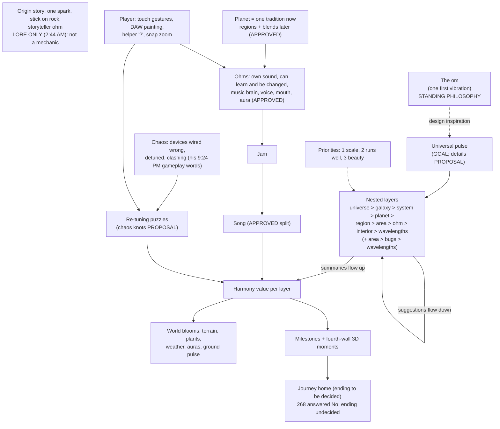

> Read GOAL_AND_FEATURES.md first.

> **Correction (Wilbow, Oct 24 2026, 10:26 PM MDT): "Gnome was just voice chat mistaking ohm".** In the 9:24 PM lore call, the misheard word means "ohm": an ohm tells the origin story, and there is no separate character. The misheard word appears below only inside his verbatim quotes, with a bracketed note (WV:1381; DEC:1222).

> **Fudged (Wilbow, Sun Oct 25 2026, 2:44 AM MDT): "The original story is causing freeze its lore. The stick"** (WV:1616; DEC:1401), and 2:45 AM: **"The stick was in that freeze and you didnt identify that"** (WV:1618; DEC:1403). Earlier, 2:42 AM, on the stick-and-rock story: "Lore" (WV:1612; DEC:1397). The origin story (one spark, the stick on the rock, the storyteller ohm) is **LORE ONLY (2:44 AM): not a mechanic**. No mechanic, system, engine design or question is derived from it. Passages below that used it are marked, detached or put on hold (MISREADS.md, 2:44 AM entry).

# CONCEPTS.md: every concept of The Journey Ohm in one place

Written Sat Oct 24 2026, about 10:15–10:45 PM MDT, by the philosophy and spirituality lead (a Grok Bot executor), for Wilbow and for the builder bot **Resonance 2.0 Game Dev**.
This is a docs-only file. No code, git history or existing doc was changed. Background sources for the om philosophy are in `PHILOSOPHY_SOURCES.md`.

## How to read this

1. **Wilbow's words win.** Where docs disagree, his most recent words win. Every quote is copied exactly, typos included, from:
   1. `WILBOW_VERBATIM.md` (cited as **WV:line**);
   2. `DECISIONS.md` (cited as **DEC:line**).
2. **Status tags.** Each concept carries one of these tags, taken from the records and not upgraded here:
   1. **APPROVED** (approved concept): Wilbow said yes to the concept. It is a concept or feature to discuss, not a rule: "Consider many of my suggestions sto be a feature that needs to be discussed intead of a rule" (10:57 PM, WV:1421) and "Rework all my suggestions and ideas as concepts and features never rules" (10:59 PM, WV:1425). It does *not* mean approved to build (see 3).
   2. **GOAL / PRIORITY**: an aim he set for the whole game, also an approved concept, not a rule. "Rule" is kept only where he called something a rule himself (quoted there).
   3. **DIRECTION**: he described it, but it is "not a build order".
   4. **PROPOSAL**: a bot's design that he has not approved. This covers all of SCALE_MUSIC.md, TRADITION_REFERENCE.md and VISION_PROPOSAL.md, plus NEW_ENGINE.md, which is marked "SCOPING, not approved for build".
   5. **PARKED / DISCUSSION ONLY / KEPT (not sent)**: Brainstorm states.
3. **For Resonance 2.0 Game Dev.**
   1. Wilbow wants a new engine, "not a bunch of patches" (10:07 PM, WV:1363). The old builds are stopped (10:08 PM, WV:1365).
   2. Builders make test builds proactively (2:00 AM Oct 25, WV:1559), in parallel (2:03 AM, WV:1561). This doc is concepts to build toward, not a gate. Every PROPOSAL is a default he can still change.
   3. For what is being built now, read the overseer's Current Summary Page and DECISIONS.md, not this doc.
4. **Question numbers.**
   1. `QUESTIONS_FOR_WILBOW.md` (QFW) holds 277–296 (the NEW_ENGINE.md §15 questions; Q293 answered: "Stop everything now").
   2. The overseer has since copied this doc's 297–305 (§9.2) into QFW, and QFW goes on past 305. QFW is the record; answer there.
5. **Each concept** is laid out the same way: **Meaning**, **Player experience**, **How the layers relate**, **Source**, **Open questions**.

---

## 1. Philosophy

### 1.1 The Journey Ohm (title) — APPROVED as title direction; no rename yet
- **Meaning.** The game is called *The Journey Ohm*. It plays on "journey home". "Ohm" is also the creatures' name.
- **Player experience.** The player is on a journey back to a world in harmony: home.
- **How the layers relate.** The title names the whole arc. "Home" is the restored, harmonious state of every layer (1.5).
- **Source.**
  1. 10:02 PM: "The journey ohm" (WV:1355).
  2. 10:03 PM card answer: "The game's title" (WV:1359).
  3. Recorded outcome: "Nothing renamed in the app yet: name, appId and icon stay until he approves a rename" (WV:1360).
  4. "Journey home = journey back to the fundamental" is a **bot interpretation** (SCALE_MUSIC §7), not his words.
- **Open questions.** 278 (new app or replace Resonance, NEW_ENGINE). 272 (respect check of the title).

### 1.2 The om: the primordial sound — STANDING DESIGN PHILOSOPHY
- **Meaning.** Everything vibrates from one sound. All things are one vibration, heard at many speeds and sizes. The om is used as **inspiration, never as a religious depiction** (§8).
- **Player experience.**
  1. A faint heartbeat is always under everything.
  2. When things are in harmony, you can *hear* that they belong to one sound: beating slows, tones merge and the world glows.
  3. Zooming out from a song to a planet to a galaxy, you hear the same pulse, just slower and deeper.
- **How the layers relate.** Every layer is an echo of one pulse and one tone (2.1–2.3). The om is the top of the harmony chain (4.2).
- **Source.**
  1. 10:03 PM: "Like an om in spirituality. Use this philosophy in the design" (WV:1357).
  2. Recorded outcome: "DESIGN PHILOSOPHY (STANDING). Om is the primordial sound that everything vibrates from, and all things are one vibration" (WV:1358; DEC:1210).
- **Open questions.**
  1. 264 (which tone is the om).
  2. 265 (the heartbeat is the om, slowed down).
  3. 272 (respect check).
  4. 279 (optional A-U-M flavour mapping, NEW_ENGINE §0).
  5. New: 301 (silence).

### 1.3 The origin story (one spark, the stick on the rock) — LORE ONLY (2:44 AM): not a mechanic
- **Meaning.** LORE ONLY (2:44 AM): not a mechanic. This is Wilbow's story, kept as his words below. On Q17 (the stick-and-rock story) he answered "Lore" (2:42 AM, WV:1612; DEC:1397), then flagged it as fudged at 2:44 AM and 2:45 AM (top of this doc). Nothing in the game's systems is derived from it: not the spark, not the stick strike, not "many echoes", not lineages, not the storyteller.
  1. His 10:44 PM card answer "266 it starts the first beat of the ohms" (WV:1403; DEC:1233) and his 11:21 PM "The strike that starts the first beat is a story from lor" (WV:1451; DEC:1255) are kept verbatim. Both are LORE ONLY (2:44 AM): not a mechanic.
- **Player experience.** On hold (2:44 AM): the earlier PROPOSAL that the player sees and hears the stick strike the rock early, with every culture's music answering it later, only made sense because of the story.
- **What is detached from the story.**
  1. The heartbeat (universal pulse) has **no origin in the story**: it is not started by a strike, and the strike is not beat 1. The pulse stands on his own words "on the universal pulse" (WV:1349; see 2.2). SCALE_MUSIC §6.6 (strike = beat 1 and sets the om pitch) is not used.
  2. The om tone has **no origin in the story**. It stands on his Q264 answer: "Low C at 64 Hz, matches the heartbeat" (10:40 PM, WV:1397; DEC:1230), kept "for now" pending research (10:43 PM, WV:1401). It is not the strike's pitch or partial.
  3. Home notes related to the om tone: the "lineages as echoes of the spark" reason is removed. What is left is the SCALE_MUSIC PROPOSAL "planet keys from one root" (Q263), standing only on its musical reasons and only as a light weight (t145, WV:690). His Q267 answer "Depends on context" (10:45 PM, WV:1405) is kept as he gave it.
- **Source.** His only lore statement. It came on a voice call at 9:24 PM Oct 24 and was relayed by Lore Discussion as a transcription (WV:1311; DEC:1186). Here it is in full, verbatim:
  > "There was originally one original spark — one first sound. A gnome [voice-chat mishearing of "ohm": "Gnome was just voice chat mistaking ohm", 10:26 PM, WV:1381] tells the player a story that goes back to the beginning: it starts with a stick and a rock, a caveman ohm banging a stick on a rock, an early caveman ohm type of idea. That first beat carries forward. How music made a bunch of other things, and all the living things also participate in the music or react to it. This is one archetype or one experience of that one original spark — there was originally one spark, and each lineage picks it up in its own way, but they all trace back to that same first sound. This also translates into the gameplay: the player may end up in a situation with a bunch of items on the ground and a bunch of chaotic devices all hooked together wrong, with bad settings creating a lot of chaos, and a lot of things in the world reacting poorly because there's no harmony to anything. It's kind of almost a puzzle to get the sound back to a cohesive thing, and then the world responds, and everything is created in an organic type of trippy look. The mess isn't just visual, it's sonic — wrong settings throwing off the harmony, and the fix is re-tuning until the world itself blooms. The same pulse that started with the stick and rock is still what the player is restoring at the end. One spark, many echoes."

  Recorded outcome: "LORE + DESIGN DIRECTION noted, not a build order … must be wordless … Nothing built until approved" (WV:1312). "Must be wordless" is a bot note from the relay, not Wilbow's words; per 9:47 PM, wordless is now a release goal (see 4.7).
  The gameplay part of the same statement ("This also translates into the gameplay: … the fix is re-tuning until the world itself blooms") is his own direction for play and is used in 4.1. The story parts around it (the spark, the stick and rock, "The same pulse that started with the stick and rock…", "One spark, many echoes") are LORE ONLY (2:44 AM): not a mechanic.
- **Not lore.** These are **PROPOSALS only** (VISION_PROPOSAL.md / SCALE_MUSIC.md), and Lore Discussion has developed nothing beyond the statement above:
  1. fossils and extinct lineages;
  2. humming or cadence monoliths;
  3. song sediment (P14);
  4. meteorite seeds;
  5. rare life at about 1 in 300;
  6. the wordless storyteller scene of SCALE_MUSIC §6.6 (on hold, 2:44 AM: it is built on the story; SCALE_MUSIC also still uses the old mistranscription).
- **Approved concepts and cautions to keep in view.**
  1. Every ohm is its own instrument, with no central composer (1.6, 3.1).
  2. Lineages must not become fixed genres (bot caution; Q302 withdrawn, 2:44–2:45 AM).
- **Open questions.**
  1. 266 answered (10:44 PM, his words above; LORE ONLY (2:44 AM): not a mechanic).
  2. 267 answered "Depends on context".
  3. 268 answered No; ending undecided.
  4. 298, 299 and 302: **withdrawn (2:44–2:45 AM)**.

### 1.4 The storyteller ohm — LORE ONLY (2:44 AM): not a feature
- **Meaning.** LORE ONLY (2:44 AM): not a mechanic. In his 9:24 PM story an ohm tells the origin story. The transcript's word for it was a voice-chat mishearing: "Gnome was just voice chat mistaking ohm" (10:26 PM, WV:1381; DEC:1222). There is no separate character, and the storyteller is not a scene, character or feature to build.
- **Player experience.** None set.
- **On hold (2:44 AM).** These PROPOSALS only made sense because of the story:
  1. NEW_ENGINE §4.6: the storyteller ohm (possibly the guide) shows the story at the first chaos knot.
  2. NEW_ENGINE §4.6: a later knot recalls the story.
- **Source.** WV:1311 (verbatim also at DEC:1186). The outcome line "must be wordless" (WV:1312) is a bot note from the relay, not Wilbow's words.
- **Open questions.** 298 **withdrawn (2:44–2:45 AM)**. The Q19 card on how an ohm tells the origin story was dropped at 2:44 AM (WV:1616).

### 1.5 His words "bring harmony back" (lore, spiritual and musical at once), and the journey home
- **Meaning.** His phrase, kept as a quote: "The goal of the game is to bring harmony back" (10:02 PM). At 11:49 PM: "Its a lore idea and spiritual term that also is a musical term youre going to have to use some inference". So it is a lore idea, a spiritual term and a musical term at once. It is not a rule or the one goal every layer is built around (flagged as fudged 11:47 PM, MISREADS.md). The player experience below is a PROPOSAL for the musical side only.
- **Player experience.**
  1. Chaos sounds rough, sour, wobbly and crowded, and the world looks grey and broken.
  2. Fixing it makes beating slow and stop, grooves lock, the land blooms, and the bloom spreads outward when you zoom out.
  3. Q270 answered (10:51 PM, WV:1415; DEC:1239): "things change and happen, so harmony can be disrupted. They can fall back into discord, but generally stabilized places tend to stay stabilized until higher or sometimes lower scale things cause chain reactions across scales." (The earlier PROPOSAL "a restored place never un-blooms" does not match this.)
- **How the layers relate.** Harmony is measured per layer and flows upward: ohm → jam → area → region → planet → system → galaxy → the om (PROPOSAL, SCALE_MUSIC §6.4; NEW_ENGINE §1).
- **Source.**
  1. 10:02 PM: "The goal of the game is to bring harmony back" (WV:1353; DEC:1208).
  2. His 9:24 PM gameplay words: "the fix is re-tuning until the world itself blooms" (WV:1311). The next sentence, "The same pulse that started with the stick and rock is still what the player is restoring at the end", is LORE ONLY (2:44 AM): not a mechanic, and not a source for this concept.
- **Open questions.**
  1. 269 (which faults first, and do they appear on their own).
  2. 270 answered (harmony can be disrupted; stable places tend to stay stable).
  3. 271 (does one galaxy or all galaxies end the game).
  4. 285 (start out of tune).

---

## 2. World

### 2.1 Nested scales, universe to atoms — GOAL (scoping only)
- **Meaning.** One nested system: universe → galaxy → system → planet → region → area → ohm → ohm interior/DNA → atoms and wavelengths. There is a side branch area → bugs and micro-life → wavelengths.
- **Player experience.** You can zoom from a galaxy down to the shimmering partials of one note, without a single screen cut.
- **How the layers relate.**
  1. Each layer is generated from its parent's seed and summary (PROPOSAL, NEW_ENGINE §4.1–4.2).
  2. Bugs are "part of the same overall system".
- **Source.** 10:00 PM, verbatim: "Snapping into ohms should feel like a directional zoom with layers you snap into, same with space and all scales.  Zoom into see bugs that are part of the same overall system, the planets harmony down to atoms and wavelengths on the universal pulse.  Ohms modulate areas and planets modulate galaxies.  We need to rethink how the sound engines may need to work" (WV:1349; DEC:1206).
- **Open questions.** 262 (zoom sound), 273 (atoms layer), 274 (light colours), 275 (bugs), 291 (two ways down).

### 2.2 The universal pulse — GOAL ("on the universal pulse"); details PROPOSAL
- **Meaning.** One master heartbeat that every layer counts from.
- **Player experience.**
  1. The ground pulses with the beat, and the environment reacts lightly. This part is APPROVED (10:05 PM, WV:1361; DEC:1212). It had been building on v08-pulse before "Stop everything now", so it now carries to the new engine as a concept.
  2. Zoom out and you hear the same pulse, slower.
- **How the layers relate.** PROPOSAL (SCALE_MUSIC §1):
  1. about 60 BPM (1 Hz, the 64 Hz om tone slowed six octaves, Q264). The heartbeat has no origin in the origin story or the stick strike: LORE ONLY (2:44 AM): not a mechanic;
  2. faster layers subdivide it (bugs ×2, ×3, ×4) and slower layers group it (bars, sections, planet day, system, galaxy);
  3. planet tempos are simple ratios of it (1/2, 2/3, 3/4, 1, 4/3, 3/2, 2…);
  4. slower layers mark the turning points of faster cycles, like the big gong at the end of a gamelan cycle, or the tala's sam (beat 1, where the cycle comes home).
- **Source.** WV:1349 ("on the universal pulse") and WV:1361. The story line "The same pulse that started with the stick and rock" (WV:1311) is LORE ONLY (2:44 AM) and is not a source for the pulse.
- **Older idea in tension.** t169, 2:06 AM Oct 22: "Theres also no shared rhythms, that should be slightly influenced by the environment at the beginning but it shouldn't dictate the whole overall sound" (WV:793). See §10 item 5.
- **Open questions.** 258 (one heartbeat), 259 (simple multiples), 260 (tap tempo glide), 261 (3% lean). 300 (how planet speeds relate during play; reworded 3:16 AM per 43B, see 9.2).

### 2.3 Each layer modulates the next — GOAL; mechanics PROPOSAL
- **Meaning.** "Ohms modulate areas and planets modulate galaxies." Influence runs both ways: suggestions flow down, summaries flow up.
- **Player experience.**
  1. Tune a jam and its area's background hum changes to match.
  2. Heal enough areas and the planet's colour and hum lift. Galaxies swell slowly.
- **How the layers relate.** PROPOSAL (SCALE_MUSIC §2–3):
  1. **Down** (a weight, never an order): galaxy root → planet home note → region mode → jam.
  2. **Up**: cheap summaries of about 20 numbers each, smoothed (region about 2 min, planet about 15 min, galaxy hours of play) and rate-limited, with hysteresis.
  3. Only the focused layer plays in full. Farther layers are soft "beds" built from those summaries, so a million off-screen ohms cost only their summaries.
  4. Ohms keep their own tuning; the world only lightly influences it (t145 / R3.25, DEC:283).
- **Source.** WV:1349.
- **Open questions.** 262, 263 (planet keys from one root).

### 2.4 Snap zoom: one continuous world — GOAL; design PROPOSAL
- **Meaning.** There are no view switches. A directional pinch "falls into" whatever is under your fingers, and layers have soft magnetic detents you push through.
- **Player experience.**
  1. A slight resistance, a veil and a change of light and reverb at each layer boundary.
  2. The music morphs on the next shared beat.
- **How the layers relate.** PROPOSAL (NEW_ENGINE §7.1):
  1. membranes with about ±15% hysteresis;
  2. floating origin;
  3. focus path streaming.

  PROPOSAL (SCALE_MUSIC §3.3): audio crossfades on the entered layer's landing.
- **Source.**
  1. 9:57 PM: "Scaleable instead of clicking between views" (WV:1347; DEC:1205).
  2. 10:00 PM (WV:1349).
  3. Earlier, 2:27 AM Oct 23: "Zooming in and out should feel smoother between" (WV:1054).
- **Open questions.** 262, 287 (DNA by zooming only), 288 (new universe by holding), 289 (drag rules), 291.

### 2.5 Planets, traditions, regions and blends
- **Meaning.** Each planet carries one real musical tradition for now. Later, much bigger planets have tradition regions with gradual blend zones between them.
- **Player experience.**
  1. Land on a planet and its ohm groups are already playing a correct, complete song in that planet's tradition.
  2. Later, walking across a border, the music shifts gradually.
- **Status.**
  1. **APPROVED** for now: one tradition per planet, with blends paused, not deleted. 8:55 PM: "Let's keep each planet as one tradition for now.  The ohms should be able to make successful song with the theory naturally and be already doing that when you encounter a group of them" (WV:1300; DEC:1181).
  2. **APPROVED long-term goal**. 8:56 PM: "Eventually I want the planets much bigger with regions of blending traditions between but it seems to have been forgotton" (WV:1302; DEC:1182). Stage 1 must be **region-ready** (planet = one region for now).
  3. **APPROVED concepts**:
     1. 4:12 AM Oct 23: "The cultures should not be a limit to the possibilities, only add variance.  They should still be more prominent than any random stuff" (WV:1080).
     2. 2:58 PM Oct 23: keep "a distinction between the cultures used to make the game vs the cultures the game generates" (WV:1116–1117).
     3. 4:56 PM Oct 23: "keep it easy to add new real world musical styles" (WV:1178).
  4. **SUPERSEDED for now**: the Oct 23 2:58 PM per-planet culture *blend* (WV:1117) was paused by the 8:55 PM one-tradition-per-planet idea until big planets arrive.
  5. **PROPOSAL** (TRADITION_REFERENCE.md):
     1. about 30 traditions stored as data, stored in cents as approximations. Maqam quarter tones and sruti (fine Indian pitch shadings) vary by region and performer, and slendro/pelog vary from one gamelan set to the next (also raga with drone, Persian koron);
     2. cycles, cadences, and essential vs decorative rules;
     3. a dev song library.
- **How the layers relate.** The region carries the tradition, and jams draw on it (a jam can still switch keys and use many chords, 2:21 AM Oct 25). PROPOSAL: the planet's home note is a partial of the om (Q263), on its own musical reasons only, not as an "echo" of the story's spark (2:44 AM). Ohms keep their own tuning; the world only lightly influences it (t145).
- **Open questions.**
  1. 228–240 (which traditions first, world reactions, library songs, gamelan style, exact tunings and more).
  2. 276 (blend zones).
  3. 281 (planet shape).
  4. Also 183–188 and 195: older blend defaults, now paused.
  5. New: 297 ("no themes" scope).

### 2.6 Deformable terrain — GOAL (scoping only)
- **Meaning.** Ohms, songs and the player can dent, raise, ripple, grow or carve the ground.
- **Player experience.**
  1. The land answers what happens on it.
  2. PROPOSAL: a settled song slowly raises a soft hill or terraces in its rhythm, and crystals grow on harmonic nodes (NEW_ENGINE §5).
- **How the layers relate.** PROPOSAL: deltas per chunk are saved, and the rest is regenerated from seed (NEW_ENGINE §4.4).
- **Source.** 9:56 PM: "I also want terrain deformation and a dynamic environment.  We may need to rethink and build alot of things" (WV:1345; DEC:1204).
- **Open questions.** 281 (2.5D planets recommended).

### 2.7 A living environment that pulses — APPROVED (ground pulse) + GOAL (dynamic environment)
- **Meaning.**
  1. The ground pulses on the beat, and weather, plants, water and creatures react lightly.
  2. Plants grow procedurally from nearby music.
  3. Biomes are blended fields, never themes.
- **Player experience.** Low harmony brings grey dust, gusts, cracked ground and a dim sky. Restored harmony brings colour, still air, bloom, clear water and glowing crystals (PROPOSAL, NEW_ENGINE §5).
- **Source.**
  1. 10:05 PM: "The ground should pulse and the environment lightly react to it" (WV:1361).
  2. Plants, APPROVED and built in old v0.5a:
     1. "it should grow using sacred geometry concepts" (t163, WV:769);
     2. "I want the shapes to be generated organically and procedurally, not as symbols etc" (t164, WV:773);
     3. "Use phi and fibbonacci patterns as well, as in nature" (t165, WV:777).
  3. Biomes: "I dont want it to feel like a set of themes" (t167, WV:785; R6.6 DEC:468).
  4. Rare life, from t92: "make life very very  rare to encounter naturally but creatable" (WV:467).
- **Open questions.** 275, 285. New: 304 (cymatics-style visuals).

---

## 3. Ohms

### 3.1 Creatures with their own instrument — APPROVED concept
- **Meaning.** An ohm is a gene-built living instrument with its own musical mind.
  1. Its sound comes from its body and other natural attributes, and it generally keeps that sound.
  2. It isn't fixed: an ohm can learn other sounds, the player can change it, items it carries modulate it noticeably and predictably, and many things can tweak its synthesis engine.
  3. When ohms play together, their instruments don't turn into each other; mostly their notes and playing style change. Self-change and influence from others are ideas for later.
  4. A type of ohm (for example percussion) isn't limited to one sound.
  5. There is no central composer.
  6. No spontaneous mutation for now; randomness at creation is fine.
- **Player experience.**
  1. Every ohm is clearly a different instrument.
  2. Two ohms jamming sound like two musicians, not copies of each other, and an ohm's sound grows with what it learns, carries and what you do to it.
- **Source** (short; full lines in WV).
  1. "ohms generally retain instrument properties unless directly changed by the player, or special future tools and objects are implemented" (3:38 AM Oct 23, WV:1075); items "only modulate in noticeable predictable ways" (3:41 AM, WV:1076).
  2. "Its not a rule that each each type can be only one thing or sound" / "It can learn other sounds too" / "All ohms" (6:57–6:59 PM Oct 23, WV:1220–1224).
  3. "there should be a way for self change or influence from others later in the game" (2:23 PM Oct 23, WV:1104).
  4. "Its synthesis engine can be tweaked by alot of things" (2:32 AM Oct 25, WV:1592); instruments looser from role, card D A B C incl. "player can assign/sculpt" (1:07–1:09 AM Oct 25, WV:1521–1523).
  5. No composer: t135 (WV:660). Mutation: t108 (WV:549).
- **Build note.** Music Theory reports the old build had item sound-borrowing and a lasting ember "grit". Item modulation is part of his concept (3:41 AM Oct 23); whether those two old effects fit it (predictable, noticeable, not replacing the ohm's own sound) is for Wilbow to discuss. Ohm-to-ohm copying stays out (3:38 AM Oct 23). Not checked in code by me.
- **Open questions.** 154 (his "not quite it" on the voice lock, still pending). 292 (import old genomes).

### 3.2 Music brains — APPROVED direction; details PROPOSAL
- **Meaning.** Each ohm knows its planet's tradition, plays its part in the jam and listens to fix clashes. A jam has no single key, chord or leader: it can switch keys and contain many chords and sounds (2:21–2:22 AM Oct 25, WV:1576–1578).
- **Player experience.** Two ohms that meet try to make something that "actually sounds good".
- **Source.**
  1. 9:15 PM: "When two ohms meet they should be trying to make something that actually sounds good" (WV:1306).
  2. 9:26 PM: "I think maybe the musical brain of the ohm needs to be more complex" (WV:1313). The brain-upgrade card was skipped.
  3. 8:52 PM: "It needs to be a game that has a daw and accurate music creation" (WV:1298; DEC:1180).
  4. Old role-word lists are a loose draft on hold ("Not yet", BRAINSTORM.md:24). "Lead" is dropped: "Lead is a freeze" (2:22 AM Oct 25, WV:1578). No fixed roles.
- **Open questions.** 227 (answered), 234, 235, 240.

### 3.3 Jams vs songs — APPROVED
- **Meaning.**
  1. A **jam** is an overarching, loose but good-sounding concept: it can switch keys and contain many chords and sounds, with call and answer, clash fixing, no leader, and no fixed form or ending ("NO A JAM NEEDS TO BE ABLE  to switch keys, cintain many chords and sounds it is an over arching concept", 2:21 AM Oct 25, WV:1576).
  2. A **song** is a fixed piece: a full chart from the tradition, a returning hook, sections, an ending, and it is remembered.
  3. A jam can become a song when a hook catches.
  4. The world reacts differently to each.
- **Player experience.** You hear groups settle, catch a hook and grow into songs. Arriving somewhere, you usually find a group already mid-song.
- **How the layers relate.** PROPOSAL (TRADITION_REFERENCE §3.2):
  1. stages EXPLORING → GROOVING → FORMING → SONG → CODA;
  2. a per-bar score where SONG starts at 0.75 and ends at 0.55.

  PROPOSAL (SCALE_MUSIC §9): the stages weight the up-flow of summaries.
- **Source.**
  1. 9:18 PM: "I agree but I want to separate a jam from a song." (WV:1308; DEC:1185).
  2. 8:50 PM: "The ohms need to be working towards making a song out of a jam.  The world reacts in different ways to a song than a jam" (WV:1294).
- **Open questions.** 231 (world reactions), 232, 236.

### 3.4 Teaching, experience and lineage — APPROVED
- **Meaning.**
  1. Experience grows in separate layers on one smooth gradient, with no "teacher" title. Any ohm can teach.
  2. Ohms learn in proportion to what others know that they don't.
  3. Ohms slowly learn extra sounds on top of the sound they were born with. Drummers grow toward a full kit.
  4. Learned changes pass to offspring in part. Hatchlings inherit experience (Q13 answered yes, 2:19 AM Oct 23, WV:1049–1050).
- **Player experience.** Old, well-travelled ohms are visibly and audibly richer, and their students carry a hint of them.
- **Source.**
  1. 8:57 PM Oct 23: "any ohm can be teacher with enough experience and its not only a title but a gradient scale" (WV:1250).
  2. 6:59 PM: learned sounds for "All ohms" (WV:1224).
  3. 8:50 PM: "As in slowly becoming a full kit through experience" (WV:1246).
  4. 4:28 PM: "jams can be multiple teachers or all teachers" (WV:1167).
- **Lineage note.** "Each lineage picks it up in its own way" (WV:1311) is a line of the origin story: LORE ONLY (2:44 AM): not a lineage system. Lineage here means only the approved family descent plus what was learned (sources above). Bot caution: it should not harden into a fixed genre (§10 item 3).
- **Open questions.** 190–194, 205–210, 182. 302 **withdrawn (2:44–2:45 AM)**.

### 3.5 Auras — APPROVED
- **Meaning.** Every ohm has an experience aura on one smooth scale.
  1. It is faint at birth, clearer when very experienced, and glowing and pulsing at master level.
  2. It is tinted by learned styles, with strands for learned sounds.
  3. Fractal and generative patterns are shaped by experience: cultures → palette, scales/meters → symmetry, tempo range → pulse/spin, what it plays → pattern shapes, students → fractal depth.
- **Player experience.** You can read an ohm's history at a glance.
- **Source.**
  1. 2:48 PM Oct 23: "beautiful fractal colors andgenerative patterns in the aura around very highly experienced teachers" (WV:1113).
  2. 3:01 PM: "Make them subtle and faded unless extremely experienced.  Glowing and pulsing when master level" (WV:1118).
  3. 2:51 PM card (WV:1114).
  4. Mastery ladder "about 2x faster" (WV:1121).
  5. Details in TEACHER_AURA.md.
- **How the layers relate.** In the new engine, aura brightness is one of the effects bound to harmony milestones (PROPOSAL, NEW_ENGINE §6.5).
- **Open questions.** 190, 192.

### 3.6 Voices, names and mouths — APPROVED
- **Meaning.**
  1. Each ohm has a speaking voice separate from its instrument. Names are **spoken syllables, never sung**, with maximum variety per planet.
  2. Each ohm has a separate signature tune that is not derived from its name.
  3. Every ohm has a distinct, always-visible mouth shaped by its voice. Double-tapping the mouth opens mouth control.
  4. Play-mode notes are added to the ohm's current jam phrase.
- **Player experience.** Tap a lone ohm to hear its first name. A two-finger tap gets the full introduction.
- **Source.**
  1. 4:57 PM Oct 23: "Remember their name is not a song it is spoken syllables" (WV:1180).
  2. 4:58 PM: "Keep a separate tune" (WV:1182).
  3. 5:29 PM Oct 24: "Double tap the mouth to enter mouth control" (WV:1268).
  4. 5:31 PM card, all six mouth options (WV:1270).
- **Open questions.** 213–217. Cultural check §8 item 2 (no "Om/Aum" or mantra syllables in generated names).

---

## 4. Play

### 4.1 Chaos re-tuning puzzles — gameplay PROPOSAL, no story attached (42A, 3:15 AM Oct 25, WV:1644; storyteller scenes stay on hold)
- **Meaning.** You find items on the ground and devices "hooked together wrong, with bad settings". The world reacts poorly until you re-tune.
- **Player experience.**
  1. A puzzle you solve by ear and by hand.
  2. Wilbow's only visual direction for the fix, quoted exactly: "the world responds, and everything is created in an organic type of trippy look" (WV:1311).
  3. PROPOSAL: the fix sounds like beating slowing to stillness, grooves locking, and bugs syncing like fireflies.
- **How the layers relate.**
  1. PROPOSAL (SCALE_MUSIC §6.1–6.3): eight cheap 0–1 checks:
     1. pitch;
     2. beat rate;
     3. key clash;
     4. phase;
     5. tempo ratio;
     6. mode;
     7. roughness;
     8. crowding.

     Each tradition is judged by **its own** tuning, never by 12-TET or pure ratios.
  2. PROPOSAL (NEW_ENGINE §4.6): "chaos knots" are generated from a solved state and then perturbed, so they are always solvable.
- **Source.** His 9:24 PM gameplay words ("This also translates into the gameplay: …", WV:1311), not the origin story. Effects lock to the beat and stay in key (4:09 PM Oct 23, WV:1161). They start synced but are adjustable off-grid (WV:1163).
- **Open questions.** 269, 270, 285.

### 4.2 Milestones (PROPOSAL) and the ending — proposed ending REJECTED (Q268 "No", 10:45 PM); ending to be decided later
- **Meaning.** The milestones are:
  1. first lock;
  2. area settles;
  3. area in harmony;
  4. planet resonance (25/50/75/100%);
  5. system chord;
  6. galaxy swell;
  7. the om.

  Each lands on a musical landing.
- **The rejected ending, kept for reference only** (Q268 "No", 10:45 PM, WV:1407; DEC:1235; then "Decide the ending later", WV:1409; DEC:1236). Do not build it:
  1. All layers lock.
  2. The hums merge into one drone on the fundamental, and the beating stops.
  3. (Struck out, 2:44–2:45 AM: a final stick strike sustaining into a pure tone, "One spark, now a tone" in SCALE_MUSIC phrasing. The stick is LORE ONLY (2:44 AM): not a mechanic.)
- **Source.** SCALE_MUSIC §6.5 and §7.5. His lore line "The same pulse that started with the stick and rock is still what the player is restoring at the end" (WV:1311) is LORE ONLY (2:44 AM): not a mechanic, and it does not define the ending. What the ending sounds like is undecided.
- **Open questions.** 271. New: 301 (whatever ending is chosen could fade into silence).

### 4.3 Fourth-wall 3D moments — APPROVED
- **Meaning.** At key moments and milestones only, things break the screen's "glass":
  1. bubbles pop out;
  2. an ohm touches the glass;
  3. songs burst out.

  Focusing on a device can be partly 3D. The renderer is three.js, level 1, with a 2D fallback (APPROVED 9:51 PM). Three.js as the *main* renderer is under the new-engine scoping (Q280).
- **Player experience.** Rare, earned "wow" moments. They line up naturally with harmony milestones (4.2).
- **Source.**
  1. 9:33 PM (WV:1317).
  2. 9:35 PM: "They should be at key moments and milestones.  Maybe also some elements when you are focused on a device, it could be partially 3d" (WV:1319; DEC:1191).
  3. 9:51 PM: "Three.js sounds great" (WV:1335; DEC:1199).
- **Open questions.** 246 (tilt), 280.

### 4.4 The DAW river and painting notes — APPROVED
- **Meaning.** The DAW river is a slightly hidden organic DAW over a jam (two-finger twist). It shows:
  1. live notes;
  2. chords and scale;
  3. what each ohm is playing, and the cycle;
  4. note sources;
  5. which sound is used;
  6. drum hits.

  You **paint notes** on a lane, and the ohm sings or plays them from the next bar and brings them into its jam. Notes are organic, moving strokes (no grid) that settle into the scale with human-feel timing. The pattern editor is also organic. The jam view is a separate view, entered by pinching into a jam's centre (look: bubbles KEPT, not sent).
- **Player experience.** Grab the music itself and reshape it by touch.
- **Source.**
  1. t108 Oct 21: "an organic DAW from one view, but it is slightly hidden" (WV:549).
  2. 7:41 PM card, all six (WV:1284).
  3. 8:44 PM: "I think we should be able to paint notes in the daw river.  The notes should dictate whatever is being currently sung and introduced to the jam" (WV:1288; DEC:1175).
  4. 8:45 PM: "Instead of a grid make the notes more organic and have movement" (WV:1290).
  5. 9:31 PM: "I want it to feel intuitive and unique" (WV:1315).
- **How the layers relate.** The DAW is a lens on the jam layer. PROPOSAL: phase is checked only at landings, so painted timing stays organic (SCALE_MUSIC §1.7).
- **Open questions.** 218–226, 241–245, 247–257, 290. Also 235: does the same "in key, human timing" idea apply when the player sits in a jam?

### 4.5 Gestures — APPROVED concepts
- **Meaning.** Everything is done with in-world touch gestures. Every new gesture is checked against GESTURES.md, and conflict fixes need Wilbow's approval. The main gestures:
  1. spiral spawn and the egg grammar;
  2. clay shaping;
  3. catch bubble;
  4. delete by flick;
  5. undo with a three-finger tap, redo with a four-finger tap;
  6. glyphs: the infinity bond, the hooked arrow plus an arrowhead, and "?" plus a dot;
  7. play mode by plain hold, listen by tap-then-hold;
  8. conducting;
  9. the DAW twist;
  10. two-finger tap for an introduction;
  11. the store gesture: a second-finger tap-and-hold (KEPT, not sent).
- **Player experience.** No menus. You learn by watching the guide and ghost fingertips.
- **Source.**
  1. t182: "Make sure not to build conflicting controls" (DEC:338).
  2. Two-stroke glyphs, 2:55 AM Oct 23 (WV:1063).
  3. The play/listen swap, 3:30 PM Oct 23 (WV:1126).
- **How the layers relate.** PROPOSAL: in the new engine, every gesture keeps its meaning, and zoom thresholds become detents (NEW_ENGINE §7.2, Appendix A5).
- **Open questions.** 287–289. New: 303 (menus).

### 4.6 The helper and diagnostics — APPROVED (priority)
- **Meaning.**
  1. Draw "?" and then tap anything. The guide shows wordlessly what it is, what it is doing and why (cause symbols), plus a relations view.
  2. The guide is present from launch.
  3. In dev mode, the helper and diagnostic tags show plain-English cards.
  4. A dev-only diagnostic mode lets Wilbow tag things and talk about them live during voice calls.
  5. A hidden dev panel uses a three-finger 2 s hold.
- **Player experience.** "What's this? Why is it doing that?" always has an answer.
- **Source.**
  1. 9:43 PM: "I also want to be able to ask about certain behaviours or, what's this?  Why is this doing x.  Ive asked so many times for a helper" (WV:1327; DEC:1195).
  2. 11:41 AM Oct 23: "Make sure the helper is there and available with question mark gesture" (WV:1083).
  3. 9:41 PM: diagnostic tool (WV:1323) and "Could we do it live with voice chat" (WV:1325).
  4. Dev panel, 2:31 PM Oct 23 (WV:1106).
- **How the layers relate.** PROPOSAL: the helper's "why" should explain harmony at any layer, for example "this area is sour because these two jams clash".

### 4.7 Wordless in release, text allowed in dev — his "now words rule" (his word "rule", 9:47 PM), now "consideration for the released game"
- **Meaning.**
  1. The **released** game aims to be text-free: sound, glow, glyphs, ghost fingertips and the guide.
  2. **Dev builds and dev tools may use text.**
- **Source.**
  1. 9:45 PM: "For dev mode it can have words" (WV:1329; DEC:1196).
  2. 9:47 PM: "Let's keep the now words rule as consideration for the released game experience, not a crucial rule for development" (WV:1331; DEC:1197). ("now words" means "no words".)
- **Superseded.** The old hard rule "No menus, buttons, panels or text UI anywhere" (R4.1, DEC:327) is now a release consideration for text. Menus are a separate open point (§10 item 2).

---

## 5. Priorities — STANDING
1. **Scale first: many ohms and elements.** 9:55 PM: "Actually running with many ohms and elements is always the main goal" (WV:1343; DEC:1203).
2. **Always runs well.** 9:54 PM: "It needs to run well always" (WV:1341; DEC:1202). Every stage needs a perf gate.
3. **Beauty within that budget.** 9:54 PM: "I want this to look beautiful. That has always been a goal" (WV:1339; DEC:1201).

Other approved concepts the new engine should keep:
1. One app: "I dont want 2 apps" (t131, WV:642).
2. Persistence matters, "but not at expense of playability" (2:35 AM Oct 23, WV:1058).
3. Background ohms stay cheap.
4. Ohms stay near home.
5. Build test builds proactively (2:00 AM Oct 25, WV:1559).

---

## 6. Glossary (plain words)
1. **Ohm**: a music creature with its own sound and speaking voice. It generally keeps its sound but can learn, be changed by the player and be modulated by items.
2. **Om**: the design idea of one first vibration that everything grows from. Inspiration only.
3. (Dropped 2:45 AM: "first sound / first spark" is LORE ONLY (2:44 AM), not a game term.)
4. **Echo**: LORE ONLY (2:44 AM): not a game term. "One spark, many echoes" is a line of his story; lineages, home notes and layer rhythms are not defined as echoes of it.
5. **Lineage**: an ohm family line plus what it has learned. Not a genre.
6. **Tradition**: a real-world musical culture, stored as data (scales in cents, cycles, cadences).
7. **Universal pulse**: the one master heartbeat.
8. **Layer**: one zoom scale (galaxy, planet, area, ohm, wavelengths…).
9. **Modulate**: gently influence the next layer without dictating it.
10. **Summary**: the few numbers a layer keeps about what its children are doing.
11. **Bed**: the soft background hum standing in for an unfocused layer.
12. **Detent / membrane**: the soft magnetic stop between zoom layers that you push through.
13. **Frame** (old bot term): a jam's current key, tuning, tempo and cycle at a moment. Not fixed: a jam can switch keys and chords.
14. **Jam / song**: loose good-sounding play vs a fixed piece with hook, sections and an ending.
15. **Harmony value**: a 0–1 number per layer saying how in tune, in time and uncrowded it is.
16. **Beating**: the wah-wah pulsing between two close tones. It slows and stops as they come into tune.
17. **Partial / harmonic**: the tones inside a sound. Harmonics are whole-number multiples of the lowest. Struck bars, bells, gongs and drum skins have overtones that are not whole-number multiples (inharmonic).
18. **Fundamental**: the lowest tone of a sound. The om tone is the game's fundamental.
19. **Chaos knot**: a generated tuning puzzle (PROPOSAL).
20. **Landing**: the end of a cycle, which is also the next beginning. Milestones happen here.
21. **Aura**: the glow around an ohm that grows with experience.
22. **DAW river**: the organic music editor over a jam.
23. **Fourth-wall moment**: a short 3D effect that breaks out of the screen at milestones.
24. **Helper**: the guide's "?"-then-tap explanations.
25. **Dev mode**: hidden developer tools. Text is allowed there.

---

## 7. Concept map

---

## 8. Cultural check needed
Treat every tradition as **inspiration, never religious depiction**. Make **no health, healing, wellness or meditation claims** anywhere, including the store listing. PHILOSOPHY_SOURCES.md has the background for each item.

1. **The Om/Aum symbol (ॐ), and Ik Onkar (ੴ).**
   - Why: these are sacred in Hinduism, Buddhism, Jainism and Sikhism.
   - Handling: never use them as an icon, logo, collectible, glyph, plant shape or decoration. Check that the glyph recogniser and generated shapes can't produce them by accident.
2. **The spoken or sung syllable "Om/Aum", mantras and chant.**
   - Why: ohm names are generated syllables (3.6), so a name could come out as "Om", "Aum" or a known mantra or deity name.
   - Handling:
     1. add a small blocklist to the name generator;
     2. no chanted "Aum" anywhere, in any ending;
     3. no recorded religious chant.
3. **The title "The Journey Ohm".**
   - Why: it is a pun on a sacred word.
   - Handling: before release, review it with people from the traditions involved (Q272). The pun works through "ohm" (the creatures, and the unit) and "home".
4. **The A-U-M layer mapping (NEW_ENGINE §0, Q279).**
   - Why: it maps the Māṇḍūkya Upaniṣad's states of consciousness onto game layers.
   - Handling: keep it as an internal design note only (colour and reverb flavour). Never label or depict it in-game. Never present it as what the text means.
5. **Sanskrit and other sacred or technical terms** (nāda brahma, turīya, sam, tāla, rāga).
   - Handling: use them in dev docs only, with correct meanings. The released game is text-free anyway. Don't name game things after sacred concepts.
6. **Chakras.**
   - Handling: don't map colours, body parts or layers to chakras. Aura colours come from experience data (3.5), not from chakra systems.
7. **"Sacred geometry" plants** (approved t163).
   - Handling: keep them generative (phi, Fibonacci, phyllotaxis). Never stamp religious diagrams such as the Sri Yantra, the "Flower of Life" or Metatron's cube. This already matches t164 "not as symbols".
8. **Mandala looks** (the "living mandala" option in Q218).
   - Why: mandalas are Hindu and Buddhist ritual diagrams.
   - Handling: if used at all, use "radial pattern" language and avoid deity or temple layouts. The current pick is bubbles.
9. **Singing bowls, gongs, tanpura and shruti box.**
   - Handling: treat them as **musical instruments** only. No ritual framing, and no "healing bowl" or "sound bath" language.
10. **Overtone singing (Tuvan khöömei, Mongolian höömii).**
    - Why: these are living traditions.
    - Handling: credit them by name in dev notes, don't call them "chanting", and don't present them as mystical.
11. **Gamelan.**
    - Why: some gongs and ensembles have ceremonial roles.
    - Handling: use the music, not the rituals. Respect that tunings belong to each ensemble (Q233).
12. **Music of the spheres (Pythagoras, Boethius, Kepler).**
    - Handling: present it as historical philosophy. Never say planets literally sing. Use Kepler's harmonies, not his astrology.
13. **Cymatics.**
    - Handling: use the real physics (Chladni patterns) only. Avoid online claims that cymatics proves metaphysics or that frequencies heal.
14. **"Special" frequencies: 136.1 Hz "om", 432 Hz, 528 Hz.**
    - Handling: these are modern conventions, not physics. Make no claims. If 136.1 Hz is ever chosen (Q264), say so neutrally.
15. **Sufi, Kabbalistic and other mystical ideas.**
    - Handling: they are not used now. If added, don't depict practices such as samāʿ or dhikr, or sacred names.
16. **"Caveman ohm"** (LORE ONLY, 2:44 AM; applies only if the lore is ever shown).
    - Handling: show the early ohm as a creature, not as a stereotype of real early peoples.

---

## 9. Open questions for Wilbow (numbered)
Existing numbers are referenced, not repeated. The overseer has copied 297–305 below into QFW, which is the record; answer there. (Text below may differ slightly from QFW where it was updated here later.)

### 9.1 Already asked (answer there)
1. Om and pulse: 258–268, 272, 279 (268 answered No; ending undecided. Several others in this range were answered 10:30–10:45 PM; see QFW).
2. Harmony puzzles and ending: 269–271, 285.
3. Layers and zoom: 262, 273–275, 287–291.
4. Traditions: 228–240, 276.
5. Own-instrument concept detail: 154.
6. DAW and jam view: 218–226, 241–257.
7. New engine, tech and scale: 277–284, 286, 292, 294–296 (293 answered).

### 9.2 New questions (proposed numbers)
297. **"No themes" today.** Your Oct 22 idea ("I dont want it to feel like a set of themes") was about biomes. Since then, planets got one tradition each (8:55 PM) and the game got one philosophy (the om).
   1. It still means biomes and environments blend, and nothing feels like a preset. Traditions per planet are fine.
   2. It is retired.
   3. Something else.
298. **The storyteller** (10:26 PM: it is an ohm). **Withdrawn (2:44–2:45 AM).** Lore only per 2:44 AM; Wilbow to say if still relevant. Who tells the first-sound story?
   1. The existing guide ohm.
   2. Another ohm.

   How does it tell it?
   1. Only acting it out with sound and picture.
   2. With spoken nonsense syllables, like ohm names.
299. **The caveman ohm.** **Withdrawn (2:44–2:45 AM).** Lore only per 2:44 AM; Wilbow to say if still relevant.
   1. With mutation off, is the stick-and-rock ohm:
      1. backstory only;
      2. an ancestral ohm you can meet;
      3. an ancestral ohm you can meet and also hatch?
   2. (Dropped 2:45 AM: the "spark itself vs one telling" question is removed. He answered Q17 with "Lore", 2:42 AM, WV:1612.)
300. (Reworded 3:16 AM Oct 25 per Wilbow's 43B, WV:1645: no story or ending; matches QUESTIONS_FOR_WILBOW.md.) **How planet speeds relate during play.** Building on 258–259 (one heartbeat; speeds follow octaves and harmonic ratios), for example:
   1. each planet keeps its own simple-multiple speed of the heartbeat while you play there;
   2. speeds can drift toward each other when places jam or heal;
   3. depends on context.
301. **Silence.** Should rests and silence count as harmony? For example:
   1. an ohm going quiet clears a crowded jam and counts as a fix;
   2. whatever ending is chosen could fade into silence before the heartbeat returns;
   3. neither.
302. **Lineages.** **Withdrawn (2:44–2:45 AM).** Lore only per 2:44 AM; Wilbow to say if still relevant. "Each lineage picks it up in its own way". Are lineages:
   1. family lines of ohms that can travel and learn any tradition;
   2. tied to one tradition each?

   Option 2 risks fixed genres.
303. **Menus.** "Id like now menus in the game until further notice" (Oct 21). On Oct 24 at 7:55 PM, you picked "Text-free menu, five-finger squeeze / Worlds as planets, snapshot saves / Story and sandbox doors" (BRAINSTORM.md:277, kept, not sent to the builder).
   1. Should those picks lift the Oct 21 no-menus idea and go into the new engine?
   2. Or should they wait?
304. **Sound you can see.** At the atoms and wavelengths layer and inside ohms, show real vibration patterns: sand-like Chladni lines on bodies and standing waves on strings. Purely as a visual, no claims.
   1. Yes.
   2. No.
   3. Only at milestones.
305. **Orbits that keep time.** Inspired by Kepler. Should planets in a system orbit in simple rhythmic ratios of each other, so a system's "chord" and the rhythm you see match?
   1. Yes.
   2. No.
   3. Only once the system is restored.

---

## 10. Contradictions and superseded ideas (most recent words win; raise tensions with him, WILBOW_STYLE 1)
1. **No words → text in dev OK.** Wilbow's own hard text-free rule (R4.1, DEC:327; HANDOFF rule 1) is now a release consideration only, by his 9:45 and 9:47 PM change (WV:1329, 1331). The relay's "must be wordless" note for the storyteller (WV:1312) reads the same way: a release goal.
2. **No menus.**
   1. t94 said "until further notice" (WV:475).
   2. Since then: the hidden dev panel was approved as an exception (2:31 PM Oct 23, WV:1106), and he picked a text-free menu (five-finger squeeze), worlds-as-planets saves and story/sandbox doors on Oct 24 7:55 PM (BRAINSTORM.md:277, kept, not sent).
   3. Unresolved: Q303.
3. **"No themes / presets / genres / fixed roles."** (t167, WV:785; START_HERE fact 12; HANDOFF rule 15.)
   1. Per the builder bot's correction, the 10:02–10:07 PM messages take precedence: "bring harmony back" (lore, spiritual and musical, per 11:49 PM), om philosophy, title, new engine.
   2. One tradition per planet (8:55 PM) already overrides "blended cultures per planet".
   3. Scope of Wilbow's no-themes idea after one-tradition-per-planet is open (Q297). He did not call it a rule; it is an approved concept. Lineages-not-fixed-genres is a bot caution (Q302 withdrawn, 2:44–2:45 AM).
   4. The no-themes idea is not superseded while Q297 is open.
4. **Culture blends per planet (2:58 PM Oct 23)** are paused by one tradition per planet (8:55 PM). They return with big planets (8:56 PM). The b6 blend defaults (Q183–185, 195) are dormant.
5. **Shared rhythm.**
   1. t169 (WV:793): the environment should only "slightly" influence the rhythm and not dictate it.
   2. The universal pulse (WV:1349) pushes toward one clock. ("The same pulse" in his 9:24 PM story, WV:1311, is LORE ONLY (2:44 AM) and not part of this tension.)
   3. These are compatible if planets use ratios of one heartbeat (Q258–260, Q300).
   4. The ≤3% regional tempo lean (R3.4/R3.17) conflicts with exact ratios: Q261.
6. **Regional and planet keys.** "The world tuning itself shouldn't be too much influence" (t145, WV:690; R3.25 DEC:283) limits SCALE_MUSIC's "planet keys from one root" to a light weight. Ohms keep their own tuning; the world only lightly influences it (t145) (Q263).
7. **Storyteller ohm vs wordless release.** LORE ONLY (2:44 AM): the storyteller is not a feature, so there is nothing to resolve here. Wordless is a release goal (9:47 PM; the "must be wordless" outcome at WV:1312 is a relay bot note). Q298 withdrawn (2:44–2:45 AM).
8. **"Caveman ohm" vs mutation off** (t108, WV:549). LORE ONLY (2:44 AM): the caveman ohm is story, not a creature in the game's systems, so it does not conflict with mutation being off. Q299 withdrawn (2:44–2:45 AM).
9. **Quote error in SCALE_MUSIC.md §6.6.** It has "[devices on the] ground". His words are "a bunch of items on the ground" (WV:1311). Use WV.
10. **64 Hz retune size.**
    1. Music Theory's relayed input says "~-32 cent global retune".
    2. SCALE_MUSIC §7.1 says 37.6 cents.
    3. Checked: 64 Hz is 37.6 cents below C2 (−37.6 cents): 1200 × log2(65.406 / 64) = 37.6. SCALE_MUSIC is right and the relayed figure is off (Q264, answered 64 Hz at 10:40 PM).
11. **"Journey home = back to the fundamental"** is a bot reading (SCALE_MUSIC §7), not his words. "Journey home" itself is the recorded title meaning (WV:1356, 1360).
12. **Question numbering.** QFW now holds 277–296 (from NEW_ENGINE.md). This doc's 297–305 are proposals for whoever next edits QFW. Check that the numbers are still free first.
13. **Own-instrument concept in the old build.** Music Theory reports item sound-borrowing and a permanent ember grit. Items modulating sound is his concept (3:41 AM Oct 23, WV:1076), so whether these fit is for Wilbow to discuss, not a ban. Q154 ("not quite it" on the voice lock) is still pending.
14. **Approved v08-pulse vs "Stop everything now".** The ground pulse was approved at 10:05 PM (WV:1361), then all old builds stopped at 10:08 PM (WV:1365). The concept stays APPROVED for the new engine. The old branch is reference only.
15. **"Constant ripples" (HANDOFF rule 17; he called it "The no constant ripples rule", WV:1135).** It is clarified, not removed: "only for preventing an early visual annoyance" (3:43 PM Oct 23, WV:1135). Developed, synced jams should show almost everything. This fits the harmony-bloom idea.
16. **"Every ohm clearly a different instrument" vs "lineages as echoes" (Q267).** The "lineages as echoes" framing came from the origin story: LORE ONLY (2:44 AM): not a mechanic, so this tension is withdrawn. Q267 keeps his answer "Depends on context" (WV:1405), and the own-instrument concept (3.1) stands on its own.
17. **HANDOFF.md and START_HERE.md are dated Oct 23** and describe v0.7 work. They are history for the new engine, not its plan. Use DECISIONS.md lines 1175–1214 and NEW_ENGINE.md for the current state.
