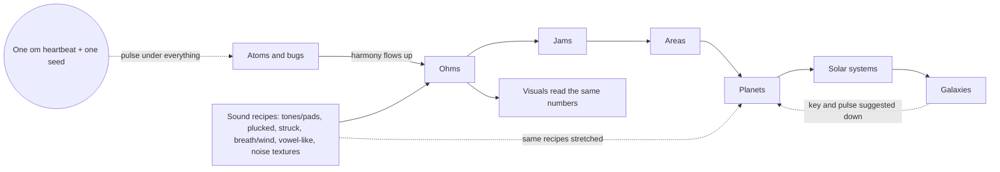
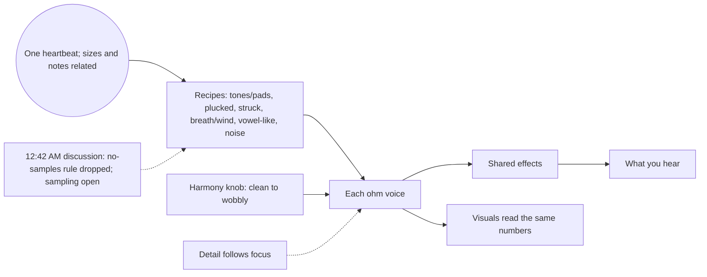
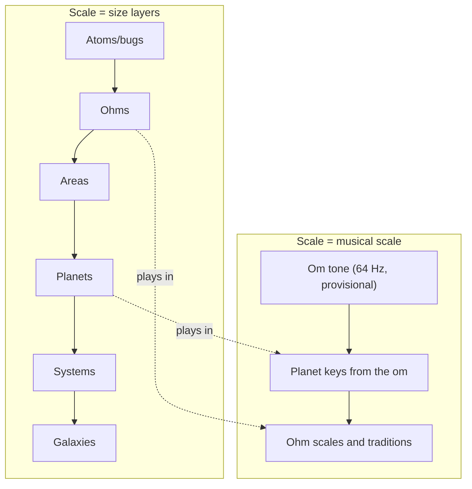

# GOAL_AND_FEATURES.md: Wilbow's goals, and every idea he has had, as concepts and features

**Read this first.** It's the starting document for every Resonance bot working on *The Journey Ohm*. Written late on Sat Oct 24 2026 (MDT), by the overseer's deep-dive job, for Wilbow's requests:
- 10:59 PM: "Rework all my suggestions and ideas as concepts and features never rules.  Reframe every conversation so that you understand my goal"
- 11:01 PM: "Im trying to eliminate confusion so we dont waste time with that"
- 11:04 PM: "All of these suggestions are from recent discussion.  I need you to deep dive what ive said before you give me multiple choice"

**How it was made.** I read all of WILBOW_VERBATIM.md (every message from Fri Oct 16 to Sat Oct 24, 11:04 PM) and the Resonance parts of DECISIONS.md, plus his own words quoted in BRAINSTORM.md, WILBOW_STYLE.md, START_HERE.md and CONCEPTS.md. Only his own words count as his ideas. Bot proposals he never answered aren't listed as his.

**How to read it.**
- Every game idea here is a **concept or feature to discuss, never a rule**. The real constraints are in Section 7.
- Quotes are verbatim, typos included. Times are **MDT** (Mountain Daylight Time, UTC-6). "WV L123" = line 123 of WILBOW_VERBATIM.md. "BR L123" = line 123 of BRAINSTORM.md. `tNN` = his message number.
- **Lensure era** (Oct 16–19) means his first project. That project is separate, but it's where many of his ideas started, so it's included to show how they grew.
- The old Resonance game is abandoned (10:07 PM Oct 24). "Approved to build" means he approved it **for the old game**. It's a concept to carry forward, not an order for the new one.
- Status labels, one per feature:
  - **IDEA**: he suggested it or thought out loud about it.
  - **LIKED**: he picked it on a card or praised it, but it was for discussion only.
  - **APPROVED TO BUILD**: he explicitly approved building it in the old game.
  - **DECIDED**: he decided it for the new game (The Journey Ohm). None standing now: the one (world sounds always synthesized, 11:18–11:19 PM Oct 24) was superseded. [DISCUSSION 12:42 AM Oct 25, not a rule: "Some sampling will be necessary that rule is inefficient, disregard". The no-samples rule is dropped; how sampling is used is still being discussed.]

---

## 0. What changed since last visit (Sat Oct 24 2026, to 11:49 PM MDT)

- 11:47–11:49 PM: he flagged "Bringing harmony back freeze", then said "Its a lore idea and spiritual term that also is a musical term youre going to have to use some inference". His 10:02 PM "The goal of the game is to bring harmony back" is now kept as his quote with three meanings at once (lore, spiritual, musical). It is no longer written as the one core goal everything is built around (MISREADS.md).
- 11:18–11:19 PM: DECIDED that world sounds are always synthesized, never samples. Sampling tools were added as an IDEA (Q307). [DISCUSSION 12:42 AM Oct 25, not a rule: "Some sampling will be necessary that rule is inefficient, disregard". The no-samples rule is dropped; how sampling is used is still being discussed.]
- 11:19 PM: new team questions renumbered to 308–329, because Q307 was taken.
- 11:17 PM: the recipe-based sound engine was added as a PROPOSAL (not approved).
- 11:21 PM: the first strike moved from engine to lore (a story, not a mechanic).
- 11:22 PM: new Possible misreadings section (13 double meanings, 10 engine items that may have been concepts).
- 11:32 PM: misreadings parts C (phrases fudged into categories or rules) and D (either/or readings) added; the pipeline examples you said yes to are listed (not final); "unified scales" is no longer used as a label.
- 11:35–11:36 PM: misread safeguards approved ("Go on all"). Parts C and D renamed to freezes and forks (now "fudged" and forks, 3:53 AM Oct 25); new Misread log section (Section 14 and MISREADS.md); two new Decisions log entries.
- 11:26 PM: new Decisions log, Shared glossary (with your quotes), Diagrams, Lore and story, and Build status sections.
- 11:28 PM: the pipeline section is on hold. He said it looks like the pipeline that misunderstood and misimplemented his ideas; it is being reworked with him.

## 1. His goals (in his words; no single one is the goal the rest are built around)

1. "The goal of the game is to bring harmony back" (10:02 PM Sat Oct 24, WV L1353). At 11:49 PM he said what kind of phrase it is: "Its a lore idea and spiritual term that also is a musical term youre going to have to use some inference". So it carries three meanings at once: a lore idea (the story of the world), a spiritual term, and a musical term (harmony in music). It's one of his goals in his words, not a rule, an engine mechanic or the one goal the others serve. The title came the same minute: "The journey ohm" → "The game's title" (10:02–10:03 PM, WV L1355, L1359). It reads as *journey home*.
2. The idea underneath it is **om, one vibration that everything comes from**. "Like an om in spirituality. Use this philosophy in the design" (10:03 PM Oct 24, WV L1357). The origin story he told is "one original spark — one first sound … each lineage picks it up in its own way, but they all trace back to that same first sound … One spark, many echoes" (9:24 PM Oct 24, WV L1311).
3. **Music comes first, and it has to be real music.** That's the thing he has repeated most, from day one ("This just sounds like noise", Oct 16 5:09 PM, WV L113) to tonight ("This currently feels like a bad generative music maker.  It needs to be a game that has a daw and accurate music creation", 8:52 PM Oct 24, WV L1298). "Keep all of my input in the context of creating inyeresting actual music and visuals" (Oct 17 6:38 PM, WV L296).
4. **It's a game, built around the music.** "I want it to feel like a game." (Oct 16 5:12 PM, WV L121). "We start with the music  and visualizer engine and how it relates to the world and ohms first, we build it for the music but its to make a game" (10:21 PM Oct 24, WV L1373).
5. **A living world that answers the music.** Planets, plants, ground and creatures react to harmony, and that reaction is what progress feels like. "The plants growing and flowering should have to do with the music around them" (Oct 22 1:35 AM, WV L764). "It reacts positively with growth the harmony to the universe" (8:22 PM Oct 24, BR L299). "The ground should pulse and the environment lightly react to it" (10:05 PM Oct 24, WV L1361).
6. **Unique, procedural and never the same twice.** It should be one deep generated system, not presets, themes or patches. "I want it to feel more physical and flexible instead of a bunch of patches" (Oct 21 7:32 PM, WV L444). "Rember complex procedurally generation engine are what i want built not a bunch of patches" (10:07 PM Oct 24, WV L1363). "The creatures should all be completely unique" (Oct 21 7:42 PM, WV L470).
7. **One continuous zoom through nested scales**, from galaxies down to atoms and wavelengths, all on one pulse. "Scaleable instead of clicking between views" (9:57 PM Oct 24, WV L1347). "…the planets harmony down to atoms and wavelengths on the universal pulse.  Ohms modulate areas and planets modulate galaxies" (10:00 PM Oct 24, WV L1349). He first said it in his Lensure era: "The way that nodes radiate light and sound is consistent at all scales.  Clusters of clusters" (Oct 16 6:15 PM, WV L179).
8. **Many ohms running smoothly matters most technically**, and the game has to look beautiful within that. "Actually running with many ohms and elements is always the main goal" (9:55 PM Oct 24, WV L1343). "It needs to run well always" (9:54 PM, WV L1341). "I want this to look beautiful. That has always been a goal" (9:54 PM, WV L1339).
9. **Endless exploration and discovery, with music at the centre.** "…add the most appealing parts of collecting Pokémon, the Exploration of the best open world sand Boxes … Keep music as the focus.  Add the explorability of noita, and the music making of ableton live.  Endless exploration, with everything we've worked on" (Oct 23 1:10 AM, WV L1042).
10. **You play by touch and gesture, without menus or words getting in the way.** "Prioritize making as much interaction from intuitive contextual gestures instead of menus" (Oct 16 4:56 PM, WV L105). "Always consider gestures as contextual" (10:34 PM Oct 24, WV L1389).

**In one line:** you travel through a living, procedurally generated universe of musical creatures (ohms), from galaxies down to wavelengths, making real music. In his words, "The goal of the game is to bring harmony back": lore, spiritual and musical, all at once (11:49 PM). Harmony as a currency is a separate idea of his (10:41 PM), and how it grows the world or opens bigger layers is still open. All of it is one vibration, the om.

---

## 2. Recurring themes (how each idea grew across the days)

**T1. Real music, not noise.** This is the oldest theme and the one he repeats most.
- Oct 16 5:09 PM (Lensure era): "There needs to be a way to actually easily make music that doesnt feel to cammed.  This just sounds like noise" (WV L113).
- Oct 21 10:20 PM: "The sounds are way too busy the animals should bot be making so many notes.  Remember using music theory.  It appears there is none" (WV L591).
- Oct 22 2:08 AM: "Its not noise really.  It has tone and variance … it doesnt sound like music and there is no cohesiveness.  It needs something to bring it together" (WV L796).
- Oct 24 8:50 PM: "We need to redo what we are calling music because the cohesiveness is only present sometimes.  We need something like a library of songs for development" (WV L1294). Later that night, at 8:52 PM: "…a game that has a daw and accurate music creation" (WV L1298).

**T2. Every ohm unique, and never the same song twice.**
- Oct 18 10:05 AM (Lensure era): "…we dont want it to be the same song everytime" (WV L343).
- Oct 21 7:42 PM: "The creatures should all be completely unique.  Make some kind of genetics system with near infinite possibilities" (WV L470).
- Oct 22 2:32–2:33 AM: "Was it clear that every ohms is different?  They are all playing the same instrument often…" then "Detail how this is done because ive said this over and over" (WV L800, L804).
- Oct 23 4:01 PM: "…one of the things that makes the games sound the same way too often instead of having completely different sound each time" (WV L1147). On the same day at 12:06 PM: "Id like those to always be random sounds with different settings and engines" (WV L1085).

**T3. Harmony makes the world come alive.** At 10:02 PM he said "The goal of the game is to bring harmony back", a phrase he later called lore, spiritual and musical at once (11:49 PM).
- Oct 17 6:46 PM (Lensure era): "Create a way to make aseed that grows.  Flowers off this plant are like full songs or soundscapes" (WV L304).
- Oct 22 1:35–1:51 AM: plants grow from the music around them (WV L764, L768), and biome #17, "fields change with music" (WV L784).
- Oct 24 8:50 PM: "The world reacts in different ways to a song than a jam" (WV L1294). At 8:22 PM: "It reacts positively with growth the harmony to the universe" (BR L299). At 9:24 PM: "a puzzle to get the sound back to a cohesive thing, and then the world responds" (WV L1311).
- Oct 24 10:02 PM: "The goal of the game is to bring harmony back" (WV L1353). At 8:32 PM: "Currency from unity and harmony as a concept" (BR L317). At 10:41 PM: "Harmony as a currency and usable resource should be baked in" (WV L1399).

**T4. Zoom forever through nested scales.**
- Oct 16 6:13–6:15 PM (Lensure era): "Nodes are fractal and can contain whole arrangements" / "consistent at all scales.  Clusters of clusters" (WV L175, L179). Oct 17 6:46 PM: "Maintain a fractal nature where infinite zooming in and out is possible" (WV L304).
- Oct 21 7:40–7:44 PM: "beautiful procedurally created systems which can be zoomed in to and explored" / "zoom down past cells into DNA" (WV L466, L474).
- Oct 23 2:27 AM: "Zooming in and out should feel smoother between" (WV L1054). At 4:14 PM: "8 zooming should be a fractal explorer" / "That is actually representative of its contents" (BR L108).
- Oct 24 9:57 PM–10:39 PM: "Scaleable instead of clicking between views" (WV L1347), "directional zoom with layers you snap into" (WV L1349), "You should be able to play space systems and other scale systems as instruments" (WV L1393) and "Scale meaning two things" (WV L1395).

**T5. Gestures, not menus. Intuitive, discoverable and contextual.**
- Oct 16 4:56 PM and 5:47 PM (Lensure era): "Prioritize making as much interaction from intuitive contextual gestures instead of menus" / "The process should be without menus and should encourage exploration" (WV L105, L142).
- Oct 21 7:44 PM: "Id like now menus in the game until further notice" (WV L474). Oct 22 1:20 AM: "I would also like to be able to draw many gestures like in lensure" (WV L744).
- Oct 23 2:31 PM: a hidden developer window "would break the rule about no menus and will be hidden in the main game" (WV L1106). Oct 24 7:50 PM: "Let's make a menu that can save and load new games…" (BR L273).
- Oct 24 9:47 PM: "Let's keep the now words rule as consideration for the released game experience, not a crucial rule for development" (WV L1331). At 10:34 PM: "Always consider gestures as contextual" (WV L1389).

**T6. Ohms as musicians who talk through music and jam.**
- Oct 21 7:59 PM: "Creatures can learn from eachother when prompted so that they harmonize and match rythm" (WV L509).
- Oct 21 11:59 PM: "Creatures should be treated as  Different instruments which are trying to communicate through music" (WV L645).
- Oct 22 2:35–2:39 AM: "Use the ways that real musicians interact and cue eachother jamming" / "settle into a harmonious arrangement together, and keep that jam going" (WV L808, L812).
- Oct 24 9:15–9:18 PM: "When two ohms meet they should be trying to make something that actually sounds good" / "I want to separate a jam from a song" (WV L1306, L1308).

**T7. Procedural and organic, not themes, presets or patches.**
- Oct 16 7:23 PM (Lensure era): "Textural aspects need to be priority to and procedural to keep sounds natural and rich" (WV L245).
- Oct 21 7:56 PM: "I dont want it to feel themed.  Like the ideas but I dont want an animal that can only drum" (WV L499).
- Oct 22 1:40 AM and 1:51 AM: "I want the shapes to be generated organically and procedurally, not as symbols etc" / "I dont want it to feel like a set of themes" (WV L772, L784). At 11:13 PM: "No full themes, just slight influence" (WV L896).
- Oct 24 10:07 PM: "complex procedurally generation engine are what i want built not a bunch of patches" (WV L1363).

**T8. Ohms learn, gain experience and pass it on.**
- Oct 21 10:24 PM: "…their offsping will have the changed dna as if epigenetics are at play" (WV L599).
- Oct 23 12:07 AM: "ohm should try to join successful jams and they should learn, and keep that knowledge on top" (WV L944).
- Oct 23 2:25 PM and 8:57 PM: "Perhaps there could be a teacher trait…" then "any ohm can be teacher with enough experience and its not only a title but a gradient scale" (WV L1105, L1250).
- Oct 23 8:50 PM: drummers "slowly becoming a full kit through experience" (WV L1246). Oct 24 9:24 PM: "each lineage picks it up in its own way" (WV L1311).

**T9. Many ohms, running smoothly, without waste.**
- Oct 18 9:00 PM (Lensure era): "The sound getts choppy and shitty sounding when theres alot going on" (WV L420).
- Oct 22 5:07 PM: "Maybe water should be a membrane between low points, or something that doesnt require too much resources" (WV L884). Oct 23 12:38 AM: "keep computational availability at fore front for background ohms" (WV L977).
- Oct 23 2:27 AM: "Make many systems in each galaxy or cluster, without too much load" (WV L1054).
- Oct 24 9:54–9:55 PM: "It needs to run well always" / "Actually running with many ohms and elements is always the main goal" (WV L1341, L1343).

**T10. Beauty, and visuals that show the music.**
- Oct 16 6:09 PM (Lensure era): "Make most visuals be gradient as opposed to lines and outlines. keep a smooth looking theme to create cinematic visuals without too much processing power" (WV L171).
- Oct 21 10:15 PM: "Theres lots of random ugly lines…" (WV L587). Oct 23 2:30 AM: "Nicer looking, more realistic space … Less cartoon  looking graphics" (WV L1055).
- Oct 23 3:35 PM and 3:43 PM: "Visualizing the music accurately and beatifully" / "You should be able to see basically everything about an ohms sound and the interplay in a jam" (WV L1129, L1135).
- Oct 24 9:54 PM: "I want this to look beautiful. That has always been a goal" (WV L1339).

**T11. Teach without text, and a helper you can ask.**
- Oct 16 6:39 PM (Lensure era): "Symbolically explain without breaking the immersion" (WV L188).
- Oct 22 1:15 AM and 11:18 PM: "Teach without text is a good call" / "The helper needs to be implemented for at least the most fundamental things" (WV L728, L908).
- Oct 23 2:53 AM: "Drawing a question mark brings helper guide to show relations between assets" (WV L1062). At 11:41 AM: "Make sure the helper is there and available with question mark gesture" (WV L1083).
- Oct 24 9:43 PM: "…what's this?  Why is this doing x.  Ive asked so many times for a helper" (WV L1327).

**T12. Exploration, discovery and collecting.**
- Oct 16 4:44 PM (Lensure era): "make them discoverable through play" (WV L89).
- Oct 21 7:48 PM: "I was thinking of a way to collect specimens being part of it" / "And maybe breeding" (WV L482, L486). At 8:08 PM: "Procedurally generated planets feel  large and are fully explorable" (WV L522).
- Oct 23 2:32 AM: "Could have a meaningful path through whole huge galaxies, tracing a path of discoveries" (WV L1057). At 2:42 AM: "Ohm collection mechanics…" (WV L1059).
- Oct 24 8:28 PM: "You can always pick things up and save them" (BR L311).

**T13. Physical, squishy and soft-bodied.**
- Oct 18 10:01 AM (Lensure era): "we need to have things with physicality that use physics and motion for sound" (WV L337).
- Oct 21 7:32–7:34 PM: "more physical and flexible" / "some fluid simulation and squishy interactions" (WV L444, L454).
- Oct 23 1:44 PM: "make clay be squishy like the soft bodies from closed loops" (WV L1089).
- Oct 24 8:04 PM: "like a modular synth bit simplified, and stylized into trippy looking soft body controls" (BR L285). At 9:56 PM: "terrain deformation and a dynamic environment" (WV L1345).

**T14. One shared pulse and real rhythm.**
- Oct 16 7:03 PM (Lensure era): "Figure out a similar mechanic for rythm" (WV L220). Oct 18 9:56 AM: loops that stay "synced with the world clock" (WV L333).
- Oct 22 2:06 AM: "Theres also no shared rhythms, that should be slightly influenced by the environment at the beginning but it shouldn't dictate the whole overall sound" (WV L792).
- Oct 24 8:26 PM: "multiple taps can set a different bas bpm sometimes like a tap input on many audio devices" (BR L303).
- Oct 24 10:00 PM–10:40 PM: "the universal pulse" (WV L1349), "There should be a scale , like octaves and harmonic relationships" (WV L1387) and "Low C at 64 Hz, matches the heartbeat" (WV L1397).

**T15. The player as a musician and maker (DAW, playing, building).**
- Oct 16 4:44 PM (Lensure era): "add tools for sound synthesis, looping and effects" (WV L89).
- Oct 21 8:34 PM: "editable … like an organic DAW from one view, but it is slightly hidden" (WV L548). Oct 22 1:10 AM: "A way to play the creatures individually like an instrument" (WV L709).
- Oct 24 7:58 PM: "Building our own instruments as well.  Then the instrument shrinks down and the ohm can play it" (BR L280). At 8:44 PM: "paint notes in the daw river" (WV L1288).
- Oct 24 8:06 PM: "I want to have more control over the sound creation and have more insight into the way we are structuring where the music is coming from" (BR L288).

---

## 3. Every concept and feature he suggested

181 items: **1 DECIDED** (new game), **124 APPROVED TO BUILD** (old game; concepts to carry forward, not rules), **14 LIKED**, **42 IDEA**. Tags are greppable: `[DECIDED]`, `[IDEA]`, `[LIKED]`, `[APPROVED TO BUILD]`. Where a newer message changes an older one, the item says which is newer. Every item is a feature to discuss, never a rule.

### 3.1 Core loop & harmony

- **Bring harmony back** [IDEA]. *For the player:* One phrase with three meanings at once: a lore idea (the world's story), a spiritual term, and a musical term. *His words:* "The goal of the game is to bring harmony back" (10:02 PM Oct 24, WV L1353); "Its a lore idea and spiritual term that also is a musical term youre going to have to use some inference" (11:49 PM Oct 24). *Serves the goal:* One of his goals in his words; not a rule and not the one goal the other features serve.
- **Harmony as currency** [IDEA]. *For the player:* Harmony you create is something you can spend and use, not just a score. *His words:* "Harmony as a currency and usable resource should be baked in" (10:41 PM Oct 24, WV L1399; earlier "Currency from unity and harmony as a concept" 8:32 PM, BR L317). *Serves the goal:* Makes making good music the way you progress.
- **Ink as currency (parked)** [IDEA]. *For the player:* An earlier, parked thought: ink as a spendable resource. *His words:* "Ink as currency for later ideas" (8:32 PM Oct 24, BR L316). *Serves the goal:* Older alternative to harmony currency; see Tensions.
- **Harmony can slip back** [IDEA]. *For the player:* Fixed places usually stay fixed, but events at bigger or smaller scales can knock them back into discord in chain reactions. *His words:* "things change and happen, so harmony can be disrupted. They can fall back into discord, but generally stabilized places tend to stay stabilized until higher or sometimes lower scale things cause chain reactions across scales." (10:51 PM Oct 24, WV L1415). *Serves the goal:* Keeps a restored world alive and changing.
- **Levels with no levels** [IDEA]. *For the player:* If a planet is in discord you can't play the next scale up yet; progress opens naturally, with no level screens. *His words:* "When one planet has discord it you cant play the next scale up. Like levels in a game but with no levels." (10:39 PM Oct 24, WV L1393). *Serves the goal:* Gives the journey a shape without menus.
- **Untangle the chaos** [IDEA]. *For the player:* You find devices hooked together wrong and causing chaos; retuning them brings the world back to bloom. *His words:* "a bunch of chaotic devices all hooked together wrong, with bad settings creating a lot of chaos" (9:24 PM Oct 24 (voice, Lore), WV L1311). *Serves the goal:* A hands-on puzzle: "get the sound back to a cohesive thing, and then the world responds" (9:24 PM).
- **Open-ended fixes; the seed sets the key** [IDEA]. *For the player:* Each out-of-tune problem is solved in whatever way fits what is wrong; the world's seed decides where everything is in key. *His words:* "E its ope. Ended and depends what is wrong.   The seed determines where everything is in key." (10:47 PM Oct 24, WV L1411). *Serves the goal:* Keeps puzzles fresh and seed-driven.
- **The world listens and grows** [LIKED]. *For the player:* No preset song to hit: the world recognises beat, resonance and harmony and responds with growth. *His words:* "Its not a preset song you are trying to achieve. But the system recognizes beat and resonance and harmony and other music theory elements. It reacts positively with growth" (8:22 PM Oct 24, BR L299; "Keep the listening and growth rules" 8:41 PM, BR L319). *Serves the goal:* The world answers the music you make.
- **Songs and jams change the world differently** [APPROVED TO BUILD] (old game; concept to carry forward). *For the player:* A finished song has a different effect on the world than a jam in progress. *His words:* "The ohms need to be working towards making a song out of a jam.  The world reacts in different ways to a song than a jam" (8:50 PM Oct 24, WV L1294). *Serves the goal:* Rewards taking a jam all the way to a song.
- **Collecting and breeding as purpose** [APPROVED TO BUILD] (old game; concept to carry forward). *For the player:* Collecting specimens and breeding them gives the game purpose. *His words:* "I was thinking of a way to collect specimens being part of it / And maybe breeding" (7:48 PM Oct 21, t96-t97, WV L482-486). *Serves the goal:* Gives reasons to explore and to shape ohms.
- **Missions from current conditions** [APPROVED TO BUILD] (old game; concept to carry forward). *For the player:* Wordless, procedurally made missions (symbols, hints) to find certain ohms, based on what exists in your seed right now, with rarity. *His words:* "missions are not a static list, they are generated from current conditions, also figure out rarity /difficulty scale.  Must be possible in current seed" (2:44-2:49 AM Oct 23, WV L1060-1061). *Serves the goal:* Guides exploration without text.
- **Trail of discoveries** [APPROVED TO BUILD] (old game; concept to carry forward). *For the player:* A meaningful path of discoveries across huge galaxies. *His words:* "Could have a meaningful path through whole huge galaxies, tracing a path of discoveries" (2:32 AM Oct 23, WV L1057). *Serves the goal:* Gives the journey a direction.
- **Different every time** [APPROVED TO BUILD] (old game; concept to carry forward). *For the player:* Every new game starts somewhere different. *His words:* "The games initial starting point should not be the same every time." (12:31 AM Oct 23, t213, WV L973). *Serves the goal:* Replayability.
- **Feel like a game, start from nothing** [APPROVED TO BUILD] (old game; concept to carry forward). *For the player:* (Lensure era) It should feel like a game and begin from nothing, as a creation process. *His words:* "I want it to feel like a game. / The beginning should start with nothing and feel like a creation process" (5:12-5:44 PM Oct 16, t17/t20, WV L121/L138). *Serves the goal:* Roots of the 'restore from chaos' start.

### 3.2 Scales & zoom

- **Zoom from galaxy to DNA** [APPROVED TO BUILD] (old game; concept to carry forward). *For the player:* One continuous zoom: space, systems, planets, creatures, cells, DNA. *His words:* "Make it be in space with beautiful procedurally created systems which can be zoomed in to and explored / zoom down past cells into DNA" (7:40-7:44 PM Oct 21, t92/t94, WV L466/L474). *Serves the goal:* The nested world you restore layer by layer.
- **Same at every scale** [APPROVED TO BUILD] (old game; concept to carry forward). *For the player:* (Lensure era) Things behave the same at every scale; clusters of clusters; infinite zoom. *His words:* "The way that nodes radiate light and sound is consistent at all scales.  Clusters of clusters" (6:15 PM Oct 16, t29, WV L179; infinite zoom t60 WV L304). *Serves the goal:* Root of 'every layer is the same kind of thing'.
- **Scaleable, not separate views** [IDEA]. *For the player:* One continuous world you scale through instead of clicking between screens. *His words:* "Scaleable instead of clicking between views" (9:57 PM Oct 24, WV L1347). *Serves the goal:* Keeps the journey seamless.
- **Directional snap-zoom down to atoms** [IDEA]. *For the player:* Zooming feels like snapping into layers in the direction you go, down to bugs, atoms and wavelengths, all on one pulse. *His words:* "Snapping into ohms should feel like a directional zoom with layers you snap into, same with space and all scales.  Zoom into see bugs that are part of the same overall system, the planets harmony down to atoms and wavelengths on the universal pulse." (10:00 PM Oct 24, WV L1349). *Serves the goal:* Makes every scale part of one harmony.
- **Ohms shape areas, planets shape galaxies** [IDEA]. *For the player:* Each layer modulates the one above: ohms colour their area, planets colour their galaxy. *His words:* "Ohms modulate areas and planets modulate galaxies." (10:00 PM Oct 24, WV L1349). *Serves the goal:* How harmony spreads upward.
- **Play planets and systems as instruments** [IDEA]. *For the player:* Bigger scales (planets, star systems) can be played like instruments, with many intervals between them. *His words:* "Possinilties for lots of intervals You should be able to play space systems and other scale systems as instruments." (10:39 PM Oct 24, WV L1393). *Serves the goal:* Extends music-making to every scale.
- **'Scale' means two things** [IDEA]. *For the player:* Scale = size layer (ohm, planet, galaxy) and musical scale (notes). *His words:* "Scale meaning two things" (10:39 PM Oct 24, WV L1395). *Serves the goal:* A deliberate double meaning to design around.
- **Smoother zoom, many systems** [APPROVED TO BUILD] (old game; concept to carry forward). *For the player:* Zoom feels smooth; galaxies hold many systems; space looks varied, without heavy load. *His words:* "More visual differences in space.  Zooming in and out should feel smoother between. Make many systems in each galaxy or cluster, without too much load" (2:27 AM Oct 23, WV L1054). *Serves the goal:* Makes the journey through space a pleasure.
- **Zoom as a fractal explorer** [LIKED]. *For the player:* Zooming into auras and jams is like a fractal explorer whose patterns represent what is inside. *His words:* "8 zooming should be a fractal explorer / That is actually representative of its contents" (4:1x PM Oct 23, BR L108, L120). *Serves the goal:* Lets you read an ohm or jam by diving into it.
- **Zoom arrival depends on context** [IDEA]. *For the player:* What you hear arriving at a new scale depends on the situation. *His words:* "Depends on context" (10:34 PM Oct 24 (Q262), WV L1391). *Serves the goal:* Keeps transitions situational.

### 3.3 Music & sound

- **World sounds are always synthesized, never samples** [SUPERSEDED 12:42 AM Oct 25; was DECIDED] (11:18–11:19 PM Oct 24). *For the player:* Every sound the world, the ohms and the planets make is generated live, never a recording. *His words:* "Definitely no samples" (11:18 PM Oct 24, WV L1447) / "There will be sampling tools but the synthesis of the sounds of the world etc will not ever be samples" (11:19 PM Oct 24, WV L1449). *Serves the goal:* Every ohm unique and never the same twice, from one vibration. [DISCUSSION 12:42 AM Oct 25, not a rule: "Some sampling will be necessary that rule is inefficient, disregard". The no-samples rule is dropped; how sampling is used is still being discussed.]
- **Sampling tools** [IDEA]. *For the player:* Tools that let you sample sounds. What they capture and where sampled sounds go is open (Q307 in QUESTIONS_FOR_WILBOW.md). *His words:* "There will be sampling tools" (11:19 PM Oct 24, WV L1449). *Serves the goal:* The player as a musician and maker.
- **Real music, not noise** [APPROVED TO BUILD] (old game; concept to carry forward). *For the player:* What you hear must be real music, with melody, chords and cohesion, never noise or canned loops. *His words:* "There needs to be a way to actually easily make music that doesnt feel to cammed.  This just sounds like noise" (5:09 PM Oct 16, t15, WV L113; again t116, t168, 8:52 PM Oct 24). *Serves the goal:* The core of the whole experience.
- **Music theory inside each ohm** [APPROVED TO BUILD] (old game; concept to carry forward). *For the player:* No central composer: every ohm carries its own music theory, scales and moods. *His words:* "We dont need a composer. We need the creatures to have musical theory built into them individually. With highly varied scales, moods." (12:02 AM Oct 22, t135, WV L659). *Serves the goal:* Music emerges from living creatures.
- **Fewer, better notes** [APPROVED TO BUILD] (old game; concept to carry forward). *For the player:* Ohms play fewer notes, guided by theory. *His words:* "The sounds are way too busy the animals should bot be making so many notes.  Remember using music theory." (10:20 PM Oct 21, t119, WV L591). *Serves the goal:* Music, not busyness.
- **A game with a DAW and accurate music** [IDEA]. *For the player:* The game includes real, accurate music creation, not a 'generative music maker'. *His words:* "This currently feels like a bad generative music maker.  It needs to be a game that has a daw and accurate music creation" (8:52 PM Oct 24, WV L1298). *Serves the goal:* Makes the player a real musician.
- **Song library and real notes** [APPROVED TO BUILD] (old game; concept to carry forward). *For the player:* Overhaul the traditions using real notes from music theory, with a library of songs for development. *His words:* "Let's overhaul the traditions system and let's look at the real notes in the music theory. ... We need something like a library of songs for development." (8:50 PM Oct 24, WV L1294). *Serves the goal:* Grounds the music in real music.
- **Many music styles to mix and match** [APPROVED TO BUILD] (old game; concept to carry forward). *For the player:* Note patterns from many kinds of music, mixable. *His words:* "The notes patterns of many types of music should be available to use and mix and match" (3:45 AM Oct 23, WV L1078). *Serves the goal:* Variety and depth.
- **Cultures add flavour, never limit** [APPROVED TO BUILD] (old game; concept to carry forward). *For the player:* Musical cultures/traditions weight what ohms play but never cap it; stronger than random. *His words:* "The cultures should not be a limit to the possibilities, only add variance.  They should still be more prominent than any random stuff" (4:12 AM Oct 23, WV L1080). *Serves the goal:* Variety with character.
- **Cultures spread across planets** [APPROVED TO BUILD] (old game; concept to carry forward). *For the player:* Every planet feels different: blends of cultures, sometimes one real tradition coming through. (Paused by 'one tradition per planet for now'.) *His words:* "the culture and culture mixes generated should be distributed across the planets and galaxies, giving a different feel on every single procedurally generated plated / it should be a blend of cultures, with the possibility of a single real cultural influence" (2:51-2:58 PM Oct 23, WV L1115-1116). *Serves the goal:* Each place sounds like somewhere.
- **One tradition per planet, for now** [APPROVED TO BUILD] (old game; concept to carry forward). *For the player:* Newer: each planet has one tradition for now; ohms already make good songs when you find them. *His words:* "Let's keep each planet as one tradition for now.  The ohms should be able to make successful song with the theory naturally and be already doing that when you encounter a group of them" (8:55 PM Oct 24, WV L1300 (newer than the blends item)). *Serves the goal:* A clear sound per planet to start from.
- **Easy to add real-world styles** [APPROVED TO BUILD] (old game; concept to carry forward). *For the player:* Adding new real-world musical styles stays easy. *His words:* "Also keep it easy to add new real world musical styles to the game." (4:56 PM Oct 23, WV L1178). *Serves the goal:* Room to grow.
- **Many sound types** [APPROVED TO BUILD] (old game; concept to carry forward). *For the player:* Lots of different kinds of sounds, not only ambient pads. *His words:* "I really want it to make alot of different types of sounds  not just ambient soundscapes." (7:54 PM Oct 21, t98, WV L495). *Serves the goal:* Variety.
- **Rich, natural texture** [APPROVED TO BUILD] (old game; concept to carry forward). *For the player:* Texture is a priority and procedural, so sounds stay natural and rich. *His words:* "Textural aspects need to be priority to and procedural to keep sounds natural and rich." (7:23 PM Oct 16, t43, WV L245; t186). *Serves the goal:* Beautiful sound.
- **Physical sound** [APPROVED TO BUILD] (old game; concept to carry forward). *For the player:* Things with physicality make sound from physics and motion. *His words:* "we need to have things with physicality that use physics and motion for sound" (10:01 AM Oct 18, t66, WV L337). *Serves the goal:* Sound you can touch.
- **World in key, never the same song** [APPROVED TO BUILD] (old game; concept to carry forward). *For the player:* (Lensure era) Pieces stay in the world's key, but every world sounds different. *His words:* "the no wrong notes feature was more meant to be an idea that keeps all of the pieces in the world in key unless you change it.  But we dont want it to be the same song everytime" (10:05 AM Oct 18, t67, WV L343). *Serves the goal:* Easy harmony, endless variety.
- **Ohm keeps its own instrument** [APPROVED TO BUILD] (old game; concept to carry forward). *For the player:* When ohms play together their instruments stay their own; only notes and style change. *His words:* "When communication happens between ohms, their instrument should not be affected and changed by eachother. ... The notes and playing style change." (3:38 AM Oct 23, WV L1075; "The individual ohms keep theor instrument" 6:57 PM, WV L1220). *Serves the goal:* Each ohm stays an individual.
- **Ohms can learn other sounds** [APPROVED TO BUILD] (old game; concept to carry forward). *For the player:* All ohms can learn new sounds; using them on their own happens rarely. Marked 'check back later'. *His words:* "It can learn other sounds too / All ohms / Alone, but rarely / Check back on this later" (6:58-7:25 PM Oct 23, WV L1222-1232 (newer than 'cleanly pull them out', L1226, and 'too disruptive', L1228)). *Serves the goal:* Growth through experience.
- **Drummers grow into a full kit** [APPROVED TO BUILD] (old game; concept to carry forward). *For the player:* Drum ohms learn from other drums and slowly become a full kit. *His words:* "Drums should be able to play a mix of sounds through learning from other types of drum / As in slowly becoming a full kit through experience" (8:50 PM Oct 23, WV L1244-1246). *Serves the goal:* Visible musical growth.
- **Varied percussion** [APPROVED TO BUILD] (old game; concept to carry forward). *For the player:* Percussion ohms span kicks, snares and more; no type limited to one sound. *His words:* "Some rhythm ohms should play a kick drum type sound while others play snare etc.  Some can do all." (10:52 AM Oct 22, t186, WV L843; 6:56 PM Oct 23, WV L1218). *Serves the goal:* A real rhythm section.
- **Effects in time and in key** [APPROVED TO BUILD] (old game; concept to carry forward). *For the player:* Effects start synced and in key, can be detuned by adjusting, are zoomable, and only affect the carrier and ohms fused to it. *His words:* "Initial starting effects should be synced and in key but possibly detuned or desynced through Adjustments / Items shouldn't affect the whole jam, only the ohms that are fused and stuck together" (4:07-4:10 PM Oct 23, WV L1159-1163 (newer than 'unless they are joined', 4:01 PM, L1147)). *Serves the goal:* Effects that add rather than wreck.
- **Harder hits sound brighter** [APPROVED TO BUILD] (old game; concept to carry forward). *For the player:* How hard you hit changes the brightness, using touch pressure where available. *His words:* "Keep 1: harder hits sound brighter for every ohm voice" (3:12 PM Oct 23, WV L1122). *Serves the goal:* Expressive touch.
- **Ohms hear their space in the mix** [APPROVED TO BUILD] (old game; concept to carry forward). *For the player:* Each ohm knows how much room it takes in the mix. *His words:* "Add ohm awareness of how much relative space it takes up in the jams not timing and frequency mix" (3:28 AM Oct 23, WV L1074). *Serves the goal:* A balanced band.
- **Items modulate, never replace** [APPROVED TO BUILD] (old game; concept to carry forward). *For the player:* Carried items change an ohm's sound only in noticeable, predictable ways; the body makes the sound. *His words:* "Ohms have theor sound from theor body and other natural attributes. Items the carry should change that, only modulate in noticeable predictable ways" (3:41 AM Oct 23, WV L1076). *Serves the goal:* Identity with variety.
- **Drawn shapes make varied sounds** [APPROVED TO BUILD] (old game; concept to carry forward). *For the player:* Drawn lines/blobs: length sets pitch, timbre is randomised, ohms partly follow their tempo and melody; blobs and default spirals always sound new. *His words:* "Make length correlate pitch, randomized timbre ... Id like those to always be random sounds with different settings and engines." (3:19 AM / 12:06 PM Oct 23, WV L1072, L1085-1086). *Serves the goal:* Drawing as instrument-making.
- **Voice ohms (Pink Trombone style)** [APPROVED TO BUILD] (old game; concept to carry forward). *For the player:* Some ohms have a vocal tract that sings vowel-like patterns and even words. *His words:* "Id like some creatures to have a vocal synthesis which can create vocal sounding patterns.  Like the web app called pink trombone. but also be able to put words in" (10:40 PM Oct 21, t128, WV L624). *Serves the goal:* Voices and names.
- **Tempos related like octaves** [IDEA]. *For the player:* Tempos across the world relate like octaves and harmonic ratios. *His words:* "There should be a scale , like octaves and harmonic relationships should be considered" (10:30 PM Oct 24 (Q258), WV L1387). *Serves the goal:* Rhythm that harmonises across scales.
- **The om: 64 Hz low C heartbeat (provisional)** [IDEA]. *For the player:* A base tone, low C at 64 Hz, matching the heartbeat; 'use 64 for now' pending research. *His words:* "Low C at 64 Hz, matches the heartbeat / Let's use 64 for now and come back" (10:40-10:43 PM Oct 24, WV L1397/L1401). *Serves the goal:* One root vibration for everything.
- **Environment lightly shapes rhythm** [APPROVED TO BUILD] (old game; concept to carry forward). *For the player:* The environment nudges shared rhythm at first but doesn't dictate the sound. *His words:* "Theres also no shared rhythms, that should be slightly influenced by the environment at the beginning but it shouldn't dictate the whole overall sound" (2:06 AM Oct 22, t169, WV L792). *Serves the goal:* World and music connected, lightly.
- **Define a shared music language** [IDEA]. *For the player:* More control and insight into where the music comes from and how to dial it in; define roles and a language better. *His words:* "I want to have more control over the sound creation and have more insight into the way we are structuring where the music is coming from." (8:06 PM Oct 24, BR L288). *Serves the goal:* Makes the music fixable and good.

### 3.4 Ohms

- **Every ohm unique (genetics)** [APPROVED TO BUILD] (old game; concept to carry forward). *For the player:* Every creature is completely unique, from near-infinite genetics. *His words:* "The creatures should all be completely unique.  Make some kind of genetics system with near infinite possibilities" (7:42 PM Oct 21, t93, WV L470; t177 'every ohms is different'). *Serves the goal:* Individuals worth meeting and collecting.
- **Life rare but creatable** [APPROVED TO BUILD] (old game; concept to carry forward). *For the player:* Natural life is very rare; you can create it. *His words:* "make life very very  rare to encounter naturally but creatable" (7:40 PM Oct 21, t92, WV L466). *Serves the goal:* Meeting life feels special.
- **Sparser encounters** [IDEA]. *For the player:* Meet ohms less often and do more by building things yourself. *His words:* "I think we need to make ohm encounters more sparse and start determining how to make more things to do by creating things ourself in the world." (7:58 PM Oct 24, BR L280). *Serves the goal:* Makes encounters meaningful.
- **Living sound creatures + instrument builder** [APPROVED TO BUILD] (old game; concept to carry forward). *For the player:* The game started as both living sound creatures and an instrument builder. *His words:* "A and C" (7:33 PM Oct 21, t88, WV L448). *Serves the goal:* The two pillars: creatures and making.
- **Not themed** [APPROVED TO BUILD] (old game; concept to carry forward). *For the player:* No themed creatures (no animal that can only drum); biomes not themes either. *His words:* "I dont want it to feel themed.  Like the ideas but I dont want an animal that can only drum" (7:56 PM Oct 21, t99, WV L500; t167). *Serves the goal:* Endless variety.
- **Senses and traits as gradients** [APPROVED TO BUILD] (old game; concept to carry forward). *For the player:* Traits like sight and hearing are gradients; some ohms blind, some deaf; music theory in DNA. *His words:* "Consider music theory in DNA.  make some creatures blind and some creatures deaf.  Brainstorm other creature attributes that can exist as gradie[nts]" (8:24 PM Oct 21, t107, WV L539). *Serves the goal:* Rich, varied individuals.
- **Body types and appendages** [APPROVED TO BUILD] (old game; concept to carry forward). *For the player:* Different bodies and functional appendages that add to the sound. *His words:* "Different body types, functional appendages which add to sound" (1:07 AM Oct 22, t146, WV L693). *Serves the goal:* Look tied to sound.
- **Breeding; out-of-key can't breed** [APPROVED TO BUILD] (old game; concept to carry forward). *For the player:* Ohms breed; two out of key can't; offspring inherit partial note data. *His words:* "If introducing 2 that are out of key they cant breed. / Each creature also inherits partial note data.  To breed good music." (7:59 PM Oct 21 / 12:37 AM Oct 22, t101/t141, WV L509/L671). *Serves the goal:* Breed better music.
- **Epigenetics** [APPROVED TO BUILD] (old game; concept to carry forward). *For the player:* Ohms keep their DNA, but offspring carry what parents learned. *His words:* "They should still have theory original dna, but their offsping will have the changed dna as if epigenetics are at play" (10:24 PM Oct 21, t121, WV L599). *Serves the goal:* Learning passes down.
- **No mutations until music is good** [APPROVED TO BUILD] (old game; concept to carry forward). *For the player:* Random mutation waits until the music is good (a sequencing choice). *His words:* "No spontaneous mutations till we can get good music ou[t]" (8:34 PM Oct 21, t108, WV L548). *Serves the goal:* Music first.
- **Fusions and colonies** [APPROVED TO BUILD] (old game; concept to carry forward). *For the player:* Stick ohms together into clusters; colonies act together and even build things. *His words:* "sticking one or more together manually makes  them stick together as one creature cluster. ... carry out more complex actions like building things of their own." (8:04 PM Oct 21, t102, WV L513). *Serves the goal:* Bigger music from groups.
- **Colonies argue in call-backs** [APPROVED TO BUILD] (old game; concept to carry forward). *For the player:* Colonies sometimes disagree musically and 'fight' with call-backs. *His words:* "sometimes they musically disagree and fight by doing call backs" (8:06 PM Oct 21, t103, WV L518). *Serves the goal:* Musical drama.
- **Interact with each other, items and world** [APPROVED TO BUILD] (old game; concept to carry forward). *For the player:* Ohms interact with each other, with what you make and with the environment. *His words:* "Also ways for the creatures to interact with eachother, the things you create and attributes of the environment" (7:57 PM Oct 21, t100, WV L505). *Serves the goal:* A living ecosystem.
- **Calm movement** [APPROVED TO BUILD] (old game; concept to carry forward). *For the player:* Ohms mostly stay put and move slowly instead of wandering. *His words:* "They shouldn't move around all the time" (11:59 PM Oct 21, t132, WV L645; t168). *Serves the goal:* Readable, calm world.
- **Ohms are instruments talking** [APPROVED TO BUILD] (old game; concept to carry forward). *For the player:* Ohms are different instruments trying to communicate through music. *His words:* "Creatures should be treated as  Different instruments which are trying to communicate through music." (11:59 PM Oct 21, t132, WV L645). *Serves the goal:* Music as conversation.
- **Floating ohms on gas giants (later)** [IDEA]. *For the player:* Every planet has ground; gas giants with floating ohms maybe later. *His words:* "They should all have a ground / We may want to add gas giants later with floating creatures" (1:08 AM Oct 22, t148-t149, WV L701-705). *Serves the goal:* Variety of worlds.
- **Delete ohms** [APPROVED TO BUILD] (old game; concept to carry forward). *For the player:* You can remove an ohm. *His words:* "A way to delete creatures" (1:16 AM Oct 22, t155, WV L736). *Serves the goal:* Control of your world.
- **Ohms play instruments you build** [IDEA]. *For the player:* Build an instrument; it shrinks so an ohm can play it; ohms have affinities for instrument types. *His words:* "Building our own instruments as well. Then the instrument shrinks down and the ohm can play it as well. Ohms have affinity to certain instruments and types." (7:58 PM Oct 24, BR L280). *Serves the goal:* Links your making to their music.
- **Learn by harmonising** [APPROVED TO BUILD] (old game; concept to carry forward). *For the player:* Ohms learn from each other when prompted, so they harmonise and match rhythm. *His words:* "Creatures can learn from eachother when prompted so that they harmonize and match rythm." (7:59 PM Oct 21, t101, WV L509). *Serves the goal:* Growth through music.
- **Experience from successful jams** [APPROVED TO BUILD] (old game; concept to carry forward). *For the player:* Ohms seek successful jams and keep what they learn on top of their genes; well-travelled ohms can play beyond their genes. *His words:* "ohm should try to join successful jams and they should learn, and keep that knowledge on top as an addition to their total knowledge." (12:07 AM Oct 23, t207, WV L944). *Serves the goal:* Ohms with life stories.
- **Watched jams grow deeper** [APPROVED TO BUILD] (old game; concept to carry forward). *For the player:* While you watch a group that stays in time and harmony, their loops grow longer and keep older ideas. *His words:* "The ohms input into jams should get more complex and longer looped as the user is focused on and watching  them, as long as harmony and syncoption is being achieved." (12:16 AM Oct 23, t208, WV L948). *Serves the goal:* Your attention feeds the music.
- **Compatibility skill** [APPROVED TO BUILD] (old game; concept to carry forward). *For the player:* Well-travelled ohms are better at fitting themselves and others into good music. *His words:* "Well traveled ohms have an increased skill in compatibility" (12:40 AM Oct 23, t215, WV L984). *Serves the goal:* Experienced ohms lead jams.
- **Roles that still harmonise** [APPROVED TO BUILD] (old game; concept to carry forward). *For the player:* Roles never stop ohms harmonising; they can step back and listen. *His words:* "Roles shouldn't keep creatures from harmonizing.  They are playing together.  But they do need to be able to also step back and listen to help keep balance." (1:04 AM Oct 22, t144, WV L684). *Serves the goal:* Balanced bands.
- **Keep traits in new places** [APPROVED TO BUILD] (old game; concept to carry forward). *For the player:* The world tunes ohms only lightly; they keep their traits and knowledge when moved. *His words:* "The world tuning itself shouldn't be too much influence.  The creatures need to retain traits and knowledge in new environments" (1:06 AM Oct 22, t145, WV L689). *Serves the goal:* Travellers stay themselves.
- **Teaching as a gradient** [APPROVED TO BUILD] (old game; concept to carry forward). *For the player:* Any ohm becomes a teacher with enough experience; it's a gradient, not a title. *His words:* "any ohm can be teacher with enough experience and its not only a title but a gradient scale" (8:57 PM Oct 23, WV L1250 (grew from the 2:25 PM 'teacher trait' idea, L1105)). *Serves the goal:* Experience you can see and use.
- **All-teacher jams still learn** [APPROVED TO BUILD] (old game; concept to carry forward). *For the player:* Jams full of teachers still learn, proportionately. *His words:* "jams can be multiple teachers or all teachers and they still learn more proportionately." (4:28 PM Oct 23, WV L1167). *Serves the goal:* Growth never caps.
- **Beginners blend in** [LIKED]. *For the player:* New ohms use safe notes, start quiet, copy and echo, wobble endearingly, drift inward. *His words:* "(card picks) safe notes, starts quiet, copies + echoes, endearing wobble, drifts inward" (7:44 PM Oct 23, BR L237-239). *Serves the goal:* Newcomers join without wrecking jams.
- **Experience shows in auras** [APPROVED TO BUILD] (old game; concept to carry forward). *For the player:* All ohms show experience and learned styles in their aura, subtle at first, glowing and pulsing at master level, on a much larger scale. *His words:* "All ohms should show experience and influenced styles in auras / Make them subtle and faded unless extremely experienced.  Glowing and pulsing when master level" (3:01 PM / 8:57 PM Oct 23, WV L1118, L1250). *Serves the goal:* See an ohm's story at a glance.
- **Fractal teacher auras from experience** [APPROVED TO BUILD] (old game; concept to carry forward). *For the player:* Highly experienced ohms have fractal, generative auras formed by what they've learned (cultures set palette, scales set symmetry, etc.). *His words:* "There should be beautiful fractal colors andgenerative patterns in the aura around very highly experienced teachers and the patterns should be formed by the attributes of their experience" (2:48-2:51 PM Oct 23, WV L1113-1114). *Serves the goal:* Beauty that means something.
- **Jam auras** [APPROVED TO BUILD] (old game; concept to carry forward). *For the player:* Jams have their own auras, shaped by members' auras, with teachers still distinct; pushed to the front, with a test space. *His words:* "When will jam auras be visible push this to the front of development / The ohms auras if visible should help shape the jams aura although still be distinctive" (7:57 PM Oct 23, WV L1240; 4:2x PM, BR L168). *Serves the goal:* See harmony forming.
- **Dive into an aura** [LIKED]. *For the player:* Zoom into an aura like a fractal explorer: in step with the jam, phrases light branches, students echo, travel back in time. *His words:* "(card picks) in step with the jam, phrases light branches, folds are the music, students echo, diving back in time, an honest picture" (4:36 PM Oct 23, BR). *Serves the goal:* Explore an ohm's history.
- **Ohms speak their names** [APPROVED TO BUILD] (old game; concept to carry forward). *For the player:* Every ohm can speak its name and a phrase in a shared language; names are spoken syllables, not songs, plus a separate signature tune. *His words:* "The language should be universal so all ohms have the ability to speak their name, phrase / their name is not a song it is spoken syllables" (4:44-4:58 PM Oct 23, WV L1174-1182). *Serves the goal:* Each ohm a character.
- **Language per planet** [APPROVED TO BUILD] (old game; concept to carry forward). *For the player:* Each planet has its own spoken language/accent. *His words:* "For shared language, it should be per planet" (4:48 PM Oct 23, BR L210). *Serves the goal:* Places feel like cultures.
- **Unique voices** [APPROVED TO BUILD] (old game; concept to carry forward). *For the player:* Each ohm's voice is unique. *His words:* "The ohms voices should be unique to make them sound like individuals" (4:50 PM Oct 23, WV L1176). *Serves the goal:* Individuality.
- **Titles and introductions** [APPROVED TO BUILD] (old game; concept to carry forward). *For the player:* Masters gain titles from their planet's tradition; introductions mention teachers and, off-world, 'of <home planet>'; on meeting and when focused, not mid-jam. *His words:* "Introductions.  And when focused on by user.  If already in a jam, that does not apply." (5:02-5:08 PM Oct 23, WV L1186-1200). *Serves the goal:* Stories you hear from ohms themselves.
- **Bands and concerts** [APPROVED TO BUILD] (old game; concept to carry forward). *For the player:* Ohms who jam together a lot form named groups and perform concerts; band members' auras show it. *His words:* "Then they could have group names and perform concerts when they successfully jam together alot / Ohms in bands auras are marked by it" (4:4x PM Oct 23, BR L201; WV L1175). *Serves the goal:* Long-term musical relationships.
- **Jams cue like real musicians** [APPROVED TO BUILD] (old game; concept to carry forward). *For the player:* Ohms cue each other the way real musicians do; chords live in their musical brain. *His words:* "Use the ways that real musicians interact and cue eachother jamming." (2:35 AM Oct 22, t179, WV L808). *Serves the goal:* Believable jams.
- **Jams settle and keep going** [APPROVED TO BUILD] (old game; concept to carry forward). *For the player:* Ohms settle into a harmonious arrangement and keep the jam going. *His words:* "There needs to be a way for them to settle into a harmonious arrangement together, and keep that jam going" (2:37 AM Oct 22, t180, WV L812). *Serves the goal:* Harmony that lasts.
- **Bystanders listen quietly** [APPROVED TO BUILD] (old game; concept to carry forward). *For the player:* Ohms not in a nearby jam watch quietly; a tap invites them in or mutes them. *His words:* "If they aren't in the jam close by the ohms are watching and quiet. But can be prompted to join or mute with a tap" (2:39 AM Oct 22, t181, WV L816). *Serves the goal:* Clean mixes, easy control.
- **Coherence draws others in** [APPROVED TO BUILD] (old game; concept to carry forward). *For the player:* Some ohms change the beat; when two or more cohere, others join. *His words:* "if 2 or more have musical coherence then others will join the jam" (12:04 AM Oct 22, t136, WV L663). *Serves the goal:* Harmony spreads.
- **A jam aims for something good** [APPROVED TO BUILD] (old game; concept to carry forward). *For the player:* When two ohms meet they try to make something that actually sounds good; jam and song are separate things. *His words:* "When two ohms meet they should be trying to make something that actually sounds good. / I agree but I want to separate a jam from a song." (9:15-9:18 PM Oct 24, WV L1306-1308). *Serves the goal:* Every meeting is music.
- **Join strings show the jam's notes** [APPROVED TO BUILD] (old game; concept to carry forward). *For the player:* When you join ohms, the strings show the notes available in the jam so you can steer it. *His words:* "the resulting strings should be representative of available notes in the jam" (2:25 AM Oct 23, WV L1053). *Serves the goal:* Steering harmony by hand.
- **Orchestras** [IDEA]. *For the player:* A large group of ohms in unity is conceptually an orchestra. *His words:* "Consider large a large group of ohms successfully working in unity conceptually as an orchestra." (2:23 PM Oct 23, WV L1103). *Serves the goal:* Scale of harmony.
- **Rider/companion variety** [IDEA]. *For the player:* More varied but holistic. *His words:* "more varied but also holistic" (12:38 AM Oct 23, t214 area, WV L977). *Serves the goal:* Variety that fits together.

### 3.5 World & environment

- **Space with beautiful procedural systems** [APPROVED TO BUILD] (old game; concept to carry forward). *For the player:* Set in space with beautiful generated systems to explore. *His words:* "Make it be in space with beautiful procedurally created systems" (7:40 PM Oct 21, t92, WV L466). *Serves the goal:* The stage for the journey.
- **Big explorable planets, lasting changes** [APPROVED TO BUILD] (old game; concept to carry forward). *For the player:* Planets feel large and fully explorable; changes persist. *His words:* "Procedurally generated planets feel  large and are fully explorable.  The changes to the world, creatures and Colonies are persitent." (8:08 PM Oct 21, t104, WV L522). *Serves the goal:* Your harmony leaves a mark.
- **Bigger planets with blending regions** [IDEA]. *For the player:* Eventually much bigger planets with regions where traditions blend. *His words:* "Eventually I want the planets much bigger with regions of blending traditions between" (8:56 PM Oct 24, WV L1302). *Serves the goal:* Musical geography.
- **Exploration with surprises** [APPROVED TO BUILD] (old game; concept to carry forward). *For the player:* Exploring spawns random things now and then, with open space to find. *His words:* "Make it spawn random things occasionally" (10:27 PM Oct 21, vc1, WV L603). *Serves the goal:* Keeps exploring fresh.
- **Biomes that blend and change with music** [APPROVED TO BUILD] (old game; concept to carry forward). *For the player:* Environments are blended fields that change with the music, not themes. *His words:* "17 seems good, I dont want it to feel like a set of themes" (1:51 AM Oct 22, t167, WV L784). *Serves the goal:* Living world.
- **Plants grow from music** [APPROVED TO BUILD] (old game; concept to carry forward). *For the player:* Plants grow and flower from nearby music, in sacred geometry, phi and Fibonacci shapes, not traditional plants. *His words:* "The plants growing and flowering should have to do with the music around them / it should grow using sacred geometry concepts / Use phi and fibbonacci patterns" (1:35-1:42 AM Oct 22, t162-t165, WV L764-776). *Serves the goal:* Visible harmony.
- **Seeds and songs as flowers** [APPROVED TO BUILD] (old game; concept to carry forward). *For the player:* (Lensure era) Seeds grow plants whose flowers are whole songs or soundscapes; elements earth, air, fire, water. *His words:* "Create a way to make aseed that grows.  Flowers off this plant are like full songs or soundscapes." (6:46 PM Oct 17, t60, WV L304). *Serves the goal:* Music growing in the world.
- **Environmental behaviours** [APPROVED TO BUILD] (old game; concept to carry forward). *For the player:* Wind, water, caves and more; some ohms can blow wind. *His words:* "1 2 3 4 5 6 11 14 (some creatures can also blow wind) 15 16 21 25" (1:34 AM Oct 22, t161, WV L760). *Serves the goal:* Rich world to play with.
- **Cheap water as a membrane** [APPROVED TO BUILD] (old game; concept to carry forward). *For the player:* Water as a light membrane between low points. *His words:* "Maybe water should be a membrane between low points, or something that doesnt require too much resources" (5:07 PM Oct 22, t195, WV L884). *Serves the goal:* Water without lag.
- **Realistic, less cartoony space** [APPROVED TO BUILD] (old game; concept to carry forward). *For the player:* Nicer, more realistic space, planets, star systems. *His words:* "Nicer looking, more realistic space, planets and star systems, plus any connecting features.  Less cartoon  looking graphics." (2:30 AM Oct 23, WV L1055). *Serves the goal:* Beauty.
- **Terrain deformation, dynamic environment** [IDEA]. *For the player:* The ground can be reshaped and the environment is dynamic. *His words:* "I also want terrain deformation and a dynamic environment." (9:56 PM Oct 24, WV L1345). *Serves the goal:* A world that responds physically.
- **The ground pulses** [APPROVED TO BUILD] (old game; concept to carry forward). *For the player:* The ground pulses and the environment lightly reacts. *His words:* "The ground should pulse and the environment lightly react to it" (10:05 PM Oct 24, WV L1361). *Serves the goal:* Feel the heartbeat.
- **Everything reacts to the song** [LIKED]. *For the player:* Elements and non-ohm creatures all react to changes in the song. *His words:* "Elements and non-ohm creatures of the environment all react to the changes to the song." (8:22 PM Oct 24, BR L299). *Serves the goal:* The world as audience.
- **Bugs and small life in the system** [IDEA]. *For the player:* Zoom in to find bugs that are part of the same system. *His words:* "Zoom into see bugs that are part of the same overall system" (10:00 PM Oct 24, WV L1349). *Serves the goal:* Life at every scale.
- **Palettes match sound** [APPROVED TO BUILD] (old game; concept to carry forward). *For the player:* Lots of nice colour palettes, linked to the sounds. *His words:* "Make sure there are alit of nice color palettes and correlate the sounds" (8:13 PM Oct 21, t106, WV L535). *Serves the goal:* Seeing music.
- **Fluid and squishy** [APPROVED TO BUILD] (old game; concept to carry forward). *For the player:* Fluid simulation and squishy interactions; physical, flexible, not patches. *His words:* "I want there to be some fluid simulation and squishy interactions" (7:34 PM Oct 21, t89, WV L454; t87). *Serves the goal:* Tactile world.
- **Pick up and carry water** [APPROVED TO BUILD] (old game; concept to carry forward). *For the player:* Carrying water (approved, never built). *His words:* "(still-wanted list)" (t113 area; DECISIONS R6.14). *Serves the goal:* Play with elements.

### 3.6 Gestures & touch

- **Gestures, not menus** [APPROVED TO BUILD] (old game; concept to carry forward). *For the player:* Interact through intuitive gestures; no menus (for the old game, 'until further notice'). *His words:* "The process should be without menus and should encourage exploration make sure that gestures are kept as priority / Id like now menus in the game until further notice" (5:47 PM Oct 16, t21, WV L142; 7:44 PM Oct 21, t94, WV L474). *Serves the goal:* Immersion.
- **Gestures are contextual** [IDEA]. *For the player:* What a gesture does depends on context (e.g. tapping in rhythm can cue off-beat ohms). *His words:* "Tapping in rythm when ohms are off beat might clue them in.  Alot of these things need to be contextual.  Always consider gestures as contextual." (10:34 PM Oct 24, WV L1389; root t13 WV L105). *Serves the goal:* Fewer gestures, more meaning.
- **Touch the world, not an interface** [APPROVED TO BUILD] (old game; concept to carry forward). *For the player:* (Lensure era) Gestures act on things in the environment, not on a UI. *His words:* "it should feel like interacting wot am environmental inteas of an interface" (6:06 PM Oct 17, t55, WV L274). *Serves the goal:* Immersion.
- **Draw to spawn** [APPROVED TO BUILD] (old game; concept to carry forward). *For the player:* Drawing spawns things; a spiral spawns an ohm. *His words:* "I also really like the drawing to spawn things aspect" (7:36 PM Oct 21, t91, WV L462). *Serves the goal:* Creation by drawing.
- **Glyph language** [APPROVED TO BUILD] (old game; concept to carry forward). *For the player:* Draw many gestures (like Lensure) for important changes; the helper can show them; two-stroke ? and undo arrow. *His words:* "I would also like to be able to draw many gestures like in lensure. ... save these gestures for important changes, spawns, attribute manipulations." (1:20 AM Oct 22, t157, WV L744; 2:55 AM Oct 23, WV L1063). *Serves the goal:* Powerful wordless control.
- **Multi-stage spawning, easy but not too easy** [APPROVED TO BUILD] (old game; concept to carry forward). *For the player:* After a spiral, a few quick gestures specify the ohm; a plain spiral gives a quick random ohm that fits a little; discoverable but not too easy. *His words:* "we need the possibility of discovering it to be easy enough but not too easy" (11:13-11:17 PM Oct 22, t198-t200, WV L896-904). *Serves the goal:* Depth you discover.
- **Stroke feeling = vibe** [APPROVED TO BUILD] (old game; concept to carry forward). *For the player:* Speed and intensity of strokes set tempo and vibe: slow = ambient, fast = hard and fast. 'Fantasy of power.' Conduct areas of ohms. *His words:* "Convert strokes to vibes.  Also a way to command a whole area of observable ohms to pay attention and be conducted. ... Fantasy of power." (11:48 PM Oct 22, t202, WV L912-920). *Serves the goal:* Feel powerful through music.
- **Conducting; multi-finger undo/redo** [APPROVED TO BUILD] (old game; concept to carry forward). *For the player:* Upstroke conducts the upbeat; 3-finger undo, 4-finger redo (newer than two-finger undo). *His words:* "7 yes conducting the upbeat makes sense with an upstroke." (12:01 AM Oct 23, t205, WV L932). *Serves the goal:* Musical control.
- **Clay shaping** [APPROVED TO BUILD] (old game; concept to carry forward). *For the player:* Shape a new ohm like soft clay: squishy, detailed, timbre set by shape, split-off pieces become section appendages. *His words:* "make clay be squishy like the soft bodies from closed loops / Solo vs section by splitting one or more pieces of clay off.  They dont make more ohms" (1:44-2:17 PM Oct 23, WV L1089, L1102). *Serves the goal:* Hands-on instrument design.
- **Retrace to make a piece** [APPROVED TO BUILD] (old game; concept to carry forward). *For the player:* Tracing the same stroke twice makes a piece (instead of every stroke making one). *His words:* "Trace over the same stroke twice makes a piece" (1:45 PM Oct 23, WV L1090 (newer than 'every stroke makes a piece', L1088)). *Serves the goal:* Less clutter, more intent.
- **Play an ohm like an instrument** [APPROVED TO BUILD] (old game; concept to carry forward). *For the player:* Play any ohm directly and tweak its instrument in the same organic place. *His words:* "A way to play the creatures individually like an instrument.  This interface should still feel organic" (1:10 AM Oct 22, t150, WV L709). *Serves the goal:* Player as musician.
- **Walk in an ohm's shoes** [APPROVED TO BUILD] (old game; concept to carry forward). *For the player:* Take control of an ohm with a joystick, play its abilities and feel its senses (grown from play mode). *His words:* "Introduce a way to command each ohm after clicking so you can walk in its shoes with joystick and control all of its capabilities musically and experience its senses" (12:43 AM Oct 23, t216, WV L989). *Serves the goal:* Become a creature.
- **Tap tempo** [APPROVED TO BUILD] (old game; concept to carry forward). *For the player:* Tapping a spot repeatedly sets an ohm's or group's tempo; several taps can set a new base BPM. *His words:* "tapping this spot multiple times can also set an ohm or group's tempo like a tap input" (3:29 PM Oct 23, WV L1124; 8:26 PM Oct 24, BR L303). *Serves the goal:* Direct rhythmic control.
- **Call, lasso, home spot** [APPROVED TO BUILD] (old game; concept to carry forward). *For the player:* Double-tap ground to call an ohm, lasso a group, give ohms a home spot. *His words:* "Idea 2: double-tap the ground to call the nearest watched ohm there / Idea 3: a lasso ... / Idea 4: ohms can be given a home spot" (3:29 PM Oct 23, WV L1125). *Serves the goal:* Herding your band.
- **Take items, split groups** [APPROVED TO BUILD] (old game; concept to carry forward). *For the player:* Drag or flick items off ohms; spread two fingers to split fused groups. *His words:* "Being able to take items away from ohms and separate groups" (4:03 PM Oct 23, WV L1151). *Serves the goal:* Undo and rearrange.
- **Store by second-finger hold** [LIKED]. *For the player:* Holding something, a second finger tap-and-hold stores it. *His words:* "When picking up anything storable, asecond tap and hold stores it." (8:30 PM Oct 24, BR L315). *Serves the goal:* Inventory without menus.
- **Bubble capture anywhere** [APPROVED TO BUILD] (old game; concept to carry forward). *For the player:* Capture ohms with a bubble anywhere, including ground and gas planets. *His words:* "I need to be able to bubbles anywhere" (6:48 PM Oct 23, WV L1214). *Serves the goal:* Collecting everywhere.
- **Mouth control** [APPROVED TO BUILD] (old game; concept to carry forward). *For the player:* Each ohm has a findable mouth; double-tap it to sing into its phrase without overwriting it; big-mouth view with a live tongue. *His words:* "Double tap the mouth to enter mouth control allow recording of sounds played in play mode to go into that ohms current jam.  Not completely overdue it, just add to its current phrase" (5:27-5:29 PM Oct 24, WV L1266-1268; 8:13 AM, WV L1260). *Serves the goal:* Your voice joins the jam.
- **Two-finger tap intro** [APPROVED TO BUILD] (old game; concept to carry forward). *For the player:* Two-finger tap an ohm for its full introduction. *His words:* "2: Two-finger tap on the ohm" (6:35 PM Oct 23, WV L1212). *Serves the goal:* Meet ohms on demand.

### 3.7 DAW & making music

- **Organic, slightly hidden DAW** [APPROVED TO BUILD] (old game; concept to carry forward). *For the player:* A whole-song editor, organic and slightly hidden, showing all creatures in a colony side by side. *His words:* "The created songs should be editable to tweak anything about it from a whole view like an organic DAW from one view, but it is slightly hidden" (8:34-8:41 PM Oct 21, t108-t109, WV L548-552). *Serves the goal:* Deep control when you want it.
- **See the ohm's musical brain** [APPROVED TO BUILD] (old game; concept to carry forward). *For the player:* The DAW view shows live notes, chords and scale, role, where notes came from, which sound, drum hits. *His words:* "The dawn view should show the notes and elements the ohms music brain is using" (7:39-7:41 PM Oct 24, WV L1282-1284). *Serves the goal:* Understand the music.
- **Paint notes in the river** [APPROVED TO BUILD] (old game; concept to carry forward). *For the player:* Paint notes into the DAW 'river'; they steer what is being sung. *His words:* "I think we should be able to paint notes in the daw river.  The notes should dictate whatever is being currently sung and introduced to the jam" (8:44 PM Oct 24, WV L1288). *Serves the goal:* Direct composition.
- **Organic, moving notes** [APPROVED TO BUILD] (old game; concept to carry forward). *For the player:* Notes are organic and moving instead of a grid. *His words:* "Instead of a grid make the notes more organic and have movement" (8:45 PM Oct 24, WV L1290). *Serves the goal:* Beautiful and musical.
- **Jam view** [APPROVED TO BUILD] (old game; concept to carry forward). *For the player:* A new view that clearly shows a jam; grab, rearrange and modulate parts with taps and slides; enter by zooming into the jam's centre. *His words:* "I want to be able to go into a mode that clearly visualize the jam and makes intuitive control of all important aspects easy through taps and slides." (5:43-5:51 PM Oct 24, WV L1272-1280). *Serves the goal:* Steering harmony.
- **Jam as squishy bubbles** [LIKED]. *For the player:* Jam parts shown as bubbles squishing into each other and pulsing with the beat. *His words:* "squishing into eachother and pulsing with the beat" (7:46 PM Oct 24, BR L266). *Serves the goal:* Music you can see and touch.
- **Build your own instruments (modular)** [IDEA]. *For the player:* Craft instruments from modular pieces, like a simplified modular synth with trippy soft-body controls; drop them as items ohms can use. *His words:* "A highly modular system of pieces which can be combined and dropped as an item that the ohm can also control / I want more complex like a modular synth bit simplified, and stylized into trippy looking soft body controls" (7:58-8:04 PM Oct 24, BR L280-285; 'think out the modular system more' L284). *Serves the goal:* The maker pillar.
- **Pieces for ohms and players** [APPROVED TO BUILD] (old game; concept to carry forward). *For the player:* Varied objects that keep shape and material sound qualities, for ohms to pick up and the player to play. *His words:* "Create specific pieces for ohms to pick up and user to play" (1:42 PM Oct 23, WV L1087). *Serves the goal:* Shared instruments.
- **Pieces as loopable instruments** [APPROVED TO BUILD] (old game; concept to carry forward). *For the player:* (Lensure era) Pieces feel like instruments, hold loops synced to the world clock. *His words:* "Each piece should be a ble to hold sets of notes like a loop of an adjustable length which stays synced with the world clock." (9:56 AM Oct 18, t65, WV L333). *Serves the goal:* Composition tools.
- **Ableton-like music making** [IDEA]. *For the player:* Pokémon collecting, best open-world exploration, Noita's explorability, Ableton Live's music making; music the focus. *His words:* "add the most appealing parts of collecting Pokémon, the Exploration of the best open world sand Boxes ... Keep music as the focus.  Add the explorability of noita, and the music making of ableton live." (1:10 AM Oct 23, t230, WV L1042). *Serves the goal:* The genre blend he wants.
- **Intuitive and unique UI** [APPROVED TO BUILD] (old game; concept to carry forward). *For the player:* Feels intuitive and unique; built on good UX research. *His words:* "I want it to feel intuitive and unique.  Research the best ui and ux theory an implement with that in mind" (9:31 PM Oct 24, WV L1315; t228-t229). *Serves the goal:* Easy to play deeply.

### 3.8 Story, lore & philosophy

- **Om philosophy** [IDEA]. *For the player:* Om (one vibration underlying all) guides the design. *His words:* "Like an om in spirituality. Use this philosophy in the design" (10:03 PM Oct 24, WV L1357). *Serves the goal:* A philosophy to design by.
- **Title: The Journey Ohm** [LIKED]. *For the player:* The game's title. *His words:* "The journey ohm / The game's title" (10:02-10:03 PM Oct 24, WV L1355/L1359). *Serves the goal:* Names the game.
- **One spark, many echoes** [IDEA]. *For the player:* All music traces back to one first sound (a caveman ohm hitting a stick on a rock); each lineage carries it in its own way. *His words:* "There was originally one original spark — one first sound." (9:24 PM Oct 24 (voice), WV L1311). *Serves the goal:* Every tradition is family.
- **The first strike starts the ohms' first beat (a lore story)** [IDEA]. *For the player:* Part of the origin story: a first strike started the ohms' first beat. It's a story from the lore, not an engine or harmony-system mechanic (corrected 11:21 PM Oct 24). *His words:* "266 it starts the first beat of the ohms" (10:44 PM Oct 24, WV L1403) / "The strike that starts the first beat is a story from lor" (11:21 PM Oct 24). *Serves the goal:* One spark, many echoes, told as story.
- **The storyteller is an ohm** [IDEA]. *For the player:* The one who tells the origin story is an ohm ('gnome' was voice-chat for ohm). *His words:* "Gnome was just voice chat mistaking ohm" (10:26 PM Oct 24, WV L1381). *Serves the goal:* Story from inside the world.
- **Story mode and sandbox** [LIKED]. *For the player:* A story mode, with sandbox still available. *His words:* "I also want to start a story mode. The sandbox should still be available" (7:50 PM Oct 24, BR L273). *Serves the goal:* Two ways to play.
- **Chapter 1** [LIKED]. *For the player:* Start on a world of trippy soft-body things, adjust size/shape/colour, a beat forms, the world reacts and grows, explore and build, meet the first ohm who says its name and plays its people's song. *His words:* "You encounter the first ohm. It tells you in its home language its name and then a song of its people." (8:22 PM Oct 24, BR L299; picks 8:26 PM BR L303). *Serves the goal:* A first hour that teaches the goal.
- **Blind start campaign (backburner)** [IDEA]. *For the player:* The player starts blind and is gradually reshaped; saved for later. *His words:* "brainstorm a campaign idea.  The player starts blind but is reshaped gradually / The blind start is on the backburner" (3:34 PM Oct 23, WV L1128; 8:28 PM Oct 24, BR L311). *Serves the goal:* A possible story arc.
- **Ending: decide later** [IDEA]. *For the player:* The ending is undecided; the 'one drone' ending was rejected. *His words:* "No / Decide the ending later" (10:45 PM Oct 24, WV L1407-1409). *Serves the goal:* Left open.
- **Explain symbolically** [APPROVED TO BUILD] (old game; concept to carry forward). *For the player:* (Lensure era) Explain things symbolically without breaking immersion. *His words:* "Symbolically explain without breaking the immersion" (6:39 PM Oct 16, t31, WV L188). *Serves the goal:* Wordless teaching.

### 3.9 Look & beauty

- **Beautiful, always a goal** [IDEA]. *For the player:* It should look beautiful. *His words:* "I want this to look beautiful. That has always been a goal" (9:54 PM Oct 24, WV L1339). *Serves the goal:* Beauty as a long-standing aim.
- **Gradients and cinematic look** [APPROVED TO BUILD] (old game; concept to carry forward). *For the player:* (Lensure era) Mostly gradients rather than lines; smooth, cinematic, cheap. *His words:* "Make most visuals be gradient as opposed to lines and outlines. keep a smooth looking theme to create cinematic visuals without too much processing power" (6:09 PM Oct 16, t27, WV L171; t118 'random ugly lines'). *Serves the goal:* Beauty within budget.
- **Visual waves for events, full display for synced jams** [APPROVED TO BUILD] (old game; concept to carry forward). *For the player:* No constant ripples (an early annoyance fix); visuals show strongly when a jam has developed harmony. *His words:* "The no constant ripples rule is only for preventing an early visual annoyance.  The visualizations should be especially visible when a jam which has underwent development of harmony" (12:08 AM Oct 22, t137, WV L667; 3:43 PM Oct 23, WV L1135). *Serves the goal:* Visuals reward harmony.
- **Visualise the music accurately and beautifully** [LIKED]. *For the player:* Visuals read the music accurately: earned bloom, full sound reading, interplay, beat rings, fraying shows drift, detail by distance. *His words:* "Visualizing the music accurately and beatifully" (3:35-3:47 PM Oct 23, WV L1129, L1137). *Serves the goal:* Sound and sight as one.
- **Kaleidoscope layers** [IDEA]. *For the player:* Kaleidoscopic layers in the visuals. *His words:* "(kaleidoscope layers)" (4:12 PM Oct 23, BR L94-96). *Serves the goal:* Trippy beauty.
- **Trippy soft-body look** [IDEA]. *For the player:* Trippy, soft-body objects and controls. *His words:* "trippy looking soft body controls / interesting trippy soft body things" (8:04 / 8:22 PM Oct 24, BR L285, L299). *Serves the goal:* A signature style.
- **Fourth-wall 3D moments** [APPROVED TO BUILD] (old game; concept to carry forward). *For the player:* 3D elements break the fourth wall (a bubble popping out) at key moments and milestones; devices partly 3D when focused. *His words:* "They should be at key moments and milestones.  Maybe also some elements when you are focused on a device, it could be partially 3d" (9:33-9:35 PM Oct 24, WV L1317-1319). *Serves the goal:* Wow moments.
- **three.js** [APPROVED TO BUILD] (old game; concept to carry forward). *For the player:* three.js for 3D, and asking whether it should be the main way. *His words:* "Three.js sounds great / Why aren't we using that as the main way?" (9:51-9:52 PM Oct 24, WV L1335-1337). *Serves the goal:* Better visuals.

### 3.10 Performance & scale

- **Many ohms and elements** [IDEA]. *For the player:* Running with many ohms and elements is always the main goal. *His words:* "Actually running with many ohms and elements is always the main goal" (9:55 PM Oct 24, WV L1343). *Serves the goal:* A living, crowded world.
- **Runs well always** [IDEA]. *For the player:* Must always run smoothly. *His words:* "It needs to run well always" (9:54 PM Oct 24, WV L1341; t83 'choppy'). *Serves the goal:* Playability.
- **Background ohms cheap** [APPROVED TO BUILD] (old game; concept to carry forward). *For the player:* Keep processing available for background ohms. *His words:* "keep computational availability at fore front for background ohms" (12:38 AM Oct 23, t214, WV L977). *Serves the goal:* Many ohms possible.
- **Procedural engines, not patches** [IDEA]. *For the player:* Complex procedural generation engines, not a pile of patches. *His words:* "Rember complex procedurally generation engine are what i want built not a bunch of patches." (10:07 PM Oct 24, WV L1363; t87 'instead of a bunch of patches'). *Serves the goal:* Depth that scales.

### 3.11 Progression & saves

- **Persistence, but playable** [APPROVED TO BUILD] (old game; concept to carry forward). *For the player:* Your changes persist (paramount), but not at the cost of long-term playability; sandbox mechanics plus new ideas. *His words:* "Persistence of changes made by the user are paramount, but not at expense of playability for long periods." (2:35 AM Oct 23, WV L1058). *Serves the goal:* Your harmony lasts.
- **Song kept when you leave** [APPROVED TO BUILD] (old game; concept to carry forward). *For the player:* The song sounds the same when you return, whether you exited or switched away. *His words:* "It should preserve it in both cases" (7:27-7:28 PM Oct 23, WV L1234-1238). *Serves the goal:* Trust in persistence.
- **Menu with saves (exception)** [LIKED]. *For the player:* A menu to save/load games: text-free, five-finger squeeze, worlds as planets, snapshot saves, story and sandbox doors. *His words:* "Let's make a menu that can save and load new games" (7:50-7:55 PM Oct 24, BR L273 (newer than 'no menus', t94)). *Serves the goal:* Manage your worlds.
- **Inventory everywhere** [LIKED]. *For the player:* You can always pick things up and store them; a soft pouch. *His words:* "The inventory is a mechanic for the whole game unless specified. You can always pick things up and save them." (8:28 PM Oct 24, BR L311). *Serves the goal:* Collect and build.
- **Collection shelf (later)** [LIKED]. *For the player:* A shelf of collected things, introduced later; unlocks. *His words:* "The collection shelf is a different thing introduced later" (8:26 PM Oct 24, BR L303). *Serves the goal:* Long-term goals.
- **Home zone for collected ohms** [APPROVED TO BUILD] (old game; concept to carry forward). *For the player:* Bring collected ohms back to a home zone you choose. *His words:* "Bring them back to an established home zone which can be chosen." (2:42 AM Oct 23, WV L1059). *Serves the goal:* A base to return to.
- **All tools unlocked, with hints** [APPROVED TO BUILD] (old game; concept to carry forward). *For the player:* (Lensure era) All tools available from the start, introduced by hints; limits only on the immediate experience. *His words:* "I want to have all tools unlocked in the beginning ... Ensure there is a series of hints / Those restrictions shouldn't limit what is possible. Only what the immediate experience without a deep dive is." (6:40 PM Oct 17 / 9:30 PM Oct 18, t59/t84, WV L300/L424). *Serves the goal:* Freedom with guidance.
- **Helper you can ask** [APPROVED TO BUILD] (old game; concept to carry forward). *For the player:* A helper ('?' gesture) that shows relations and answers 'what's this? why is it doing x?'. *His words:* "I also want to be able to ask about certain behaviours or, what's this?  Why is this doing x.  Ive asked so many times for a helper" (9:43 PM Oct 24, WV L1327; 2:53 AM / 11:41 AM Oct 23, WV L1062/L1083; t201). *Serves the goal:* Understanding without frustration.
- **Teach without text** [APPROVED TO BUILD] (old game; concept to carry forward). *For the player:* Teach without text; words only a consideration for the released game. *His words:* "Teach without text is a good call / Let's keep the now words rule as consideration for the released game experience, not a crucial rule for development" (1:15 AM Oct 22, t153, WV L728; 9:47 PM Oct 24, WV L1331). *Serves the goal:* Universal, immersive.
- **Hints for every feature** [APPROVED TO BUILD] (old game; concept to carry forward). *For the player:* Explanations available in game through hints. *His words:* "make sure explanations are available through hints etc ingame" (12:50 AM Oct 23, t218, WV L1003). *Serves the goal:* Discoverability.

### 3.12 Dev tools

- **Hidden dev window** [APPROVED TO BUILD] (old game; concept to carry forward). *For the player:* A hidden gesture opens a dev window to identify tapped items and see stats (an exception to no menus). *His words:* "Id like a gesture to open a developer window  type interface to see important things and identify tapped items" (2:31 PM Oct 23, WV L1106). *Serves the goal:* Faster fixing.
- **Point-and-talk diagnostic** [APPROVED TO BUILD] (old game; concept to carry forward). *For the player:* An in-game tool to point at things and talk about them, live by voice; dev mode can have words. *His words:* "Can we make an in-game diagnostic tool so I can point to stuff and talk to you about it? / Could we do it live with voice chat / For dev mode it can have words" (9:41-9:45 PM Oct 24, WV L1323-1329). *Serves the goal:* Less lost time in chat.
- **Aura test environment** [APPROVED TO BUILD] (old game; concept to carry forward). *For the player:* A test space to show advanced and jam auras. *His words:* "build a test environment to show advanced auras and jam auras" (7:58 PM Oct 23, WV L1242). *Serves the goal:* Tune the visuals.
- **Music data visible** [IDEA]. *For the player:* Knowing what musical data makes the ohms' music. *His words:* "I need to know what musical data is being used to create the ohms music" (8:50 PM Oct 24, WV L1296). *Serves the goal:* Fix the music at its source.
---

## 4. Tensions and open threads (stated neutrally; he decides)

Each pair is two things he has said that could pull in different directions. Neither side is a rule, and many could be 'depends on context'.

1. **An ohm's instrument: fixed for life, or changing?**
   - One side: "The individual ohms keep theor instrument" (6:57 PM Oct 23, WV L1220); instruments "dont change into eachochers" (3:38 AM Oct 23, WV L1075).
   - Other side: "It can learn other sounds too" / "Alone, but rarely" / "Check back on this later" (6:58-7:25 PM Oct 23); drums "slowly becoming a full kit" (8:50 PM Oct 23); ohms play built instruments with "affinity" (7:58 PM Oct 24, BR L280).
2. **One tradition per planet, or blends everywhere?**
   - One side: "Let's keep each planet as one tradition for now" (8:55 PM Oct 24, WV L1300).
   - Other side: "it should be a blend of cultures" (2:58 PM Oct 23); "I dont want it to feel like a set of themes" (t167); "Eventually ... regions of blending traditions" (8:56 PM Oct 24).
3. **Rare, sparse life, or many ohms everywhere?**
   - One side: "make life very very  rare to encounter naturally but creatable" (t92); "make ohm encounters more sparse" (7:58 PM Oct 24).
   - Other side: "running with many ohms and elements is always the main goal" (9:55 PM Oct 24); Pokémon-style collecting (t230).
4. **No menus, or a save/story menu?**
   - One side: "Id like now menus in the game until further notice" (t94).
   - Other side: "Let's make a menu that can save and load new games" (7:50 PM Oct 24); dev window "would break the rule about no menus" (2:31 PM Oct 23).
5. **No composer, or shared songs?**
   - One side: "We dont need a composer" (t135).
   - Other side: "something like a library of songs", "working towards making a song out of a jam" (8:50 PM Oct 24); groups "already doing that when you encounter" them (8:55 PM).
6. **How much does the world shape the music?**
   - One side: "The world tuning itself shouldn't be too much influence" (t145); rhythm "slightly influenced" (t169).
   - Other side: "The seed determines where everything is in key" (10:47 PM Oct 24); "planets modulate galaxies" (10:00 PM Oct 24).
7. **Different every time, or your world persists?**
   - One side: "initial starting point should not be the same every time" (t213).
   - Other side: "Persistence ... paramount" (2:35 AM Oct 23); save/load menu (7:50 PM Oct 24).
8. **Everything open, or unlocked step by step?**
   - One side: "all tools unlocked in the beginning" (t84, Lensure).
   - Other side: "Like levels in a game but with no levels" (10:39 PM Oct 24); unlocks picked (7:55 PM Oct 24).
9. **Wordless, or a helper that explains?**
   - One side: "Teach without text is a good call" (t153).
   - Other side: "Ive asked so many times for a helper" (9:43 PM Oct 24); words "as consideration for the released game" (9:47 PM).
10. **Ink or harmony as currency?**
   - One side: "Ink as currency for later ideas" (8:32 PM Oct 24).
   - Other side: "Harmony as a currency and usable resource should be baked in" (10:41 PM Oct 24).
11. **2D with 3D moments, or 3D as the main way?**
   - One side: 3D "at key moments and milestones" (9:35 PM Oct 24).
   - Other side: "Why aren't we using that as the main way?" (9:52 PM Oct 24).
12. **Blind start or Chapter 1?**
   - One side: "The player starts blind but is reshaped gradually" (3:34 PM Oct 23), now "on the backburner" (8:28 PM Oct 24).
   - Other side: Chapter 1 frame (8:22 PM Oct 24).
13. **Where does the journey end?**
   - One side: Ending rejected: "No"; "Decide the ending later" (10:45 PM Oct 24).
   - Other side: Q271 (one galaxy or all) is still open.
14. **Big builds, or slow down and think?**
   - One side: "Fewer bigger updates" (t26); "as much implemented per build as is efficient" (t186).
   - Other side: "We need to slow down and think things over before we start building useless stuff" (10:23 PM Oct 24).
15. **Mutation and genetic range**
   - One side: "No spontaneous mutations till we can get good music" (t108).
   - Other side: "near infinite possibilities" (t93).

## 5. How the pieces could fit together (overseer's PROPOSAL, not decided)

> **PROPOSAL.** This is the overseer's suggestion of how his concepts could connect. He hasn't approved it. Every link is grounded in his words, and he decides.

1. **One heartbeat.** Everything vibrates on one shared pulse, the om: "the planets harmony down to atoms and wavelengths on the universal pulse" (10:00 PM Oct 24), "Low C at 64 Hz, matches the heartbeat" (10:40 PM, provisional), and "The ground should pulse" (10:05 PM).
2. **Every layer is the same kind of thing.** An ohm, a planet and a galaxy are each a musician in the layer above: "You should be able to play space systems and other scale systems as instruments" (10:39 PM Oct 24), "consistent at all scales.  Clusters of clusters" (t29, Oct 16). His tempos idea fits this too: "like octaves and harmonic relationships" (10:30 PM).
3. **Harmony moves up, suggestions move down.** Jams make an area harmonious, areas tune a planet, and planets tune a galaxy: "Ohms modulate areas and planets modulate galaxies" (10:00 PM). The bigger layer passes its key and pulse down as a light suggestion, never an order: "shouldn't be too much influence" (t145), "slightly influenced ... shouldn't dictate" (t169). Discord blocks the next layer up ("Like levels in a game but with no levels", 10:39 PM), and changes can ripple either way ("chain reactions across scales", 10:51 PM).
4. **Harmony is the currency.** The harmony a layer reaches is what you spend to build, shape, unlock and travel: "Harmony as a currency and usable resource should be baked in" (10:41 PM).
5. **Sound and visuals come from one source.** The same musical state drives what you hear and see, including auras, plants, ground pulse and jam view: "Visualizing the music accurately and beatifully" (3:35 PM Oct 23), "the patterns should be formed by the attributes of their experience" (2:48 PM Oct 23), "palettes and correlate the sounds" (t106).
6. **Detail follows your focus.** Where you look gets full detail and deeper music, and everything else runs as a light summary: "more complex and longer looped as the user is focused on and watching" (t208), "keep computational availability at fore front for background ohms" (t214). That's how "running with many ohms and elements" can stay "the main goal" (9:55 PM) while it "needs to run well always" (9:54 PM).
7. **One seed.** A single seed generates the whole universe, including keys, traditions, ohms and puzzles: "The seed determines where everything is in key" (10:47 PM), with a different world each time (t213). It can also be saved so your changes persist (2:35 AM Oct 23).

8. **A recipe-based sound engine** (PROPOSAL, 11:17 PM Oct 24, awaiting his OK). This answers his 11:17 PM question: "how can we make something thats capable and lightweight enough, to imitate all sounds and make good multilayered music" (WV L1445). Every sound is a recipe from six sound families: tones/pads, plucked, struck, breath/wind, vowel-like and noise textures. Everything runs on one heartbeat, with sizes and notes related the way he described ("There should be a scale , like octaves and harmonic relationships should be considered", 10:30 PM). Harmony is a per-voice knob, from clean to wobbly. Detail follows focus: far layers blend together, and planets and space systems use the same recipes stretched, so they're playable as instruments. Effects are shared, and sound and visuals read the same numbers. The only part already decided is **no samples for world sounds** (11:18–11:19 PM); the rest awaits his OK.

If mermaid doesn't render, here is the same picture in text: atoms/bugs → ohms → jams → areas → planets → systems → galaxies. Harmony flows up; key and pulse are suggested down. Everything runs on one om heartbeat and one seed, and what you see is what you hear.

## 6. (Section moved)
The glossary was moved to archive/process_rules_2026-10-25.md on Oct 25 2026. His words are read in context; see Section 8A for words with more than one meaning.

## 7. Constraints
- One app ("I dont want 2 apps").
- No audio recordings or analysis; no desktop screenshots; lean testing.
- Never touch /workspace/lightsynth. APKs go only to the Drive folder 'Resonance overnight'; never delete Drive files without his OK. Signing uses the KSP env var.
- WILBOW_VERBATIM.md and DECISIONS.md are append-only and never committed; never run /workspace/audit gen.py or wv.py; never renumber QUESTIONS_FOR_WILBOW.md.

---

## 8. Possible misreadings (flags for Wilbow, nothing decided)

Asked for at 11:22 PM Oct 24: "Search for possible double meanings that confused us. Search for things in the engine that may have been meant for concepts. Contextualize". Everything is read through his goals in his words (Section 1), the whole game as he describes it (galaxies down to wavelengths, size and musical scale linked: "Scale meaning two things", 10:39 PM) and WILBOW_STYLE.md (ideas are concepts, not rules; voice typos; double meanings can be on purpose). Line refs: WV = WILBOW_VERBATIM.md, BR = BRAINSTORM.md, other files by name. These are flags only. Each "Question" is for him to answer and none of them is resolved here.

### 8A. Words with more than one meaning (13)

**A1. scale**
- His words: "Possinilties for lots of intervals You should be able to play space systems and other scale systems as instruments" (10:39 PM Oct 24, WV L1393); "There should be a scale , like octaves and harmonic relationships should be considered" (10:30 PM Oct 24, WV L1387)
- Meanings in play: A size layer (ohm, planet, galaxy); a musical scale (set of notes); a graded range ("a much larger scale", 3:08 PM Oct 23, WV L1119)
- Where we took one meaning: Intentional double meaning, confirmed 10:39 PM ("Scale meaning two things"; WILBOW_STYLE.md item 6). But the 10:30 PM reply was read only as tempo ratios: QUESTIONS_FOR_WILBOW.md L372–373 marks Q258/Q259 ANSWERED as "one heartbeat, speeds as simple multiples"; NEW_ENGINE.md L28, L258
- Confused us? Yes, maybe. Question: at 10:30 PM did you mean a musical scale, a size scale, a scale of speeds, or all of them linked?

**A2. ohm / om / home / gnome**
- His words: "The journey ohm" (10:02 PM Oct 24, WV L1355); "Like an om in spirituality" (10:03 PM, WV L1357); "Gnome was just voice chat mistaking ohm" (10:26 PM, WV L1381)
- Meanings in play: Ohm = the creatures; om = the one vibration; home = the journey home; ohm = the unit of resistance; gnome = a voice-chat mishear
- Where we took one meaning: SCALE_MUSIC.md L357, L366 and CONCEPTS.md L66 still tell "the gnome's story"; CONCEPTS.md L44 notes "journey home = back to the fundamental" is a bot reading
- Confused us? Yes: "gnome" confused us until 10:26 PM. Question: should the story keep all three readings (ohm, om, home) on purpose?

**A3. harmony**
- His words: "The goal of the game is to bring harmony back" (10:02 PM Oct 24, WV L1353); "Currency from unity and harmony as a concept" (8:32 PM Oct 24, BR L317)
- Meanings in play: Musical harmony (notes that fit); unity, peace or balance between beings and places
- Where we took one meaning: NEW_ENGINE.md L297 defines "fully restored" as a number (harmony ≥ 0.9 and phase-locked); L306 adds milestones at 25/50/75/100%
- Confused us? Yes: we froze it into the one core goal (flagged 11:47 PM). At 11:49 PM he said "Its a lore idea and spiritual term that also is a musical term youre going to have to use some inference", so it is lore, spiritual and musical at once. Still open: does it also mean ohms and places getting along?

**A4. key**
- His words: "The seed determines where everything is in key" (10:47 PM Oct 24, WV L1411); "They should be at key moments and milestones" (9:35 PM Oct 24, WV L1319)
- Meanings in play: Musical key; important ("key moments"); perhaps "where everything is" plus "what key it is in"
- Where we took one meaning: CONCEPTS.md L366 read "key moments" correctly. NEW_ENGINE.md L302 reads 10:47 PM as a seed baseline where early worlds are "mostly discordant"
- Confused us? Low for "key moments". Question for 10:47 PM: does the seed set each place's musical key, its layout, or both?

**A5. level**
- His words: "Like levels in a game but with no levels" (10:39 PM Oct 24, WV L1393); "Glowing and pulsing when master level" (3:01 PM Oct 23, WV L1118)
- Meanings in play: A game stage you unlock; a skill tier; a feeling of moving forward without stage screens
- Where we took one meaning: Read as a hard lock: "you can't play the next scale up" (proposed Q313, GOAL_AND_FEATURES 3.1 "Levels with no levels"); NEW_ENGINE.md L306 milestones
- Confused us? Possibly. Question: is the next layer truly locked, or should it just feel like progress opening up naturally?

**A6. seed**
- His words: "Create a way to make aseed that grows.  Flowers off this plant are like full songs or soundscapes" (6:46 PM Oct 17, WV L305); "Must be possible in current seed" (2:49 AM Oct 23, WV L1061); "The seed determines where everything is in key" (10:47 PM Oct 24)
- Meanings in play: A plant seed you grow; the world-generation number; the team's own "jam seeds"
- Where we took one meaning: The team uses "seed" almost only for the world generator (NEW_ENGINE.md L302, L537); "jam seeds" is a team term (DECISIONS.md L951)
- Confused us? Low so far. Question: are seeds you plant (songs as flowers) still part of the game?

**A7. pulse / beat**
- His words: "The ground should pulse and the environment lightly react to it" (10:05 PM Oct 24, WV L1361); "the planets harmony down to atoms and wavelengths on the universal pulse" (10:00 PM, WV L1349); "266 it starts the first beat of the ohms" (10:44 PM, WV L1403)
- Meanings in play: A visual throb of the ground; the one musical clock; a story moment (the first beat)
- Where we took one meaning: CONCEPTS.md L135, L212: "The ground pulses on the beat"; NEW_ENGINE.md L258 ties the clock's phase zero to the first strike
- Confused us? Yes, for the first beat (corrected 11:21 PM, lore). Question: is the ground pulse a look and feel, the musical clock, or both?

**A8. strike**
- His words: "266 it starts the first beat of the ohms" (10:44 PM Oct 24); "The strike that starts the first beat is a story from lor" (11:21 PM Oct 24, WV L1451)
- Meanings in play: Hitting an instrument (a tap strikes a body); the story's first strike (lore)
- Where we took one meaning: SCALE_MUSIC.md L363–364 make the strike set the clock and the pitch; NEW_ENGINE.md L258 makes it phase zero
- Confused us? Yes, confirmed 11:21 PM: it's lore. (Same as B1.)

**A9. rule**
- His words: "Let's keep the now words rule as consideration for the released game experience" (9:47 PM Oct 24, WV L1331); "Its not a rule that each each type can be only one thing or sound" (6:57 PM Oct 23, WV L1220); "Consider many of my suggestions sto be a feature … not a rule" (10:57 PM Oct 24, WV L1421)
- Meanings in play: A hard law of the game; a working preference for now. ("now words" means "no words", per CONCEPTS.md L441)
- Where we took one meaning: The team turned his wishes into standing rules: START_HERE.md L46, DECISIONS.md L327 (R4.1)
- Confused us? Yes, confirmed 10:57–10:59 PM: his ideas are features, never rules.

**A10. theme**
- His words: "keep a smooth looking theme to create cinematic visuals" (6:09 PM Oct 16, WV L172); "I dont want it to feel like a set of themes" (t167, WV L785); "The journey ohm" logged as a "THEME/TITLE candidate" (DECISIONS.md L1209)
- Meanings in play: A visual style; themed content (a drum-only animal, a desert biome); the game's big idea
- Where we took one meaning: START_HERE.md L46: "must never use themes, presets, genres or fixed roles"
- Confused us? Possibly. Question: was "no themes" about how it feels (no preset look-alike places), or a ban on strong identities?

**A11. jam / song**
- His words: "What defines a jam currently" (9:11 PM Oct 24, WV L1304); "I agree but I want to separate a jam from a song" (9:18 PM, WV L1308)
- Meanings in play: Ohms improvising together; a finished piece the world responds to
- Where we took one meaning: Before 9:18 PM, jams and songs were treated as one thing ("Jam seeds … whole accompaniment", DECISIONS.md L951)
- Confused us? Yes, and he separated them at 9:18 PM. Open: what each does to the world (proposed Q328).

**A12. world**
- His words: "The world reacts in different ways to a song than a jam" (8:50 PM Oct 24, WV L1294); "synced with the world clock" (9:56 AM Oct 18, WV L334)
- Meanings in play: The nearby area; a whole planet; the whole universe; the shared clock
- Where we took one meaning: NEW_ENGINE.md splits reactions by layer (area, planet, galaxy)
- Confused us? Low. Question: when the world reacts, how far does it reach?

**A13. tune**
- His words: "Keep a separate tune" (4:58 PM Oct 23, WV L1182); "in tune" is used throughout
- Meanings in play: A melody (an ohm's signature tune); being in tune (tuning)
- Where we took one meaning: DECISIONS.md L1124 read it as each ohm's own signature melody
- Confused us? Low; noted for awareness.

### 8B. Engine items that may have been meant as concepts (10)

**B1.** His words: "266 it starts the first beat of the ohms" (10:44 PM Oct 24); "The strike that starts the first beat is a story from lor" (11:21 PM)
- What the team built or specced: The strike sets the universal clock and the pitch: SCALE_MUSIC.md L363–364; NEW_ENGINE.md L258 ("phase zero at the first stick-on-rock strike"); the 11:17 PM sound proposal; ending SCALE_MUSIC.md L423
- Likely meaning, in the context of his goal: CONFIRMED 11:21 PM: a lore story about the origin, not a mechanic.

**B2.** His words: "Like an om in spirituality. Use this philosophy in the design" (10:03 PM Oct 24, WV L1357)
- What the team built or specced: The om becomes a literal tone and clock: "the universal pulse is the om" (SCALE_MUSIC.md L373), F0 options and 64 Hz (L378), "This *is* the om pulse" (NEW_ENGINE.md L258)
- Likely meaning, in the context of his goal: A philosophy for the whole design (one vibration, one spark, many echoes). He did pick 64 Hz on a card, "for now" (10:40–10:43 PM), so the number is partly his; the om itself may be meant as meaning, not machinery.

**B3.** His words: "There should be a scale , like octaves and harmonic relationships should be considered" (10:30 PM Oct 24, WV L1387)
- What the team built or specced: Q258/Q259 marked ANSWERED as a 60 BPM heartbeat with simple-multiple planet speeds (QUESTIONS_FOR_WILBOW.md L372–373; NEW_ENGINE.md L28, L258)
- Likely meaning, in the context of his goal: A concept: relationships like octaves and harmonics should run through everything. 60 BPM and the multiples were team numbers, not his.

**B4.** His words: "The goal of the game is to bring harmony back" (10:02 PM Oct 24, WV L1353)
- What the team built or specced: "Fully restored" = harmony ≥ 0.9 and phase-locked (NEW_ENGINE.md L297); milestones at 25/50/75/100% (L306)
- What he said it is (11:49 PM): "Its a lore idea and spiritual term that also is a musical term youre going to have to use some inference". Lore, spiritual and musical at once. The numbers are engine guesses to bring to him, not his words.

**B5.** His words: "When one planet has discord it you cant play the next scale up. Like levels in a game but with no levels" (10:39 PM Oct 24, WV L1393)
- What the team built or specced: A strict gate: the next layer is locked until a threshold (proposed Q313 options; NEW_ENGINE.md L306 milestones)
- Likely meaning, in the context of his goal: Likely a feeling of natural progression ("no levels"); how hard the gate is stays open.

**B6.** His words: "Let's keep each planet as one tradition for now" (8:55 PM Oct 24, WV L1300)
- What the team built or specced: "Weights rule, one tradition per planet" (SCALE_MUSIC.md L159–161); a structural region model (NEW_ENGINE.md L233)
- Likely meaning, in the context of his goal: A starting point "for now" so songs sound good; blends come back later (8:56 PM, WV L1302).

**B7.** His words: "I dont want it to feel like a set of themes.  Like the ideas but…" (t167, WV L785); "I dont want it to feel themed" (7:56 PM Oct 21, WV L502)
- What the team built or specced: A standing rule: "must never use themes, presets, genres or fixed roles" (START_HERE.md L46; SCALE_MUSIC.md L469)
- Likely meaning, in the context of his goal: A feeling to aim for: places that blend and don't feel preset. Not a ban; he liked the ideas themselves.

**B8.** His words: "Id like now menus in the game until further notice" (7:44 PM Oct 21, t94, WV L475)
- What the team built or specced: R4.1: "No menus, buttons, panels or text UI anywhere" (DECISIONS.md L327), enforced by a DOM test
- Likely meaning, in the context of his goal: A preference "until further notice" that he has since loosened himself (a hidden dev window that "would break the rule about no menus", 2:31 PM Oct 23, WV L1106).

**B9.** His words: "Initial starting effects should be synced and in key but possibly detuned or desynced through Adjustments of controls for each variable" (4:10 PM Oct 23, WV L1163)
- What the team built or specced: "effects locked to the grid (the 4:09 PM Oct 23 rule)" as a restoration check (NEW_ENGINE.md L299)
- Likely meaning, in the context of his goal: A starting state that the player can push out of time or tune on purpose, not a permanent lock.

**B10.** His words: "the no wrong notes feature was more meant to be an idea that keeps all of the pieces in the world in key unless you change it" (10:05 AM Oct 18, WV L344)
- What the team built or specced: Lensure era: "no wrong notes" had been built as a hard snap (corrected by him, implemented v3.3)
- Likely meaning, in the context of his goal: The earliest example of this same pattern: he explained that it was an idea, not a rule. That's useful context for every item above.

### 8C. Fudged ideas: his phrases fudged into categories or rules (10)

Added 11:32 PM. He said: "Unified scales is a seems to be a term youre stuck on as a category, this rule or framework in a context thats misunderstood." These are phrases he used once to describe a goal, which the team turned into terms of art, rules or frameworks.

| His words (with context) | What he was describing | How we used it |
|---|---|---|
| "Always consider the unified scales in the game and my inputs to be taken into the context of what we are trying to build" (10:34 PM Oct 24, WV L1389) | Describing his goal in that moment: read his inputs in the context of the whole game, where every size of thing is connected | Fudged into a "STANDING RULE" (START_HERE.md L9), a lens in WILBOW_STYLE.md item 4, and a checklist word in our own documents (the sound engine's "one unified scale", the misreadings intro). He called this out at 11:32 PM. |
| "the planets harmony down to atoms and wavelengths on the universal pulse" (10:00 PM Oct 24, WV L1349) | An image of everything sharing one pulse | Made a system: "the universal pulse is the om" (SCALE_MUSIC.md L373), then "The universal clock U. About 60 BPM … This is the om pulse" (NEW_ENGINE.md L258) |
| "Like an om in spirituality. Use this philosophy in the design" (10:03 PM Oct 24, WV L1357) | A philosophy to design by | Turned into a literal fundamental tone and clock (see B2) |
| "the no wrong notes feature was more meant to be an idea…" (10:05 AM Oct 18, WV L344) | An idea: the world's pieces stay in key unless you change them | Built as a hard snap in Lensure; he corrected it (see B10) |
| "Id like now menus in the game until further notice" (7:44 PM Oct 21, t94, WV L475) | A preference for now | R4.1 "No menus, buttons, panels or text UI anywhere", enforced by a DOM test (DECISIONS.md L327; see B8) |
| "I dont want it to feel themed" (7:56 PM Oct 21, WV L502) / "a set of themes" (t167) | A feeling to aim for | "must never use themes, presets, genres or fixed roles" (START_HERE.md L46; see B7) |
| "Let's keep each planet as one tradition for now" (8:55 PM Oct 24, WV L1300) | A starting point, "for now" | "Weights rule, one tradition per planet" (SCALE_MUSIC.md L159–161; see B6) |
| "Teach without text is a good call" (1:15 AM Oct 22, t153) / "now words rule" (9:47 PM Oct 24) | A good direction for the released game | Treated as a no-words rule for development too, until he said "For dev mode it can have words" (9:45 PM Oct 24) |
| "Like levels in a game but with no levels" (10:39 PM Oct 24, WV L1393) | A feeling of progress opening up | Turned into a gate with thresholds (NEW_ENGINE.md L306; see B5) |
| "The goal of the game is to bring harmony back" (10:02 PM Oct 24, WV L1353) | "a lore idea and spiritual term that also is a musical term" (11:49 PM): three meanings at once | Logged as the CORE GOAL every layer is built around; headline of the docs and the Page; lead of Q31. He flagged it 11:47 PM; fixed 11:49 PM (MISREADS.md) |

### 8D. Forks: both/and split into either/or (11)

Added 11:32 PM: "Part of this is due to and/or way of thinking." These are places where we forced one option and he likely meant both.

| Where we forced a choice | His words, both sides | Likely both/and |
|---|---|---|
| An ohm keeps its own instrument, or it learns | "The individual ohms keep theor instrument" (6:57 PM Oct 23) and "It can learn other sounds too" (6:58 PM Oct 23) | Both: it keeps its own voice and also learns (Q320 now offers "grows richer over its life") |
| One tradition per planet, or blends | "one tradition for now" (8:55 PM) and "regions of blending traditions" (8:56 PM Oct 24), one minute apart | Both, over time: one for now, and blends as planets grow |
| Rare life, or many ohms | "very very rare to encounter naturally but creatable" (t92) and "running with many ohms … is always the main goal" (9:55 PM Oct 24) | Both: rare in the wild, many where you create or restore them |
| No menus, or a save menu | "now menus … until further notice" (t94) and "a menu that can save and load new games" (7:50 PM Oct 24) | Both: gesture-first play, with a few menus where they help |
| Wordless, or a helper | "Teach without text is a good call" (t153) and "Ive asked so many times for a helper" (9:43 PM Oct 24) | Both: a helper that teaches without breaking the wordless feel |
| Different every time, or your world persists | "should not be the same every time" (t213) and "Persistence … paramount" (2:35 AM Oct 23) | Both: new starts differ, and what you change stays |
| Story or sandbox | "start a story mode. The sandbox should still be available" (7:50 PM Oct 24) | Both, in his own words |
| Om as a philosophy, or a tone | "Use this philosophy in the design" (10:03 PM) and a 64 Hz card pick "for now" (10:40–10:43 PM) | Possibly both: the meaning guides the design, and a tone may express it |
| Scale: size or music | "Scale meaning two things" (10:39 PM Oct 24) | Both, as he said |
| 2D with 3D moments, or 3D as the main way | 3D "at key moments and milestones" (9:35 PM) then "Why aren't we using that as the main way?" (9:52 PM Oct 24) | A question, not a switch; possibly both |
| Our question cards | Most cards offered A or B, and he kept answering "Depends on context" (Q262, Q267) | Cards should allow mixes and "both" |

## 9. Decisions log (ONLY what he explicitly decided, his exact words; no inferences)

Ideas and proposals are not here. Answered card questions Q258–270 are listed on the Page.

| When (MDT) | His exact words | What it settles |
|---|---|---|
| 9:18 PM Oct 24 (WV L1308) | I agree but I want to separate a jam from a song | A jam and a song are separate things. |
| 9:45–9:47 PM Oct 24 (WV L1329, L1331) | For dev mode it can have words / Let's keep the now words rule as consideration for the released game experience, not a crucial rule for development | Development builds can use words. "No words" is a consideration for the released game. |
| 10:03 PM Oct 24 (card) | The game's title | The game is called The Journey Ohm (no in-app rename yet). |
| 10:07–10:08 PM Oct 24 (WV L1363, L1365) | we're are abandoning the product for something better / Stop everything now | The old Resonance game is abandoned and its builds are stopped. It's kept only as a concept reference. |
| 10:12–10:13 PM Oct 24 (WV L1369, L1371) | Then make a game dev bot for resonance 2.0 / That game dev bot will take you current role and you will oversee the others | Game Dev builds; the overseer oversees. |
| 10:22 PM Oct 24 (WV L1375) | Do not build | No building on the new game until he says go. |
| 10:40–10:43 PM Oct 24 (WV L1397, L1401) | Low C at 64 Hz, matches the heartbeat / Let's use 64 for now and come back | 64 Hz low C, PROVISIONAL, pending research. |
| 10:45 PM Oct 24 (WV L1407, L1409) | No / Decide the ending later | The proposed one-drone ending is rejected; the ending is undecided. |
| 10:59 PM Oct 24 (WV L1425) | Rework all my suggestions and ideas as concepts and features never rules | How we work: his ideas are concepts and features, never rules. |
| 11:18–11:19 PM Oct 24 (WV L1447, L1449) | Definitely no samples / There will be sampling tools but the synthesis of the sounds of the world etc will not ever be samples | World sounds are always synthesized. Sampling tools will exist (what they do is open). |
| 11:21 PM Oct 24 (WV L1451) | The strike that starts the first beat is a story from lor | The first strike is lore, not an engine mechanic. |
| 11:35 PM Oct 24 (WV L1463) | Go on all | The five misread safeguards are approved (MISREADS.md). The name "misread" (fudged/fork) was the overseer's choice and can be changed. |
| 11:36 PM Oct 24 (WV L1465) | If you see contradictions when I authorize let me know | When he authorizes something, we flag any contradictions first. |

## 10. Lore and story (kept separate from engine mechanics)

These pieces are story. They can stay lore forever and never need to become engine.

| Piece | His words | Status |
|---|---|---|
| One spark, one first sound | "There was originally one original spark — one first sound" (9:24 PM Oct 24, voice, WV L1311) | Lore (concept) |
| The caveman ohm, stick on rock | "a caveman ohm banging a stick on a rock" (9:24 PM Oct 24, WV L1311) | Lore. Backstory, an ancestor or someone you can hatch? OPEN (Q299) |
| The strike starts the ohms' first beat | "266 it starts the first beat of the ohms" (10:44 PM) / "…is a story from lor" (11:21 PM) | Lore, not engine |
| The storyteller is an ohm | "Gnome was just voice chat mistaking ohm" (10:26 PM Oct 24) | Lore; which ohm is OPEN (Q298) |
| The journey home | "The journey ohm" (10:02 PM) / "The game's title" (10:03 PM) | Title (decided); its meaning is lore |
| Bringing harmony back | "The goal of the game is to bring harmony back" (10:02 PM) / "Its a lore idea and spiritual term that also is a musical term youre going to have to use some inference" (11:49 PM) | Lore, and also spiritual and musical, all at once |
| Om as the philosophy | "Like an om in spirituality. Use this philosophy in the design" (10:03 PM Oct 24) | Philosophy |
| The world in chaos (devices wired wrong) | "a bunch of chaotic devices all hooked together wrong, with bad settings creating a lot of chaos" (9:24 PM Oct 24, WV L1311) | Story setting; how you fix it is gameplay (Q310) |
| Chapter 1 | "You encounter the first ohm. It tells you in its home language its name and then a song of its people" (8:22 PM Oct 24, BR L299) | Story concept (LIKED) |
| Story mode and sandbox | "I also want to start a story mode. The sandbox should still be available" (7:50 PM Oct 24, BR L273) | Concept (LIKED) |
| Blind start campaign | "The player starts blind but is reshaped gradually" (3:34 PM Oct 23), on the backburner (8:28 PM Oct 24) | Parked |
| The ending | "No" / "Decide the ending later" (10:45 PM Oct 24) | Undecided (decided to decide later) |

## 11. Build status and next step

| Item | Status |
|---|---|
| Building | "Do not build" (10:22 PM Oct 24) is in force. Nothing is being built. |
| Old game | Abandoned and stopped ("Stop everything now", 10:08 PM Oct 24). It's a concept reference only. |
| Who builds | Game Dev holds building (10:13 PM); the overseer oversees. Game Dev waits for his "go" (Q277). |
| Where to start | "We start with the music  and visualizer engine and how it relates to the world and ohms first" (10:21 PM Oct 24) |
| Priority order | 1. Many ohms and elements running smoothly ("always the main goal", 9:55 PM). 2. Always runs well ("It needs to run well always", 9:54 PM). 3. Beauty ("I want this to look beautiful", 9:54 PM). |
| Smallest next thing (PROPOSAL only) | On your phone: one heartbeat, a pulsing ground and a few synthesized ohms (one recipe family) jamming toward harmony, with you able to zoom between two layers. Built only after you say go; you choose the slice in Q319. |

## 12. Pipeline (being reworked with Wilbow)

Being reworked. At 11:28 PM he said a 6-step draft "looks like the pipeline that misunderstood my ideas and misimplemented them". No stages are set until he OKs a new one.

**Examples he said yes to, 11:32 PM, not final** ("1-5 yes. but as an example"):

1. We say his idea back to him, in our own words, before designing anything.
2. We name what kind of thing it is: a story, a feeling, a concept, a feature or a mechanic.
3. We check it against his full history and his goal, not against a single phrase.
4. He hears or see a sketch before anything gets built.
5. Every build traces back to his exact quote.

## 13. Diagrams (PROPOSALS, not decided)

**Sound engine proposal (11:17 PM; only "no samples" is decided):** [DISCUSSION 12:42 AM Oct 25, not a rule: "Some sampling will be necessary that rule is inefficient, disregard". The no-samples rule is dropped; how sampling is used is still being discussed.]

**Layers and the two meanings of scale (10:39 PM "Scale meaning two things"):**

## 14. Misread log

A **misread** is when we take his words the wrong way. There are two kinds:
- A **fudged** idea is a phrase he used to describe a goal that got turned into a rule, category, framework, heading or term (for example, "unified scales").
- A **fork** is something he meant as both/and that got split into either/or (for example, "scale" means both a size layer and a musical scale).

The log is in MISREADS.md (3 entries so far: the strike read as a mechanic, "unified scales", and "bring harmony back" fudged into the core goal). Section 8C lists fudged ideas and Section 8D lists forks.

Safeguards approved with "Go on all" (11:35 PM Oct 24):
1. His words stay quotes, with time and context; none becomes a heading, rule, checklist item or glossary term without his OK.
2. Say every meaning: list each meaning we see instead of quietly picking one.
3. Overseer check: scan the team's docs and proposals for your phrases used as labels or rules, and for forced either/or, before anything reaches him.
4. Log every flag or catch in MISREADS.md, with his quote, what we did and the fix.
5. A one-word flag from him in chat: "misread", "fudged" or "fork".

Also: "If you see contradictions when I authorize let me know" (11:36 PM).
