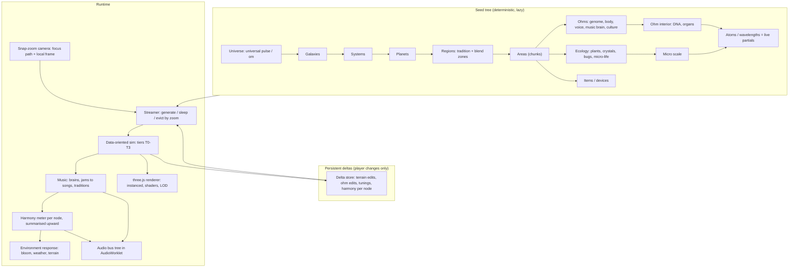
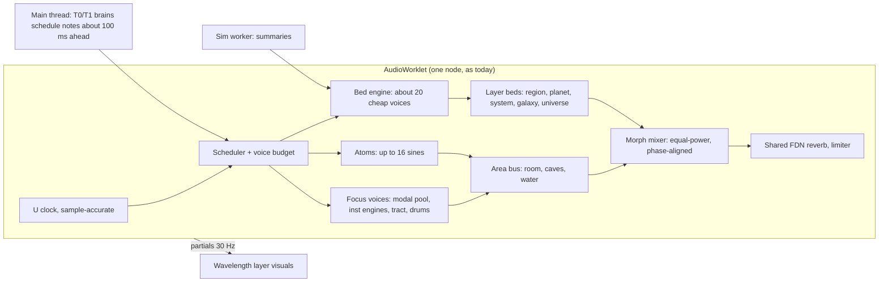

> **Build from /workspace/resonance2/SUMMARY.md first** (Wilbow's Current Summary). If this doc disagrees with the summary, the summary wins.

> **Correction (Wilbow, Oct 24 2026, 10:26 PM MDT): "Gnome was just voice chat mistaking ohm".** In the 9:24 PM lore call, "gnome" means "ohm": an ohm tells the origin story, and there is no gnome character. Read every "gnome" below as that storyteller ohm.

# NEW_ENGINE.md: The Journey Ohm, a new procedural engine (scoping only)

Status: **design reference and build plan** for The Journey Ohm. Written 10:07–10:30 PM MDT Sat Oct 24 2026 from Wilbow's 9:52–10:07 PM messages; the build is under way in /workspace/resonance2 (see §12 and the restored build list §12.1).

Where this came from:
- It started as "why isn't three.js the main renderer?"
- Then came "it needs to run well always", "many ohms is always the main goal", "terrain deformation and a dynamic environment", "scalable instead of clicking between views", "snapping into ohms … down to atoms and wavelengths … rethink the sound engines", and "the goal of the game is to bring harmony back".
- At 10:07 PM: *"complex procedurally generation engine are what i want built not a bunch of patches … we're abandoning the product for something better."*
- The three.js and migration analysis is therefore folded in here as the renderer section (§9). There is no separate THREE_MIGRATION.md.

**Priority order**, used for every tradeoff in this doc:
1. **Scale**: many ohms and many elements.
2. **Always runs well** on a mid-range Android.
3. **Beauty**, within that budget.

---

## 0. Design philosophy: the om

*The Journey Ohm* is a play on "journey home". The om is treated here as inspiration, not as a religious depiction: no sacred symbols are drawn as UI, no scripture, no deities. The idea used is the widely shared one, that the om is the primordial sound everything vibrates from.

- **One vibration, all scales.**
  - The engine has a single root clock, the **universal pulse**, and every layer is a slower or faster harmonic of it.
  - Galaxies breathe over many bars. Planets turn over a few bars. Ohms play beats. Atoms and wavelengths are the audio-rate partials themselves.
  - Zooming in or out never changes the pulse. It only changes which octave of it you are hearing and seeing.
- **The journey home**, one possible reading (ours, not his): the world's music coming back together (§6.4). His "The goal of the game is to bring harmony back" (10:02 PM) is lore, spiritual and musical at once (11:49 PM: "Its a lore idea and spiritual term that also is a musical term youre going to have to use some inference"), so this covers only the musical side.
  - At the start the world is out of tune: the echoes of the first spark have drifted apart (DECISIONS 9:24 PM lore: one spark, many echoes).
  - Each re-tuned layer blooms and passes its harmony upward. The ending is the whole universe resolving into the one pulse.
- **A-U-M plus silence (optional mapping, decision 279).** In the traditional reading, A, U and M stand for waking, dreaming and deep sleep, and the silence after them is the fourth state.

  | Sound | State | Zoom layers | Journey arc | What it sounds like |
  |---|---|---|---|---|
  | **A** | waking, the manifest | planet surface, areas, ohms, devices | the early journey: you fix what is in front of you | the most *voices* |
  | **U** | dreaming, the subtle | ohm interior/DNA, bugs and micro-life, the DAW/song "mind" of a jam | mid journey: you shape what's inside | intimate, filtered |
  | **M** | deep sleep, the vast and undivided | system, galaxy, universe: everything is one drone | late journey: you tune planets and galaxies | one *drone* |
  | **Silence** | the fourth state | the pause between pulses, the "new universe" threshold beyond the outermost detent, and the ending | the end, when everything is one sound | silence |

  It is purely optional flavour. It can shape colour temperature, reverb size and how many voices are audible at each depth, but no rule depends on it.

## 1. A possible core loop: re-tuning (PROPOSAL)

This is one musical take on his "bring harmony back" (10:02 PM). He said it is lore, spiritual and musical at once (11:49 PM); it is not the one goal everything here is built around.

- Every layer can be **out of tune or chaotic**: an ohm that clashes, a jam fighting itself, devices wired wrong, items with bad settings, a region in the wrong tradition, a planet whose regions disagree, a galaxy of discordant planets.
- **Re-tuning a layer makes it bloom**: terrain softens and greens, plants and crystals grow, the weather clears, the sky gains colour, the music bed turns consonant.
- **Restored harmony flows upward.** An area heals, then its region, then the planet, then the galaxy.
- **Puzzles are generated** (chaos knots, §4.6), never hand-placed, and solvable by construction.
- The old game's concepts all feed this loop:
  - teaching, jams, songs, traditions, clay and DNA, items, the guide, the DAW and painting become **tools for tuning**;
  - breeding and collecting (catch, ark, home zone, longings) become **how you carry harmony between places**.

## 2. What we measured in today's engine (lessons, not a migration)

Method: headless Chromium, 412x860 CSS px, dpr 2, starting from the app's own adaptive DPR, with `?fixed=1` and on-screen ohms ramped in steps. The box load was about 7 on 8 cores, so absolute numbers are pessimistic. Ratios are what matter.

The scripts and raw JSON are in `/workspace/softsound_logs/three_scope/`: probe.js, simprobe.js, cpuprof.js, glproto.html, glrun.js and dspbench.js.

**On-screen ohm ramp** (record mode: JS time of the draw calls, raster not included):

| On-screen ohms | fps | Adaptive dpr | Sim (Sf.step) mean / p95 ms | Render JS mean / p95 ms |
|---|---|---|---|---|
| 6 | 60 | 2 | 1.3 / 2.5 | 1.3 / 2.1 |
| 16 | 48.5 | 2 | 3.6 / 5.6 | 1.9 / 2.7 |
| 26 | 41.7 | 1.75 | 7.0 / 8.8 | 2.3 / 2.9 |
| 46 | 28.5 | 1 (lowQ) | 16.2 / 22.5 | 4.2 / 6.1 |
| 76 | 14.5 | 1 (lowQ) | 37.4 / 63.8 | 8.5 / 11.2 |
| 106 | 10 | 1 (lowQ) | 56.8 / 77 | 11.3 / 16.7 |

- **Raster (flush mode, 36 ohms, dpr 1):** the surface layer costs 14.5 ms with its pixels flushed, against 2.9 ms of JS. That is about 11.6 ms of pure Canvas2D rasterisation even at dpr 1. The 2D canvas is a real second wall, behind the simulation.
- **Where the sim time goes**, at 76 ohms (4,367 particles, 404 bodies):
  - physics `W.step` 10.3 ms;
  - minds 1.2 ms;
  - light rays 0.8 ms;
  - jams 0.4 ms;
  - about 19 ms inline per-ohm work.
  - A CPU profile at 55 ohms shows the separation scan `sepScan` at 14% of samples (it allocates Sets per call), the physics solver and collide at about 11%, and ohm `think` and `forces` at about 2%.
- **Conclusion:** the wall is CPU simulation of full soft bodies for every visible ohm, then Canvas2D raster. Music brains are cheap. **The new engine must not simulate every ohm as a full soft body.** This is the single most important design input (§8).
- **Audio thread:** today's modal voice pool (32 voices x 8 modes, FDN reverb, limiter), benchmarked offline in node:
  - 0.15 ms per 128-sample block at full load, which is 5.6% of the real-time budget on this box;
  - estimated 25–35% on a mid-range phone.
  - The articulatory tract voices (tract.js, 4 pooled) are heavier per voice.
  - Audio has headroom. Its limit is the voice pool design, not raw DSP.
- **WebGL probe:** SwiftShader, which is a CPU rasteriser, so only the shape of the curve is meaningful:
  - instanced additive glow sprites stay at **2 draw calls from 100 to 2,000 instances**;
  - uploading the full 2D canvas as a texture every frame added about 14 ms at dpr 1 and 60 ms at dpr 2.
  - **Lesson: never round-trip a full-screen 2D canvas each frame.** Draw natively in WebGL from the start, which is what a new engine does anyway.
- **Bundle:**
  - a tree-shaken three.js (renderer, ortho camera, ShaderMaterial, instancing) is 134 KB gzipped (534 KB minified); the full build is 191 KB gzipped.
  - The APK is 3.96 MB today, so that adds about 3–5%.
- **Today's practical limit:** about 20–25 on-screen ohms hold 60 fps on this box. On a mid-range phone, assuming a CPU 2–3x slower (an *estimate*, to be confirmed by the on-device probe in V0), that is roughly **10–15 on-screen ohms at a steady 60 fps**. The 0.8b10 perf_j baseline (node, sim only, a 35-ohm busy world) is 6.7/7.8 ms mean and 8.5/9.3 ms p95.

## 3. Engine overview and system map

What the old structures become (the "structures getting confused" fix):

- **World / planet / region / area**
  - Old: one circular planet with a 1D heightfield, chunks for saving only, a regional-key lean.
  - New: a **tree of nodes**. Every node has a seed, a generator, a harmony value, an audio bus and a tier.
- **Ohms**
  - Old: soft body, mind, genome, voice, all always simulated in full.
  - New: the same concepts, simulated at **four tiers** (§8).
- **Jam vs song**
  - Both are states of an **area-level ensemble node** (jam = loose vamp; song = form, hook, ending), as approved at 9:18 PM.
- **Items / devices**
  - Entities with typed ports. Wiring is a small graph with a harmony contribution.
  - "Wired wrong" is a measurable state.
- **Guide / helper**
  - An ohm-like agent with its own node. The "what is this / why" helper reads the same node tree and why-log.
- **DAW and jam view**
  - **Lenses** on an area's ensemble node, shown at the area depth (§7). They are not separate screens.
- **Auras and renderer layers**
  - The visual expression of node state: harmony, role, teacher, mood. Drawn as GPU shaders.

## 4. The core: a layered procedural generation engine

### 4.1 Principles

1. **Everything comes from seeds in one nested hierarchy.**
   - `seed(child) = hash(seed(parent), childKind, childIndex)`, using a stable 64-bit hash (for example xxhash/splitmix carried in two uint32 values).
   - There is no global RNG stream, so generating a node never depends on the order things were visited in.
2. **Deterministic.** The same seed and the same engine version give the same world, bit for bit.
   - The generators are versioned.
   - A save records the generator version of every node it touched, so a future generator change cannot silently reshape a planet the player has already seen.
3. **Lazy and streamed by zoom.**
   - A node exists only as `(seed, summary)` until the camera's focus path comes near it.
   - Detail is generated on demand in a **worker**, then cached, then evicted.
   - Nothing exists in detail until it is observed.
4. **Persistent deltas only.** Saves hold the player's changes and nothing else:
   - terrain edits;
   - spawned, bred or edited ohms;
   - tunings and wirings;
   - harmony values per node.

   A fully explored planet whose player changed nothing costs a few bytes.
5. **Rules and grammars, not hand-placed content.** Every generator is a small grammar or rule set fed by its parent's summary: tradition, climate, harmony, star type. That is what makes layers modulate each other (§6.3).

### 4.2 Node kinds and their generators

| Layer | Generated from | Produces (summary kept always / detail on observe) | Grammar or rules |
|---|---|---|---|
| Universe | Root seed | pulse tempo and phase, key centre "om", galaxy count and shape | Physical constants of the music: pulse ratio table, tuning family weights |
| Galaxy | Universe summary | Spiral or elliptic structure, star density, tradition "climate", harmony | Spiral-arm density waves; tradition climate is a smooth field across the galaxy |
| System | Galaxy field at its position | Star type (sets groove, palette, light), planets and orbits locked to rhythmic periods (already a concept: orbits snap to rhythm) | Star-to-groove table, orbital resonance grammar |
| Planet | System and star | Size, type (rocky, giant, gas, moon), **region graph** (Voronoi on the sphere seen as a circle, or on 2.5D strips; decision 281), tradition per region and blend zones, biome fields, base terrain spectrum | Region grammar: tradition adjacency rules; biomes are continuous blended fields (R6.6) |
| Region | Planet | Tradition rules (scale, cycle, form, ornament), wild ohm lineages, device styles, chaos-knot budget | Tradition = generative music grammar (§6.1) |
| Area (chunk) | Region | Terrain chunk, ecology spawn table, ohm groups already mid-song (8:55 PM approval), items and devices, chaos knots | Spawn grammars weighted by harmony and biome |
| Ecology | Area | Plants and crystals (phi/Fibonacci growth from nearby music, R6.7), bugs and micro-life that eat, pollinate and echo sound | L-systems driven by audio features; bug behaviour rules |
| Ohm | Area or player stroke | Genome → body plan, material, voice (synth engine mix), music brain, culture, abilities, senses | Genome expression (concepts from genome.js: about 240 genes, mutation 0, epigenetic learning) |
| Ohm interior | Ohm | DNA helix, organs or resonators (the actual modal modes) | Directly the genome |
| Micro | Area ground or air | Spores, grains, tiny bugs | Cellular or reaction-diffusion |
| Wavelengths | Live audio | Partials, standing waves, phase on the pulse | **Not generated**: it is the real synthesis state, visualised (§10.6) |

### 4.3 Streaming and lifetimes

- The camera keeps a **focus path**, for example `universe › galaxy 3 › system 41 › planet 2 › region 7 › area 1203 › ohm 88`.
- Nodes are kept at a tier by graph distance from that path:
  - **live**: on the path and its children in view;
  - **near**: siblings, summarised;
  - **far**: seed plus summary only.
- **Generation budget:** at most 2 ms of main-thread time per frame to integrate results. The heavy generation runs in 1–2 workers.
- Results come back as transferable typed arrays: terrain chunk heights, instance buffers, genome blocks.
- **Prefetch** follows the zoom direction (§7): the streamer already generates what is under the fingers while the pinch is still moving.

### 4.4 The delta store

- **Key** = node path hash. **Value** = a typed component list, reusing the design already proven in persist.js: versioned components, migrations, and unknown components kept verbatim.
- **Terrain edits:** low-resolution height deltas per chunk, as int8 at 1/4 of the render resolution and RLE/zlib compressed. A dented area is about 0.2–1 KB.
- **Ohms:** genome bytes, learned or epigenetic layer, position, relations.
- **Harmony:** one float16 per node the player has touched or that has changed.
- **Off-screen time passes.** On return, a node fast-forwards from its summary state (plants grown, songs moved on), as `persist.js` and songsave do today.

### 4.5 Generator tooling (for building fast)

- Each generator is a pure function `(seed, parentSummary, version) → summary | detail`.
- Each one gets a **headless node test**: determinism, distribution checks and "guaranteed solvable".
- Each one gets a **seed gallery** dev page that renders 50 seeds, so a human or I can judge variety.
- A dev-mode "seed inspector" overlay shows the node path, tier and harmony. It may use text in dev mode only (9:45 and 9:47 PM rule).

### 4.6 Chaos knots: generated tuning puzzles (from the 9:24 PM lore; still direction; which faults come first and whether they appear on their own is q269)

> **On hold (Wilbow 2:44 AM Oct 25: "The original story is causing freeze its lore. The stick").** Anything here that comes from the origin story (the storyteller ohm at the knots, the strike, echoes) is lore only and on hold. Whether the tuning-puzzle direction itself stands ("This also translates into the gameplay") is an open question for Wilbow, not decided.

- **Construction:** generate the **solved** state first: a harmonious device chain, a jam, a region's tradition fit. Then apply *k* inverse perturbations: miswire a port, detune an item, swap a role, put clashing ohms together, turn a knob the wrong way. That makes it solvable by construction, the same idea as V08_SPEC N9 "guaranteed possible in this seed".
- **Difficulty** = *k* and the kinds of perturbation. It is shown without text by how loud and how visually fractured the knot is.
- **The gnome or guide** tells the origin story wordlessly (one spark, a stick on a rock) at the first knot. A later knot recalls it.

## 5. Planet: deformable terrain, biomes, regions, dynamic environment

- **Terrain representation (decision 281).**
  - **Recommended for the slice:** a **2.5D planet**. The ground is a ring of height per angle, as today but chunked and much larger, with a depth axis for parallax layers and for the zoom-to-micro.
  - It renders as a GPU mesh strip per chunk (vertex shader displacement from a height texture), with background and foreground layers.
  - The physics stays 2D, which keeps the many-ohm budget.
  - Full 3D spherical terrain is possible later. It multiplies the collision and camera work and is not needed for "zoom planet → ohm → wavelength".
- **Deformation.**
  - Ohms, songs and the player can dent, raise, ripple, grow or carve.
  - Each edit writes a height-delta brush into the chunk's delta texture. The GPU updates instantly; the CPU collision copy updates the touched samples only.
  - **Songs** can sculpt slowly: a settled song raises a soft hill or terraces in its rhythm, and crystals grow on harmonic nodes.
  - **Off-screen**, the chunks hold only their compact delta.
- **Biomes** are continuous blended fields (R6.6), not themes. Fields respond to music (#17) and now also to **harmony**.
- **Regions and traditions**
  - Each region carries one tradition (8:55 PM: one tradition per planet for now, regions later, per 8:56 PM). **Blend zones** are where two traditions' grammars interpolate.
  - Regional keys (R3.17) come free: region → key centre, with the light-influence rule (R3.25).
- **Dynamic environment** (GPU-driven, LOD by tier):
  - weather and wind as a low-resolution flow field texture (64x64), which particles and plants read in their shaders;
  - day/night from planet rotation, on the planet's pulse harmonic;
  - water as height-field pools on the GPU, which concept-carries R6.10's "lightweight, no particles" rule;
  - plants and crystals as instanced meshes with vertex sway and music-reactive growth uniforms.
  - **Harmony drives it all:**
    - low harmony gives grey, dusty, gusty, cracked ground, sparse plants and a dim sky;
    - restored harmony gives colour, still air, blooming plants, clear water and glowing crystals.

## 6. Music generation as a first-class procedural system

**Built on `SCALE_MUSIC.md`** (Music Theory bot, proposal; its decisions are questions **258–276**, not repeated here). This section only says how the new engine *hosts* it. Today's concepts carry over:
- no central composer;
- per-ohm minds with a functional-harmony belief built from what each ohm hears (harmony.js);
- consensus frames (cohere.js);
- the jam → song stages (jamsong, approved 9:18 PM);
- traditions with real rules (trad.js, TRADITION_REFERENCE);
- song records (songsave);
- teaching, experience and the teacher aura;
- DAW painting that dictates what an ohm plays.

### 6.1 One heartbeat, layers as groupings (SCALE_MUSIC §1)

- **The universal clock U.** About **60 BPM** (q258), with phase zero at the first stick-on-rock strike. This *is* the om pulse of §0.
- **Every layer's unit is a whole-number grouping or split of U.** Atoms run at audio rate, bugs on subdivisions, ohms on steps and beats, jams on cycles, regions on sections, the planet on its day, the system on cycle meetings, the galaxy on a slow swell.
- **Planet tempos are simple ratios of U** (½, ⅔, ¾, 1, 4/3, 3/2, 2, 9/4, 8/3, 3; q259). Layers therefore meet on shared downbeats, so every zoom crossfade can land on a beat.
- **Accents are landings** (the gamelan/tala rule, §1.4): slower layers mark the *end* of faster cycles.
- **Engine requirement:** one sample-accurate clock that lives **in the AudioWorklet**, mirrored to the main thread and the workers as `(t0, bpm)`. Any layer clock is then one multiply. Cost: free.

### 6.2 Traditions as generative grammars

- Each tradition is data: tuning, scale/raga/maqam rules, cycle grammar, form grammar, ornaments, role templates, a hook grammar and an allowed tempo-ratio set.
- **The same grammar** is used to:
  1. generate wild groups already mid-song (8:55 PM);
  2. judge fit (check 6, mode match);
  3. build the region bed.
- **One tradition per planet now; regions with blend zones later** (SCALE_MUSIC §2.6, q276).
- Region keys (R3.17) fall out of the downward flow.

### 6.3 Key down as a suggestion, summaries up, smoothed (SCALE_MUSIC §2)

- **Down (weights, never orders; existing ohms are never retuned, per R3.25 and V08_SPEC §C):**
  - the universe sets F0 and U;
  - the galaxy sets its home harmonic;
  - the planet sets its tradition and a tonic that is a simple ratio of the galaxy root;
  - the region sets the mode and section chord;
  - the jam's frame moves with everyone playing in it: it can switch keys and hold many chords, with no leader.
- **Up:** a ~20-number summary record per jam, region, planet, system and galaxy (under 100 bytes): pitch-class histogram, tonic, mode, tempo ratio, energy, density, song stage, harmony.
  - Records are smoothed with time constants of about 2 min (region), 15 min (planet), 45 min (system) and 3 h (galaxy).
  - Changes are rate-limited and use hysteresis.
  - Tonic changes happen only at landings, as pivot modulations.
- **Engine requirement:** summaries are a **component on each seed-tree node** (§4) and are persisted in the delta store.
  - Off-screen nodes are updated by the generation/sim worker on SCALE_MUSIC §8's slow schedule: per song or per minute.
  - Upper nodes recompute only when a child changes. The cost grows with the number of nodes, not ohms.

### 6.4 Harmony per layer: the 8 checks (SCALE_MUSIC §6.3)

- **The eight checks:** pitch accuracy, beat rate, key clash, phase vs U, tempo ratio, mode match, roughness (judged against each tradition's own normal) and crowding.
- **Each check returns h = exp(−error/scale)**, and the jam value is a weighted mean of them.
- **Schedule:** they run **per bar for on-screen jams** and **per minute (or per song) off-screen**, all on cached note numbers, never on audio analysis.
- **Cost:** a few hundred operations per jam per bar. Roughness is on-screen only, using the top 6 partials of the top 4 voices.
- **Upward spread:** weighted means with the smoothing above. Values are rate-limited to +0.05 per landing and use a **ratchet**: milestones never un-bloom (q270).
- **"Fully restored"** means harmony ≥ 0.9 *and* phase-locked to U's great-cycle points.
- **What the engine adds for non-music sources** (§1), folded in as extra inputs to the same area value:
  - device chains: ports and settings inside the tradition's sweet range, effects locked to the grid (the 4:09 PM Oct 23 rule);
  - ecology health;
  - chaos-knot weight.
- **Seed baseline:** an untouched node starts from a generated baseline. Early worlds are mostly discordant, which is the journey home. The baseline curve is decision 285.

### 6.5 Milestones up to the om, and the world's response

- **SCALE_MUSIC §6.5 milestones:** first lock → area settles → area in harmony → planet resonance at 25, 50, 75 and 100% → system chord → galaxy swell → **the om** (§7.5, q268 and q271). All of them land on a landing.
- **The new engine binds each milestone to the visual and world response, from the same number:**
  - environment bloom: colour, plants, crystals, still air, clear water (§5);
  - terrain softening and slow song-sculpting;
  - aura brightness;
  - ecology spawn tables;
  - the next layer's challenges.
- **One number, many effects** keeps it cheap and readable. Healing an area visibly lifts the planet's colour when you zoom out. That is the "it flows up" moment.

## 7. One continuous world: the snap-zoom camera

### 7.1 Layers and detents

- **Layers, outermost first** (Wilbow's 10:00 PM list, aligned with SCALE_MUSIC §1.2):
  - universe → galaxy → system → planet → region → area → **ohm** → ohm interior/DNA → atoms/wavelengths;
  - a sibling branch area → **micro-life (bugs)** → atoms/wavelengths.
- **Directional zoom picks the branch.** Pinching toward an ohm goes into the ohm. Pinching toward ground or air goes into micro-life. Both end at wavelengths (decision 291).
- **Directional zoom.** The zoom target is whatever is under the pinch centroid, or what the camera faces when there is no centroid (system and galaxy).
  - The camera eases the target toward the screen centre while zooming, with a magnet strength of about 30% per zoom octave, so you "fall into" what you're reaching for.
- **Soft snap layers (magnetic detents).**
  - Each layer has a preferred zoom band. When the fingers lift, the zoom settles into the nearest band over about 250 ms, using a critically damped spring.
  - Crossing from one layer into the next needs pushing through a **membrane**: a band of about ±15% hysteresis in log-zoom that resists slightly, shown as a soft veil or ripple and heard as the SCALE_MUSIC §3.3 phase-aligned morph.
  - The feel is the same at every scale.
- **Clear transitions.** Each membrane crossing:
  - changes the light (key light, fog colour);
  - changes the reverb size;
  - plays one landing accent on the next beat of the layer being entered.
  - There are no screen swaps and no iris cut.
- **Precision:**
  - **nested coordinate frames.** Each node has a local frame, and the camera stores `(focus node path, local position as float64, log-zoom)`.
  - **Floating origin:** the renderer draws everything relative to the focus node, so float32 on the GPU never loses precision, from a galaxy down to a partial.
- **Cost:** only the focus node, its children in view and the parent's summary are live (§4.3). Unseen detail costs nothing.

### 7.2 Existing gestures mapped (GESTURES.md §1 and §2)

| Today | In the continuous world | Conflict and resolution |
|---|---|---|
| Pinch on empty world zooms about the centre. Past .013 goes to the **system** view; past 4.2 near an ohm enters **DNA** | Pinch = directional zoom through detents: area → planet → system outward; area → ohm → interior inward | The fixed thresholds become membranes; nothing jumps |
| Pinch on an instrument body = tension; spread > 1.65 pops it on or off the grid | Unchanged. A pinch that **starts on** a body edits it and never zooms | Same hit test (start point decides) |
| Pinch on an ohm = squeeze (sings) | Unchanged | Same |
| **Spread > 1.8 on an ohm (zoom > 1.6) enters DNA** | **Removed** (decision 287). DNA = push through the ohm's membrane | Fixes **C15** (accidental DNA). It frees the register spread (1.18–1.75) from its neighbour |
| Pinch on the inspected ohm (zoom 1.8–4.2) = register | The ohm detent band *is* inspect. Register is unchanged | Register is read only while settled in the band, not mid-membrane |
| DNA: pinch-in < .55 exits | Pinch out back through the membrane | Same feel, continuous |
| Drag at zoom < .35 pans | One-finger drag **pans** in space layers (planet outward). At area and ohm depth it **draws** (ink, material, glyphs) as today. Two-finger drag pans at every depth (decision 289) | Removes the hidden .35 rule. A drawing finger never pans by surprise |
| Two-finger twist opens the DAW river | Still opens the DAW river **in place** as a lens over the area. Optionally, zooming into a jam's centre at area depth also opens it (decision 290) | C13 twist-vs-zoom: zoom freezes once rotation > .3 rad (already proposed) |
| System: double tap a body enters the surface | Becomes a "fly to": an animated directional zoom through the membranes | Same intent, no cut |
| System: pinch deep enters a world; pinch out goes to the galaxy | Native | — |
| Galaxy: double tap enters a system, or flies home on empty space | Fly-to / fly-home | — |
| **Galaxy: pinch out at minimum zoom = NEW UNIVERSE** | Beyond the universe detent, a **held** pinch-out of ≥ 1 s builds a visible warp. Releasing early cancels (decision 288) | Fixes **C17** (destructive and easy to trigger) |
| Play mode (tap then hold), mouth (double-tap the mouth), inspect, device focus | Each is a settled detent plus a lens on the focused ohm or device. Device focus gets the approved partial 3D for free (§9) | — |
| '?' hook then a point calls the guide; in space the camera eases back | Same gesture; the guide flies along the camera path | — |
| Taps, holds, strokes, glyphs, teach lines, catch, delete, undo/redo (3 and 4 finger), conducting, DAW editing | **Unchanged.** Hit tests are geometric (body radius, model-based DAW hits), not pixel picking, so they port 1:1 | §1 rows marked CARRY in Appendix A5 |

**Effort:**
- camera, detents and membranes, floating origin: 6–9 builder-days;
- re-hosting every gesture and the GESTURES.md §13-style conflict check: 4–6 days, inside V3.

## 8. Simulation runtime: many ohms (priority #1)

- **Data-oriented, ECS-style.** Components live in typed-array columns: position, velocity, tier, genome ref, music state, aura state. Systems iterate the columns. There are no per-ohm objects in hot loops, and no Set or closure allocation per frame (the measured `sepScan` problem).
- **Four simulation tiers.** A tier is picked by distance to the focus path and by screen size.

| Tier | Who | Body | Brain | Typical cap | Cost target |
|---|---|---|---|---|---|
| T0 full | The focused ohm, its jam, anyone touched or dragged | Soft body (Verlet springs, the concept from physics.js), collisions | Full mind per bar, every check | ≤ 24 | ≤ 0.12 ms each |
| T1 puppet | Other on-screen ohms | **Skeletal puppet**: a few bones moved kinematically on the terrain, with GPU vertex wobble that *looks* soft. Promoted to T0 instantly when touched | Mind per bar, simplified checks | ≤ 300 | ≤ 0.01 ms each |
| T2 summary | Ohms in nearby areas, off-screen | None (an anchor point) | A jam-level summary record per minute | ≤ 5,000 | ≈ 0 per frame |
| T3 statistical | Everything else | None | Area counts plus the generated baseline | Unbounded | 0 |

- **Sleep:** an ohm that is still and not playing a new phrase sleeps, so its physics is skipped. This is today's "stay home" rule turned into a performance feature.
- **Workers.**
  - Generation runs in 1–2 workers.
  - T2 and T3 summary updates and harmony propagation run in a worker.
  - The T0 and T1 sim stays on the main thread for the slice; it can move to a worker later.
  - SharedArrayBuffer needs cross-origin isolation inside the Capacitor WebView; that is unverified, so the fallback is transferable buffers.
- **CPU limits WebGL does not fix:**
  - music brains (cheap: 1.2 ms at 76 ohms today);
  - the audio voice count (§10);
  - jam logic;
  - the physics of T0.
  - These are the reason for the tiers.
- **Measured scale targets** (the gate, on the reference phone; decision 283):
  - **Vertical slice:** 300 ohms on one planet, 120 on screen (24 T0 + 96 T1), with plants, bugs and particles. 60 fps, main-thread sim ≤ 5 ms and render submit ≤ 4 ms, p95 frame ≤ 16.6 ms, no frame > 33 ms in a 5-minute run.
  - **Grown engine:** 2,000 ohms per planet, 300 on screen, distant ohms as up to 10,000 glowing points. Same gate.
  - Today, for comparison: about 20–25 on-screen ohms at 60 fps on the box; estimated 10–15 on a mid-range phone.

## 9. Renderer: three.js / WebGL2

- **Ortho 2.5D scene.** There is one renderer and no Canvas2D in the main path. The UI is drawn ink in the same scene (the no-text rule for release).
  - **Instanced quads and shaders for everything numerous:** T1 ohm bodies (an SDF/metaball shader per body plan, one draw call per body plan), auras, glow, particles, plants, bugs.
  - **Meshes for terrain chunks** (height texture plus vertex displacement) and water.
  - Distant ohms are glowing point sprites.
- **What old systems become (concept map):**
  - field/terrain → terrain chunk mesh plus biome shader;
  - sky/symbols → gradient sky shader and constellation sprites;
  - body.js, mouths, claylook → SDF body shader (fresnel rim, subsurface warmth, catchlights, per ART_DIRECTION);
  - aura.js (9 offscreen caches today) → one instanced aura pass with a per-ohm uniform block;
  - FX → GPU particles;
  - DAW river, dawpaint and jam view → instanced bead and stroke meshes in a lens layer;
  - guide → an ohm;
  - items/devices → instanced meshes;
  - glyph ink → a ribbon mesh;
  - galaxy and system → point clouds plus shaders on the same camera.
- **Beauty unlocks (priority #3, every one on the quality ladder):**
  - bloom and soft glow;
  - fresnel and subsurface light on ohms;
  - flowing shader backgrounds;
  - depth of field on the focus layer;
  - volumetric aura light (screen-space god-rays from the key light);
  - refractive bubbles and glass (the fourth-wall moments, approved 9:35 and 9:51 PM, native here);
  - gradient skies;
  - GPU particle fields;
  - partial 3D in device focus.
- **Quality ladder.** It is driven by the **measured GPU and CPU frame time**, an EMA of `performance.now()` deltas plus `EXT_disjoint_timer_query` where available. Steps, in order:
  1. DPR cap 2 → 1.5;
  2. bloom half-resolution, then off;
  3. depth of field off;
  4. particles −50%;
  5. simpler body shader (no subsurface);
  6. T1 cap 96 → 48;
  7. DPR 1 → 0.75 (dynamic resolution).

  It steps down after 1 s over budget and steps up after 5 s under it, never more than one step per second, so there is no visible pumping.
- **Thermal and battery.**
  - Sustained mode targets 60 fps with 25% headroom.
  - When the frame-time trend creeps up over minutes (throttling), the ladder steps down early.
  - A low-battery or battery-saver signal (Capacitor Device plugin) caps the ladder at step 2.
  - When the app is hidden, the render loop stops and audio beds drop to a single drone or pause.
- **WebGL context loss.**
  - All GPU resources are re-creatable from the CPU state: instance buffers are regenerated and textures re-baked from seeds.
  - On `webglcontextlost` the sim and audio keep running and a soft veil shows. On restore, a rebuild in ≤ 500 ms is the gate.
  - This is tested with `WEBGL_lose_context` in Playwright.
- **Fallback.**
  - WebGL2 is required. WebGL1 is an emergency path with fewer effects.
  - For devices with no WebGL at all, the options are a decision (294): require WebGL2 (~all Android 8+ WebViews) or keep a tiny "lite" mode.
- **Older GPUs:**
  - no float render targets → bloom off;
  - Mali/Adreno precision issues → floating origin keeps coordinates small;
  - texture memory budget ≤ 96 MB, with an LRU on baked atlases (ART_DIRECTION's 24 MB cache rule applies to CPU-side bakes).
- **APK size:** three.js adds ~134–191 KB gzipped. Assets are procedural, so the APK should stay under 6 MB.

## 10. Audio architecture (built on SCALE_MUSIC §3, §5 and §8)

### 10.1 Shape: a bus tree that mirrors the seed tree

- **Focus layer in full** means only the focus jam's and the focused ohm's voices are synthesised.
  - This uses today's proven DSP concepts: a 32-voice modal pool with 8 modes each, gene-built instrument engines (inst.js), pooled articulatory tract voices (tract.js, after Pink Trombone, MIT), drums, effect-item inserts, and the shared FDN reverb and limiter.
- **Everything farther away is a bed.** A fixed pool of **about 20 bed voices** in total plays SCALE_MUSIC §3.1's beds from summary records. It does not grow with world size.
  - At most 2 bed layers are loud at once. Beds are frequency-slotted around the band where the nearby jam is busiest (it moves with the music) and duck between phrases.
- **Zoom morph.** Pictures move at once. Sound morphs at the next landing of the layer being entered: a beat for a jam, a bar for a region, a phrase for a planet. The filter opens, the chord splits into instruments and the crossfade is equal-power (SCALE_MUSIC §3.3).
  - The camera's membrane crossing (§7.1) is what triggers it.
- **Modulation routing between layers** follows the §6.3 down and up flows.
  - Tempo comes only from U ratios.
  - Key and mode arrive as suggestions.
  - Timbre: a tradition's colour tints the planet hum.
  - Energy: the summary energy drives bed swell and the environment.
- **Voice budget and priority** (worklet side). Priority = layer distance (focus first) × loudness × audibility in the current mix (how exposed the voice is right now, not a fixed role) × visibility.
  - Steal the quietest lowest-priority voice with a 5–20 ms fade, as today's pool does.
  - **Off-screen costs zero audio:** T2 and T3 ohms only produce summary numbers.
- **Universal pulse in the worklet.** U is one clock. The main thread receives `(t0, bpm)` and schedules notes ahead, as today.

### 10.2 Atoms and wavelengths layer

- This is the real synthesis state, visualised. The worklet already knows each modal voice's modes (frequency, decay, amplitude).
- At this depth it posts the top partials of the focused voice at about 30 Hz. The renderer draws standing waves, and the beats between near-partials shimmer.
- SCALE_MUSIC §4 rules apply: up to 16 sines, see and hear only, never retuning the ohm (q273, q274).

### 10.3 Where the old engine pieces go

| Old | New engine |
|---|---|
| audio.js modal pool, FDN reverb, limiter, data-URL worklet loading (WebView-safe) | Ported as the focus-voice core of the new worklet |
| inst.js gene-built engines | Ported. Engine choice stays a genome expression |
| tract.js vocal tract | Ported as is (pooled kernel; it already runs offline for tests) |
| drums.js | Ported, with drum timing on U subdivisions |
| harmony.js per-ohm belief | The T0/T1 brain module (main thread, per bar) |
| cohere.js and jam.js consensus | The area ensemble node's "jam" state |
| jamsong (v08-jamsong) jam → song | The area node's state machine; its score EMA and clash fixer feed the 8 checks |
| trad.js and TRADITION_REFERENCE | Tradition grammars (data) at planet and region level |
| songsave | Song record component in the delta store |
| listen.js mic worklet | Kept as a separate small worklet |
| ScriptProcessor fallback | Dropped (technical, not a feature; AudioWorklet is in all supported WebViews) |

### 10.4 Main thread vs worklet, and WASM

- **Measured:** the full modal pool at 32 voices costs 0.15 ms per 128-sample block, which is 5.6% of the budget on this box and an estimated 25–35% on a mid-range phone. Brains cost about 1.2 ms per frame at 76 ohms on the main thread. Beds and atoms add little: ~20 simple voices plus ≤ 16 sines.
- **Verdict:** **WASM is not needed for the slice.**
  - Plan a Rust or C → WASM (SIMD) DSP kernel as an option for V4 if on-device worklet load exceeds 50%, or if tract voices need raising above 4. Expect 1.5–3x and no GC jitter.
  - The JS DSP stays the reference implementation for tests.

## 11. Tech stack options (judged for many entities on Android, procedural tooling, DSP control, and how fast I can iterate from a shell)

| Option | Many-entity perf on Android | Procedural tooling | Audio DSP control | My iteration speed (shell, headless tests, APK builds) | Verdict |
|---|---|---|---|---|---|
| **Capacitor + TypeScript/JS + three.js (+ optional Rust/WASM kernels)** | Good for the GPU side with instancing. The CPU side is JS: needs data-oriented code and tiers, with WASM available for hot loops | Excellent (plain code, node tests, seed galleries in a browser) | **Full:** our own AudioWorklet DSP, already proven in the WebView | **Fastest:** the existing pipeline builds and signs an APK in minutes, node headless tests, Playwright, no editor | **Recommended** |
| Godot 4 (GDScript/C#, GDExtension C++) | Good: native, Vulkan/GLES3, MultiMesh instancing | Good (scenes plus code) | Custom DSP needs GDExtension C++ for real-time synthesis; GDScript generators are too slow for synthesis | Medium: headless CLI exports work, but scene files are clumsy to edit by shell and the Android export/toolchain is heavier | Strong second choice if JS CPU limits bite |
| Unity (DOTS/Burst) | Excellent for entities | Good | Native plugins or OnAudioFilterRead | Slow for me: editor-centric, licensing, large builds, poor headless iteration | Not recommended |
| Bevy (Rust) native or WASM in a WebView | Excellent ECS | Good | Excellent (Rust DSP) | Slow: long compile times, an Android path that is less mature, and a GPU stack (wgpu) that varies on old phones | Use **Rust as WASM kernels** inside option 1 instead |

**Honest tradeoffs of the recommendation:**
- JS will never match native for full soft-body physics on hundreds of bodies. That is why the tiers exist, and why a WASM physics kernel is kept in reserve.
- WebView GPU drivers vary.
- WebGPU in Android WebView would enable compute shaders and large particle and terrain simulation later. It is not required.
- I'd write the new engine in **TypeScript** (esbuild, sub-second builds) for safety at this size. That is an internal choice, not a player decision.

## 12. Build order: vertical slice first, then grow

- **Efforts** are focused builder-days for me, with tests, and assume the scope above. Calendar time depends on review and phone-testing rounds.
- **Every stage has a perf gate:** the PERF harness (headless) plus an **on-device frame-time probe** in dev mode. The probe logs mean, p95, worst and per-system ms over 5 minutes on the reference phone. **A stage cannot ship unless it meets the gate.**

| Stage | Contents | Effort | What you'll see | Perf gate |
|---|---|---|---|---|
| **V0 Skeleton** | TS + esbuild + Capacitor shell (new appId if decision 278 says so); three.js renderer; quality ladder; context-loss recovery; seed tree and hash; delta store; worker plumbing; PERF harness and device probe; U clock in the worklet | 5–7 | A pulsing gradient sky and a planet ring that breathes on the heartbeat | Empty scene ≤ 2 ms per frame on device; context loss recovers in ≤ 500 ms |
| **V1 Vertical slice** | One procedurally generated planet (chunked 2.5D terrain, deformable, biome fields, one tradition); ohms generated from genomes with T0/T1/T2 tiers and sleep; SDF bodies, auras and particles instanced; jams → songs with the 8 checks and harmony; area and planet bloom; snap zoom **planet → area → ohm → interior → wavelengths** with membranes and the audio morph; focus voices plus bed engine | 20–28 | A living planet of 300 ohms jamming toward harmony; healing an area makes it bloom; one continuous zoom from planet to partials | **300 ohms / 120 on screen at 60 fps, p95 ≤ 16.6 ms, no frame > 33 ms, worklet ≤ 50%** |
| **V2 Scale out** | Universe, galaxy and system layers; streaming between planets; region graph with blend-ready data; dynamic environment (weather, day/night, water, plants and crystals, bugs on subdivisions); harmony propagating to planet, system and galaxy; milestones | 15–20 | Fly from a galaxy to an ohm without a cut; restored areas tint the whole planet and the system chord | 2,000 ohms per planet with 300 on screen at 60 fps; streaming hitch ≤ 1 frame over 33 ms per minute |
| **V3 Hands: carried concepts, wave 1** | Spiral spawn and egg grammar, clay shaping and timbre stage, teach lines and demonstration, catch / ark / home zone / longings, delete and restore, undo/redo, glyphs, guide and '?' helper, play mode, mouth and voice, conducting, items and devices with ports, DNA editing; GESTURES re-check | 22–30 | Everything you know how to do, now in the new world | Same gate; gesture tests pass 1:1 |
| **V4 Music tools** | DAW river and painting, pattern lattice, jam view as lenses; song save; record and share; diag mode; optional WASM DSP | 15–20 | The DAW in place over a jam; painting notes that reshape the song | Lens open costs ≤ 2 ms |
| **V5 Journey and beauty** | Chaos knots, gnome origin story, journey arc to the om ending; bloom, depth of field, subsurface and refraction; fourth-wall moments; text-free hints | 12–18 | The world visibly heals layer by layer, the beautiful pass, the ending | Ladder keeps 60 fps; beauty only above step 0 |

- **Total:** about 90–125 builder-days.
- **The slice (V0 + V1) is about 25–35 days**, and it is the go/no-go point. If the scale gate fails on the device, we change tiers or move to WASM physics *before* carrying anything over.
- Everything is ordered by scale win first: tiers and instancing are in V1, before the carried features in V3.

### 12.1 Build list: features Wilbow discussed, restored Oct 25 (things to build)

Restored on his 10:34 AM Oct 25 words: "go back to the plan where you build from what we've discussed thoroughly roll back recent cuts". These are build items, not options. The detail lives in /workspace/resonance2 PLAN_SYSTEMS.md, PLAN_INSTRUMENTS.md, PLAN_REAL_PLANET.md and PLAN_SOUND_PLAYGROUND.md.

1. **DAW river**: paint notes into the river, organic notes, the jam view and a brain view of what an ohm knows (V4).
2. **Songs separate from jams**: a jam works toward a song; songs are saved to a song library; the world reacts to songs differently; your own songs can become traditions.
3. **The "?" helper** you can ask what something is (V3).
4. **Keep everything on exit**: the world, the music and the song you were in carry on when you come back; time passes while away.
5. **Spiral makes a quick random ohm**, plus drawn gestures and shapes (glyphs) as input.
6. **Undo / redo**: 3-finger tap undo, 4-finger tap redo.
7. **Old features picked at 3:35 AM: B drummer ohms and drum kits, C calling and herding (built), E effects as objects in the world, F drawn instruments.** He said "Return later" at 3:40 AM; SUMMARY.md lists B, E and F as on hold, so they are queued next, not dropped.
8. **Instruments**: an ohm's own tone from its genes, plus instruments it learns or picks up, sounds it learns, the player assigning or sculpting its sound, a role that grows from what it plays, and carried items that modulate its sound noticeably and predictably.
9. **Many scales and traditions** from many real cultures, one tradition per planet for now with regions blending; cultures add variance and never limit.
10. **Sampling and granular from recordings** (his voice and world sound), ohms listening to samples and chopping and reusing them in their own style.
11. **Mouth control and recording** your voice into a jam; singing to an ohm.
12. **Harmony as currency**, and discord on a planet holding back the next scale up.
13. **Music visuals and auras**: earned visuals, experience glow, interplay, trippy organic look.
14. **Walk in an ohm's shoes**, fusions and colonies, plants growing from nearby music.
15. **Galaxies**: planets modulate their galaxy, and systems can be played as instruments.
16. **The om at low C, 64 Hz, matched to the heartbeat** (his 10:40 PM Oct 24 card pick). The engine switch turned off as "lore" (resonance2 bf05712) should default on.
17. **Realism on**: rivers and erosion, snow, shadows, real light where the budget allows.
18. **The full sound suite** from SUMMARY.md: arranging (sequencer, looper, song structure, swing, polyrhythm, automation), harmony tools (scales, tunings, chords, arpeggiator), mixing and 3D space, recipes as breedable seeds, resampling, export as audio, stems or MIDI.
19. **Settled songs become loops**, live again the moment you play, sing to or encourage them; same at every scale.
20. **Physical ohm controls** (for example squish, stretch, flick) and soft bodies used strategically.
21. **Knowledge passes through teaching and offspring**; each ohm's version of a traditional song drifts with its environment and abilities, and drift causes discord.
22. **Scale spaces** including molecules and cells below the ohms.

## 13. Tests and tooling

- **Logic stays headless in node.** That covers generators (determinism and distribution), tradition grammars, the 8 checks, summaries and smoothing, the delta-store round trip, tier promotion and demotion, and the voice budget (offline DSP render as today).
- **Rendering tests run in Playwright with SwiftShader:** a smoke render, context-loss recovery, ladder stepping and frame-budget regressions. SwiftShader is a CPU rasteriser, so these test correctness and shape, not phone speed.
- **Gesture tests:** CDP touch helpers (tap, twist, pinch) carry over from tests/pw_app.js.
- **Seed galleries** and the dev seed inspector (text allowed in dev mode).
- **No screenshots or recordings** are delivered or analysed (R9.4). Visual checks are numeric (pixel stats), as today.

## 14. Risks

1. **Scale gate on real phones.** JS physics and brains at 120 on screen is plausible only with tiers. The mitigations are a T1 cap on the ladder and WASM physics. The slice exists to find this out early.
2. **Feel regressions.** Soft bodies become puppets at T1. Ohms must still *feel* physical: they are promoted on touch, and the GPU wobble is tuned against T0.
3. **Losing approved concepts in a rewrite.** Appendix A is the checklist: every CARRY or REDESIGN row gets a test or a demo note before V3 is called done.
4. **Two products at once.** If Resonance keeps getting fixes, effort splits (decision 293).
5. **WebView variance:** GPU drivers, SharedArrayBuffer isolation, thermal behaviour. The device probe and the ladder cover it, but older Mali GPUs may sit at ladder step 3–4.
6. **Respect.** The om is used as inspiration (q272). Its visuals and title get a check from people within the traditions before release.

## 15. Decisions for Wilbow (new-engine; SCALE_MUSIC's are 258–276, not repeated)

277. **Start the new engine?** Build The Journey Ohm fresh, using Resonance only as a concept reference. The first milestone is the vertical slice (one planet, hundreds of ohms jamming toward harmony, one continuous zoom from planet to wavelengths), about 25–35 builder-days. Yes / no?
278. **Name and app.** Should The Journey Ohm be a **new app** (new appId, for example `com.lensure.journeyohm`, alongside Resonance) or eventually **replace** Resonance's app and listing? Nothing is renamed until you say.
279. **A-U-M layers.** Use the optional mapping as flavour: A = surface life (most voices), U = inner and micro layers (intimate), M = space layers (one drone), silence = the pulse gaps and the ending? Or don't map it?
280. **Tech.** Recommended: keep the web app shell (Capacitor) with three.js and our own audio engine, adding Rust/WASM pieces only where speed demands. The alternative is Godot. OK with the recommendation?
281. **Planet shape.** Recommended: **2.5D planets** (a ring of ground with depth layers, deformable, very large, with regions), which keeps hundreds of ohms smooth. Full 3D spheres could come later. OK?
282. **Slice scale target.** 300 ohms on one planet, 120 on screen, at a steady 60 fps on a mid-range phone. Is that the right first bar, or do you want higher?
283. **Reference phone.** Which phone is the performance gate? Yours, or a specific mid-range model?
284. **Far ohms look simpler.** Distant ohms become soft glowing points and simple shapes, and turn into full bodies as you zoom in. OK?
285. **Start out of tune.** New worlds start mostly discordant near you, with harder chaos farther out (the journey home). Or should the start be partly harmonious?
286. **Physics up close only.** Only ohms near your focus or that you touch are fully soft and squishy. Others move as lighter puppets that look the same at a glance and become soft the moment you touch them. OK?
287. **DNA by zooming only.** Remove "spread on an ohm enters DNA". You enter DNA by zooming through the ohm. This fixes accidental DNA (C15). OK?
288. **New universe by holding.** Pinch out past the universe and **hold for 1 second** while a warp builds; letting go early cancels. This fixes C17. OK?
289. **Drag rules.** One finger drags the view in space layers and draws on the ground and around ohms, as now. Two fingers always move the view. That replaces today's hidden "zoomed-out" pan rule. OK?
290. **DAW in place.** Keep the twist to open the DAW river over the jam. Should zooming into the centre of a jam also open it?
291. **Two ways down.** Zooming into an ohm goes to its DNA. Zooming into the ground or air goes to bugs and micro-life. Both reach the wavelengths at the bottom. OK?
292. **Your current world.** Should your existing ohms (their genomes) be imported into the new game, or should it start fresh?
293. **Resonance while building.** Keep shipping Resonance bug fixes (for example 0.8b11 voicestuck) and finish open branches, or freeze it except for crashes?
294. **Old phones.** Require WebGL2 (nearly every Android 8+ phone), or keep a very simple "lite" mode for phones without it?
295. **Automatic quality.** When the phone gets hot or busy, the game quietly lowers glow, particles and sharpness to keep running smoothly. OK?
296. **Concept check.** Appendix A lists every approved feature. All are kept (CARRY or REDESIGN), and only technical internals are dropped (the old 2D renderer and the ScriptProcessor audio fallback). Anything you want dropped or protected specially?

## 16. Recommendation (player terms)

- **Build it new, slice first.** Today's game was built screen by screen and every ohm is a full soft-body simulation. That is why it slows down past about 20 ohms on screen and why views click instead of flow.
- **The new engine starts from one heartbeat and one seed:**
  - the universe, galaxies, planets, regions and ohms grow out of rules;
  - only what you are looking at is detailed;
  - only what you are listening to is played in full, and everything else is a soft bed of its summary;
  - harmony is one number per layer that makes the world bloom.
- **The first playable piece** is one planet with hundreds of ohms jamming toward harmony and one smooth zoom from the planet down to the shimmering partials of a note. It tells us within about a month whether the "many ohms, always smooth" promise holds on your phone. Then everything you have approved is carried over on top, and nothing approved is lost.

## Appendix A. Concept inventory (generated from the source docs; nothing approved is dropped)

Dispositions: **CARRY** = same concept, new code. **REDESIGN** = same player promise, new mechanism (section given). **OPEN** = never approved, still a question. **ALREADY OUT** = rejected or superseded before today (listed so nothing is silently lost). **DROP** = none proposed; any drop needs Wilbow's OK (see decisions).

### A1. DECISIONS.md register (Resonance R1–R10)

| Id | Status | Item | New engine | Why / where |
|---|---|---|---|---|
| R1.2 | IMPL | Spiral = creature, genome seeded from the stroke. | CARRY | same player-facing concept, re-implemented on the new engine |
| R1.3 | IMPL | Mutation rate 0, no random culture drift; only player DNA edits (randomness at creation OK). | CARRY | same player-facing concept, re-implemented on the new engine |
| R1.4 | IMPL | DNA zoom below the body to genes; edit by slide/pluck/scramble/transfer; regrow. | REDESIGN | becomes a depth on the one snap-zoom camera (§7) |
| R1.5 | IMPL | Learned changes = epigenetic layer; offspring inherit learned changes as DNA (deterministic, not mutation). | CARRY | same player-facing concept, re-implemented on the new engine |
| R1.6 | IMPL | Inherited note data: scale-degree melodies, rhythm separate, crossover at phrase boundaries, seams on chord tones. | CARRY | now a core engine law: sim tiers + sleep (§8) |
| R1.7 | IMPL | Genome's main job = the instrument (timbre/texture/technique). | CARRY | same player-facing concept, re-implemented on the new engine |
| R1.8 | IMPL | More genetic control from how the spiral is drawn (pressure, wobble, tightness, speed trend, pauses = motif rhythm, height, shape). | CARRY | same player-facing concept, re-implemented on the new engine |
| R1.9 | IMPL | Clay shaping window with feedback from the newborn. | CARRY | same player-facing concept, re-implemented on the new engine |
| R1.10 | IMPL | Plain spiral = quick randomised ohm, slightly fitted to its birthplace (birthplace lean) ('the plain spiral should generate a quick randomized ohm… | CARRY | same player-facing concept, re-implemented on the new engine |
| R1.11 | IMPL | Every new ohm clearly distinct (minimum timbre distance). | CARRY | same player-facing concept, re-implemented on the new engine |
| R1.29 | IMPL | Creatures learn from each other when prompted (drawn teach-line) so they harmonise and match rhythm; two out-of-key creatures can't breed. | CARRY | same player-facing concept, re-implemented on the new engine |
| R1.30 | IMPL | DNA edits must change values you can see and hear. | CARRY | same player-facing concept, re-implemented on the new engine |
| R1.13 | SPEC | Orbit hints: everything available after the spiral orbits the egg, current availability in every tier. | CARRY | same player-facing concept, re-implemented on the new engine |
| R1.14 | SPEC | Tier 2 = doubling a glyph makes it stronger. | CARRY | same player-facing concept, re-implemented on the new engine |
| R1.15 | SPEC | Stroke feel = vibe: speed sets synced base tempo (calm-frenzy); fast = distortion or double-time short-decay notes; slow = ambient; fast series =… | CARRY | same player-facing concept, re-implemented on the new engine |
| R1.16 | SPEC | Tier 3 hidden combos shown as dim, unlabelled orbiters lit when one stroke away. | CARRY | same player-facing concept, re-implemented on the new engine |
| R1.17 | SPEC | Glyph marks on ohms, wild ohms and fossils. | CARRY | same player-facing concept, re-implemented on the new engine |
| R1.18 | SPEC | Unrecognised egg stroke = small random nudge. | CARRY | same player-facing concept, re-implemented on the new engine |
| R1.19 | SPEC | Prompts for the end-of-spiral hold (filling ring + rising tone; orbit hint; guide demo). | CARRY | same player-facing concept, re-implemented on the new engine |
| R1.21 | PROP | Birthplace-lean tuning option 1-4 (recommended 3+4). | OPEN | still awaiting Wilbow; carried as an open question |
| R1.22 | PROP | Plain spiral now hatches when the 1.5 s egg window closes instead of v0.6.2's 0.45 s quick spawn. | OPEN | still awaiting Wilbow; carried as an open question |
| R1.24 | REJ | Shaky vs smooth line = grit vs purity modifier (T2 #3) (note: v0.3.2-pre spiral wobble->grit reading is older and unaffected). | ALREADY OUT | rejected earlier; stays out unless re-asked |
| R1.26 | REJ | Attribute glyphs drawn over a creature (list items 1-14). | ALREADY OUT | rejected earlier; stays out unless re-asked |
| R1.27 | SUP | Clay window after every spiral (8 s ring). | ALREADY OUT | superseded earlier |
| R2.1 | IMPL | Each creature a clearly different instrument built from genes, not presets. | CARRY | same player-facing concept, re-implemented on the new engine |
| R2.2 | IMPL | Highly varied, tuneable sounds incl. envelope manipulation by touch (halo, DAW bead edges). | REDESIGN | DAW = the 'area/jam' lens depth; same gestures re-hosted on GPU (§7, §12) |
| R2.3 | IMPL | Many synth engines (VA, FM, wavetable, additive, PD, fold+LPG, ring/AM, KS/waveguide, wind/reed, modal, membrane, vocal tract, granular,… | CARRY | same player-facing concept, re-implemented on the new engine |
| R2.4 | IMPL | Percussion as a gradient gene; specialised drum ohms (kick, snare/clap, hats, toms, full kits). | CARRY | same player-facing concept, re-implemented on the new engine |
| R2.5 | IMPL | Much wider palette: drones, wind, shimmer, bowed, mallet, glass, choir, sub, gritty leads, moving pads (23 archetypes). | CARRY | same player-facing concept, re-implemented on the new engine |
| R2.6 | IMPL | Vocal tract voice; spoken/handwritten words sung by creatures. | CARRY | same player-facing concept, re-implemented on the new engine |
| R2.7 | IMPL | Effects are physical world items ohms seek, carry, wear, trade. | CARRY | same player-facing concept, re-implemented on the new engine |
| R2.9 | IMPL | Sound comes from real physics/vibration of the one soft material. | CARRY | same player-facing concept, re-implemented on the new engine |
| R2.11 | IMPL | Nine sound-variety/replay ideas (materials, sound depends on the air, roles from genes made continuous, star-type groove, weather/geology, cosmic… | REDESIGN | becomes a depth on the one snap-zoom camera (§7) |
| R2.12 | IMPL | Rods sound only on real hits (not constant noise). | CARRY | same player-facing concept, re-implemented on the new engine |
| R2.13 | IMPL | Lots of nice colour palettes, with sound correlated to them. | CARRY | same player-facing concept, re-implemented on the new engine |
| R2.10 | SPEC | Senses as audio filters while driving an ohm (listener at the ohm, deaf muffle). | CARRY | same player-facing concept, re-implemented on the new engine |
| R2.8 | GAP | Player draws a closed shape -> effect item (form + material set the effect). | CARRY | same player-facing concept, re-implemented on the new engine |
| R3.1 | IMPL | Real music by default; musicality is the top acceptance criterion. | CARRY | same player-facing concept, re-implemented on the new engine |
| R3.2 | IMPL | Real music theory in sound and DNA (scales, harmony, voice leading, counterpoint, rhythm, motif development). | CARRY | same player-facing concept, re-implemented on the new engine |
| R3.3 | IMPL | No composer: per-ohm musical minds with highly varied scales/tunings, moods, harmony, rhythm and melody grammar. | CARRY | now a core engine law: sim tiers + sleep (§8) |
| R3.4 | IMPL | Shared rhythm; environment only lightly seeds the starting tempo, never dictates. | CARRY | same player-facing concept, re-implemented on the new engine |
| R3.5 | IMPL | Cohesion glue without a composer: consensus key, emergent chord cueing, shared pulse, aligned cadences, bass anchor, register space, one acoustic… | CARRY | same player-facing concept, re-implemented on the new engine |
| R3.6 | IMPL | Real song development, audible progression, never the same phrase over and over. | CARRY | same player-facing concept, re-implemented on the new engine |
| R3.7 | IMPL | Jams settle into a harmonious arrangement, lock in, keep going, persist while away. | REDESIGN | becomes seed + delta store (§4.4); same 'everything persists' promise |
| R3.8 | IMPL | Bystanders watch quietly; tap to join, tap a member to mute/unmute. | CARRY | same player-facing concept, re-implemented on the new engine |
| R3.9 | IMPL | Breakdowns in long jams. | CARRY | same player-facing concept, re-implemented on the new engine |
| R3.10 | IMPL | Song form, rests, tension/release, dynamics. | CARRY | same player-facing concept, re-implemented on the new engine |
| R3.11 | IMPL | Day/night moods, day length shapes phrases, audible weather. | CARRY | same player-facing concept, re-implemented on the new engine |
| R3.12 | IMPL | Real modulation (pivot chords to IV, V, ii, relative, parallel). | CARRY | same player-facing concept, re-implemented on the new engine |
| R3.23 | IMPL | Certain creatures can change the beat. | CARRY | same player-facing concept, re-implemented on the new engine |
| R3.24 | IMPL | Roles never stop ohms harmonising (they play together) but ohms can step back and listen to keep balance. | CARRY | same player-facing concept, re-implemented on the new engine |
| R3.25 | IMPL | World self-tuning must stay a light influence; ohms keep their traits and knowledge in new environments. | CARRY | same player-facing concept, re-implemented on the new engine |
| R3.26 | IMPL | Loops synchronise after creatures go through communication; original DNA kept, offspring get the changed DNA. | CARRY | same player-facing concept, re-implemented on the new engine |
| R3.27 | IMPL | Far fewer notes per creature, governed by music theory. | CARRY | same player-facing concept, re-implemented on the new engine |
| R3.13 | SPEC | Ohms seek successful jams, learn; permanent experience layer on top of genes; jam outside genetic/environmental range. | CARRY | same player-facing concept, re-implemented on the new engine |
| R3.14 | SPEC | Compatibility skill: integrate themselves and others. | CARRY | same player-facing concept, re-implemented on the new engine |
| R3.15 | SPEC | Watched, fully matched jams grow longer and more complex; keep old loop; keep what works; explore in small doses; jam band + electronic craft. | CARRY | same player-facing concept, re-implemented on the new engine |
| R3.16 | SPEC | Theory from many cultures, each with its own rules. | CARRY | working rule, unchanged |
| R3.17 | GAP | Regional KEYS (approved in the v0.4 stage list); only a <=3% regional tempo lean exists. | REDESIGN | planet grammar: chunked regions with traditions + blend zones (§4, §5) |
| R3.18 | NOTE | Experience vs identity; matched-gate threshold tuning; cultures inside one consensus key. | OPEN | still awaiting Wilbow; carried as an open question |
| R3.19 | SUP | Central composer engine (v0.3 first plan). | ALREADY OUT | superseded earlier |
| R3.20 | SUP | v0.2 shared conductor/gate as the source of musicality. | ALREADY OUT | superseded earlier |
| R3.22 | SUP | 60 s opening recording as the quality gate. | ALREADY OUT | superseded earlier |
| R4.2 | IMPL | Lensure-style drawn glyphs reserved for important actions; helper can demo them. | CARRY | same player-facing concept, re-implemented on the new engine |
| R4.3 | IMPL | Glyph picks 20 infinity bond, 21 undo hook, 25 guide demo, 26 sky constellation, 27 ghost completion, 28 personal variants. | REDESIGN | re-implemented as GPU shaders/instancing inside the perf budget (§9) |
| R4.4 | IMPL | Organic DAW river via two-finger twist; manual pattern editing; colony lanes side by side. | REDESIGN | DAW = the 'area/jam' lens depth; same gestures re-hosted on GPU (§7, §12) |
| R4.6 | IMPL | Gesture audit fixes C1, C2, C8, C11 (+ bug fixes C7, C9, C13, C18). | CARRY | same player-facing concept, re-implemented on the new engine |
| R4.7 | IMPL | Play an ohm by hand (play mode: tap then hold; nodes, appendage tweaks, vocal tube; phrase twice = taught). | CARRY | same player-facing concept, re-implemented on the new engine |
| R4.8 | IMPL | Delete: bubble + firm flick, 5 s tap-to-restore. | CARRY | same player-facing concept, re-implemented on the new engine |
| R4.9 | IMPL | Teach by demonstration with no new gesture. | CARRY | same player-facing concept, re-implemented on the new engine |
| R4.10 | IMPL | Record and share (star loop, 60 s, share sheet). | CARRY | same player-facing concept, re-implemented on the new engine |
| R4.14 | PROP | Conducting read as two-handed (baton stays up only while the two fingers stay down). | OPEN | still awaiting Wilbow; carried as an open question |
| R4.15 | REJ | Ground spawn glyphs 15-19, lightning 22, arc 23, snap-then-morph 24. | ALREADY OUT | rejected earlier; stays out unless re-asked |
| R4.16 | REJ | Audit items C4, C5, C6, C12, C14, C15, C16, C17, C19 (left unchanged). | ALREADY OUT | rejected earlier; stays out unless re-asked |
| R4.17 | SUP | Two-finger tap undo / three-finger tap redo (v0.1). | ALREADY OUT | superseded earlier |
| R5.1 | IMPL | Creatures interact with each other, player creations and environment, gene- and context-driven. | CARRY | working rule, unchanged |
| R5.2 | IMPL | Fusion into clusters, colonies building sounding structures. | CARRY | same player-facing concept, re-implemented on the new engine |
| R5.3 | IMPL | Colony relations and non-violent musical duels. | CARRY | same player-facing concept, re-implemented on the new engine |
| R5.4 | IMPL | All 25 special abilities from gene thresholds. | CARRY | same player-facing concept, re-implemented on the new engine |
| R5.5 | IMPL | Blind/deaf and other senses as gradient genes. | CARRY | same player-facing concept, re-implemented on the new engine |
| R5.6 | IMPL | Ohms mostly still, slowly approach a nearby partner; never wander or bounce off screen; stay home watched or not. | CARRY | same player-facing concept, re-implemented on the new engine |
| R5.7 | IMPL | Creatures are called 'ohms'. | CARRY | same player-facing concept, re-implemented on the new engine |
| R5.8 | IMPL | Behaviours 1-6 + 25 (v0.3); 11 crazes, 14 wind + wind-blowing ohms, 15 water, 16 caves, 21 day length (v0.4). | REDESIGN | regenerated by the planet grammar on deformable chunked terrain (§5) |
| R5.9 | IMPL | Body plans (blob, shell, serpent, strider, drum-belly, cluster, floater) + functional appendages. | CARRY | same player-facing concept, re-implemented on the new engine |
| R5.10 | IMPL | All 8 symbiosis mechanics. | CARRY | same player-facing concept, re-implemented on the new engine |
| R5.12 | IMPL | Cloud gas giants with floating ohms; void walkers; moon settlers. | CARRY | same player-facing concept, re-implemented on the new engine |
| R5.17 | IMPL | Purpose: collecting specimens + breeding; all six purpose features (catch, ark, breeding, signals, awakening, habitability). | CARRY | same player-facing concept, re-implemented on the new engine |
| R5.18 | IMPL | No physics glitches: creatures must not spin or fly away for no reason. | CARRY | same player-facing concept, re-implemented on the new engine |
| R5.19 | IMPL | Every planet has a ground (bug: some had none); gas giants later with floating creatures (built v0.6 as cloud worlds with a hidden floor). | CARRY | same player-facing concept, re-implemented on the new engine |
| R5.20 | IMPL | Direction: instrument builder + living sound creatures ('A and C'), physical and flexible, not 'a bunch of patches'. | CARRY | same player-facing concept, re-implemented on the new engine |
| R5.13 | SPEC | Experience, compatibility, groove keeping (x-ref S3). | CARRY | same player-facing concept, re-implemented on the new engine |
| R5.14 | PROP | Rider relationship variety: 7 options (body-plan riders, shared role, earned bond, shared home, ferrying, outgrowing, single-unit off-screen). | OPEN | still awaiting Wilbow; carried as an open question |
| R5.15 | NOTE | Carrier carries its rider to jams elsewhere (conflicts with stay-home). | OPEN | still awaiting Wilbow; carried as an open question |
| R5.21 | REJ | Marble machine direction (option B, not picked). | ALREADY OUT | rejected earlier; stays out unless re-asked |
| R5.16 | SUP | Pairing #1 original (rider travels) and #16 original (crowded ohms move away). | ALREADY OUT | superseded earlier |
| R6.1 | IMPL | Space setting: procedural galaxy and star systems, continuous zoom galaxy -> planet -> body -> DNA. | REDESIGN | becomes a depth on the one snap-zoom camera (§7) |
| R6.2 | IMPL | Big explorable planets; every change persists; time passes while away. | REDESIGN | becomes seed + delta store (§4.4); same 'everything persists' promise |
| R6.3 | IMPL | Natural life very rare, creatable by the player. | CARRY | same player-facing concept, re-implemented on the new engine |
| R6.4 | IMPL | Exploration variety with guaranteed open space. | CARRY | same player-facing concept, re-implemented on the new engine |
| R6.5 | IMPL | Lensure's best parts rebuilt inside the physics (lens = clear blob, droplet = prism, optics->pitch). | CARRY | same player-facing concept, re-implemented on the new engine |
| R6.6 | IMPL | Biomes = blended continuous fields, never themes; #17 fields change with the music. | CARRY | same player-facing concept, re-implemented on the new engine |
| R6.7 | IMPL | Plants grow from nearby music, organic and procedural, sacred-geometry rules, phi/Fibonacci, no symbols. | CARRY | working rule, unchanged |
| R6.8 | IMPL | Caves (acoustics v0.4a, overhang roofs v0.6.1). | REDESIGN | regenerated by the planet grammar on deformable chunked terrain (§5) |
| R6.9 | IMPL | Visuals and world life: art direction, parallax, sky, critters, rare events, history traces. | REDESIGN | re-implemented as GPU shaders/instancing inside the perf budget (§9) |
| R6.10 | IMPL | Water = lightweight height-field pools (no particles); particle density capped per area. | REDESIGN | regenerated by the planet grammar on deformable chunked terrain (§5) |
| R6.17 | IMPL | No random ugly lines in the background or coming off creatures. | CARRY | same player-facing concept, re-implemented on the new engine |
| R6.11 | SPEC | Cave roofs near ohms: build once clear or arch over the ohm. | REDESIGN | regenerated by the planet grammar on deformable chunked terrain (§5) |
| R6.12 | SPEC | Storm seed 53 root cause (flying ohms). | CARRY | same player-facing concept, re-implemented on the new engine |
| R6.13 | SPEC | Random start world on every launch (galaxy, planet type, landing, starting ohms); no auto-load for now. | REDESIGN | becomes a depth on the one snap-zoom camera (§7) |
| R6.14 | GAP | Creatures carrying water (dew collectors #14 only carry droplets home). | REDESIGN | regenerated by the planet grammar on deformable chunked terrain (§5) |
| R6.15 | SUP | Lensure assimilation roadmap: UV/IR hidden items, fire/air/earth elements, CA growth as material, fractal zoom into the material, binary/drawn… | ALREADY OUT | superseded earlier |
| R7.1 | IMPL | Text-free guide ohm demos gestures with ghost fingertips and waits for the copy. | CARRY | same player-facing concept, re-implemented on the new engine |
| R7.2 | SPEC | Helper teaches at least the fundamentals (spiral, 4 tier-1 strokes, hold). | CARRY | same player-facing concept, re-implemented on the new engine |
| R7.3 | SPEC | In-game, text-free hints for every new v0.7 feature. | CARRY | same player-facing concept, re-implemented on the new engine |
| R7.4 | PROP | Scope question: should older features (DAW twist, DNA zoom, catch, delete, teach, envelope halo) also get in-game hints?. | OPEN | still awaiting Wilbow; carried as an open question |
| R8.1 | IMPL | Persistence with chunk deltas; IndexedDB-first saves. | REDESIGN | becomes seed + delta store (§4.4); same 'everything persists' promise |
| R8.2 | IMPL | Off-screen ohms on a cheap LOD path. | CARRY | now a core engine law: sim tiers + sleep (§8) |
| R8.3 | IMPL | Lean headless tests, Wilbow phone-tests feel; no separate Lab APK. | CARRY | working rule, unchanged |
| R8.4 | SPEC | Background ohms stay cheap; heavy v0.7 systems on screen only; measure before/after. | CARRY | now a core engine law: sim tiers + sleep (§8) |
| R8.5 | SPEC | Save code kept writing; save/load system designed later. | REDESIGN | becomes seed + delta store (§4.4); same 'everything persists' promise |
| R8.7 | PROP | Random start never picks the ark, so Wilbow's existing world is unreachable in-game (only via index.html?fixed=1). | OPEN | still awaiting Wilbow; carried as an open question |
| R8.6 | NOTE | A proper save/load system (no menus). | OPEN | still awaiting Wilbow; carried as an open question |
| R9.1 | IMPL | Deliver signed APKs to Wilbow's Google Drive (not tmpfiles). | CARRY | working rule, unchanged |
| R9.2 | IMPL | One app only (no Lab APK). | CARRY | working rule, unchanged |
| R9.3 | IMPL | As much per build as efficient; no tiny patches; be candid about thin spots. | CARRY | same player-facing concept, re-implemented on the new engine |
| R9.4 | IMPL | No recordings or recording analysis; no screenshots. | CARRY | working rule, unchanged |
| R9.5 | IMPL | Consult before major feel changes (gestures, looks, core music); never remove a feature he has seen. | REDESIGN | re-implemented as GPU shaders/instancing inside the perf budget (§9) |
| R9.7 | IMPL | Build only what he mentions (for the v0.7 list). | CARRY | working rule, unchanged |
| R9.8 | IMPL | Numbered suggestions; explain in player-experience terms; suggestions must not break established systems; keep unaddressed items as notes; don't… | CARRY | working rule, unchanged |
| R9.10 | IMPL | Lossless handoff to a fresh instance (HANDOFF, DECISIONS, START_HERE). | CARRY | working rule, unchanged |
| R9.11 | IMPL | Ship in stages, music first. | CARRY | working rule, unchanged |
| R9.14 | IMPL | Starter brief optimised as a start point on this same Grok Bot system. | CARRY | same player-facing concept, re-implemented on the new engine |
| R9.9 | PROP | Phone feedback; keep haptics?; delete 2 old Drive uploads?; replace placeholder signing password before Play release. | OPEN | still awaiting Wilbow; carried as an open question |
| R9.13 | PROP | Detailed synopsis of everything still to build, most efficient order, no loss of quality or detail; research UX in all applicable categories and… | OPEN | still awaiting Wilbow; carried as an open question |
| R9.6 | SUP | Autonomy: 'Do whatever you think it needs to accomplish the goals ive talked about' (12:33 PM Oct 22), later narrowed for v0.7 by t205. | ALREADY OUT | superseded earlier |
| R9.12 | SUP | Wait for the full build rather than a smaller playable build first (later builds shipped in stages, w151). | ALREADY OUT | superseded earlier |

### A2. Later approvals and rules from the chronological log (DECISIONS.md, Oct 23–24)

Note: this table matches the timestamped Oct 24 log entries. Oct 23 approvals are covered through their R-register items (A1) and the V08_SPEC sections (A3).

| When | Decision | New engine | Why / where |
|---|---|---|---|
| 8:13 AM Sat Oct 24 2026 | APPROVED voice control (card answer; not 5, the vowel pad). Built on branch v08-voice; shipped in v0.8b6 (vc31). | CARRY | same player-facing concept, re-implemented on the new engine |
| 5:29 PM Sat Oct 24 2026 | APPROVED: visible distinct per-ohm mouth shaped by voice; double tap mouth opens mouth control; play-mode sounds recorded into the ohm's current jam phrase as an… | CARRY | same player-facing concept, re-implemented on the new engine |
| 5:31 PM Sat Oct 24 2026 | APPROVED all six; supersedes 5:29 note that 3, 5, 6 were not picked. Branch v08-mouth. | CARRY | same player-facing concept, re-implemented on the new engine |
| 7:41 PM Sat Oct 24 2026 | APPROVED all six: DAW river shows live played notes (stored tune as faint ghost), chord + tradition scale lattice, role mark + cycle strong beats, note source colours… | REDESIGN | DAW = the 'area/jam' lens depth; same gestures re-hosted on GPU (§7, §12) |
| 8:44 PM Sat Oct 24 2026 | APPROVED: paint notes in DAW river lanes; painted notes dictate what the ohm currently sings/plays and are introduced to the jam. Brainstorm 8:42 ideas card skipped… | REDESIGN | DAW = the 'area/jam' lens depth; same gestures re-hosted on GPU (§7, §12) |
| 8:45 PM Sat Oct 24 2026 | APPROVED (DAW painting): no grid; painted notes are organic moving strokes with glides/bends/swells, in scale, humanised timing. Open: de-grid the pattern lattice… | REDESIGN | DAW = the 'area/jam' lens depth; same gestures re-hosted on GPU (§7, §12) |
| 8:45 PM Sat Oct 24 2026 | APPROVED: pattern lattice editor becomes organic (no grid), all edits kept. v08-dawpaint. | CARRY | same player-facing concept, re-implemented on the new engine |
| 8:50 PM Sat Oct 24 2026 | APPROVED direction: MUSIC OVERHAUL. Step 1: audit current generation + traditions vs real theory, measure cohesion; step 2: numbered proposal for Wilbow (song library,… | CARRY | working rule, unchanged |
| 8:52 PM Sat Oct 24 2026 | DIRECTION for MUSIC OVERHAUL: game + real DAW + accurate music (shared frame, in key/in time, theory-correct parts, song library). Proposal pending; nothing dropped… | CARRY (direction) | shapes the design; not a build approval |
| 8:55 PM Sat Oct 24 2026 | APPROVED: one tradition per planet (pause culture blend/fusion, keep code); groups already mid-song, theory-correct, when encountered. Stage 1 of MUSIC OVERHAUL. | REDESIGN | planet grammar: chunked regions with traditions + blend zones (§4, §5) |
| 8:56 PM Sat Oct 24 2026 | APPROVED LONG-TERM GOAL (not previously recorded): much bigger planets; regions each with a tradition; blending zones between regions. Constraint now:… | REDESIGN | planet grammar: chunked regions with traditions + blend zones (§4, §5) |
| 9:15 PM Sat Oct 24 2026 | DIRECTION: rethink jams so two meeting ohms aim to make something that sounds good; options offered, awaiting picks. | CARRY (direction) | shapes the design; not a build approval |
| 9:18 PM Sat Oct 24 2026 | APPROVED: 9:15 options 1-6 all; jam and song are separate states (jam = loose vamp/drone, roles, call-answer, clash fixing, no form; song = full chart, hook, sections,… | CARRY | same player-facing concept, re-implemented on the new engine |
| 9:26 PM Sat Oct 24 2026 | DIRECTION: richer ohm music brain; options offered, awaiting picks. | CARRY (direction) | shapes the design; not a build approval |
| 9:31 PM Sat Oct 24 2026 | APPROVED: research UI/UX theory and implement for DAW river/painting/pattern editor/jam view; no approved item dropped; gesture changes proposed, not imposed. Branch… | REDESIGN | DAW = the 'area/jam' lens depth; same gestures re-hosted on GPU (§7, §12) |
| 9:33 PM Sat Oct 24 2026 | DIRECTION: fourth-wall 3D effects (bubble popping out); options offered, awaiting picks. | CARRY | native in the WebGL renderer (§9) |
| 9:35 PM Sat Oct 24 2026 | APPROVED: fourth-wall 3D effects at key moments/milestones only (options 1,3,4,5,6 as moment effects); partial 3D in device focus. Tilt (option 2) not approved;… | CARRY | native in the WebGL renderer (§9) |
| 9:40 PM Sat Oct 24 2026 | BUG FIX approved; v08-voicestuck, release 0.8b11. | CARRY (as a test) | becomes a regression test in the new engine |
| 9:41 PM Sat Oct 24 2026 | APPROVED: dev-only diagnostic mode (v08-diag). | CARRY | same player-facing concept, re-implemented on the new engine |
| 9:41 PM Sat Oct 24 2026 | APPROVED: live tag push via webhook routine during voice calls (v08-diag). | CARRY | same player-facing concept, re-implemented on the new engine |
| 9:43 PM Sat Oct 24 2026 | APPROVED, PRIORITY: ?-then-tap "what is this / why" helper with V08_SPEC O3 relations view (v08-helper) + why-log in diag snapshots. | CARRY | same player-facing concept, re-implemented on the new engine |
| 9:45 PM Sat Oct 24 2026 | APPROVED: dev mode may use text (helper why-cards, diag summaries); normal play remains text-free. | CARRY | same player-facing concept, re-implemented on the new engine |
| 9:47 PM Sat Oct 24 2026 | RULE CHANGE: no-words applies as a consideration for the released game, not development; dev mode/builds may use text. | CARRY | working rule, unchanged |
| 9:51 PM Sat Oct 24 2026 | APPROVED: three.js WebGL overlay (level 1) for fourth-wall moments + device focus; 3D ohms/full 3D not approved. | CARRY | native in the WebGL renderer (§9) |
| 10:05 PM Sat Oct 24 2026 | APPROVED: ground pulse + light environment reaction (v08-pulse). | CARRY | same player-facing concept, re-implemented on the new engine |

### A3. V08_SPEC.md sections (all approved for build unless marked)

| Section | New engine |
|---|---|
| A. Drawn closed shape -> effect item (R2.8) | CARRY: same player-facing concept, re-implemented on the new engine |
| B. Ohms carry water (R6.14) | REDESIGN: regenerated by the planet grammar on deformable chunked terrain (§5) |
| C. Regional keys, LIGHT (R3.17, t145) | REDESIGN: planet grammar: chunked regions with traditions + blend zones (§4, §5) |
| D. Jam-tuned strings (Wilbow, 2:25 AM MDT) | CARRY: same player-facing concept, re-implemented on the new engine |
| E. Space: variety, smooth zoom, many systems (Wilbow, 2:27 AM MDT) | REDESIGN: becomes a depth on the one snap-zoom camera (§7) |
| F. Realistic space look (Wilbow, 2:30 AM MDT) | REDESIGN: re-implemented as GPU shaders/instancing inside the perf budget (§9) |
| G. A path of discoveries (Wilbow, 2:32 AM MDT) | CARRY: same player-facing concept, re-implemented on the new engine |
| H. Persistence foundation (Wilbow, 2:35 AM MDT). BUILD FIRST: E, F, G, N and O depend on it. | REDESIGN: becomes seed + delta store (§4.4); same 'everything persists' promise |
| I. In-game hints for everything new (same style as V07 L: no text; each shows at most 3 times, at most one at a… | CARRY: same player-facing concept, re-implemented on the new engine |
| J. Gesture check against GESTURES.md (§13 format; done BEFORE building) | CARRY: same player-facing concept, re-implemented on the new engine |
| K. Behaviour changes and tests that must change (flagged, not decided) | CARRY: same player-facing concept, re-implemented on the new engine |
| L. Build order and the split | CARRY: same player-facing concept, re-implemented on the new engine |
| M. Open questions for Wilbow (continuing from 41; each has a default so the build can proceed) | CARRY: same player-facing concept, re-implemented on the new engine |
| N. Collecting ohms for a chosen home, and longings (missions) (Wilbow, 2:42, 2:44 and 2:49 AM MDT). Build as… | CARRY: same player-facing concept, re-implemented on the new engine |
| N1. Choosing a home zone (the hearth) | CARRY: same player-facing concept, re-implemented on the new engine |
| N2. Collecting: catch anywhere, carry through space, settle at home | CARRY: same player-facing concept, re-implemented on the new engine |
| N3. The longing generator (procedural missions from what home is missing) | CARRY: same player-facing concept, re-implemented on the new engine |
| N4. Showing which ohm and which DNA helps, text-free | CARRY: same player-facing concept, re-implemented on the new engine |
| N5. Direction, warmth, pinning and completion | CARRY: same player-facing concept, re-implemented on the new engine |
| N6. Mechanics, cost, tests, risks | CARRY: same player-facing concept, re-implemented on the new engine |
| N7. Gesture check (§13 format) | CARRY: same player-facing concept, re-implemented on the new engine |
| N8. Live generation from current conditions (Wilbow, 2:49 AM MDT) | CARRY: same player-facing concept, re-implemented on the new engine |
| N9. Guaranteed possible in this seed | CARRY: same player-facing concept, re-implemented on the new engine |
| N10. Rarity and difficulty, shown without text | CARRY: same player-facing concept, re-implemented on the new engine |
| N11. Checklist: Wilbow's 2:44 AM design, and where each part is | CARRY: same player-facing concept, re-implemented on the new engine |
| O. The '?' guide: relations, rankings and goals (Wilbow, 2:53 and 2:55 AM MDT). Counters and the two-stroke… | CARRY: same player-facing concept, re-implemented on the new engine |
| O1. Counters (cheap, saved in H) | REDESIGN: becomes seed + delta store (§4.4); same 'everything persists' promise |
| O2. Drawing '?': the summon | CARRY: same player-facing concept, re-implemented on the new engine |
| O3. The relations view (text-free) | CARRY: same player-facing concept, re-implemented on the new engine |
| O4. Context of all procedural generation | CARRY: same player-facing concept, re-implemented on the new engine |
| O5. Goals | CARRY: same player-facing concept, re-implemented on the new engine |
| O6. Two-stroke glyphs: '?' and the changed undo arrow (Wilbow, 2:55 AM MDT). FLAG: changes an existing gesture. | CARRY: same player-facing concept, re-implemented on the new engine |
| O7. Mechanics, cost, tests, risks | CARRY: same player-facing concept, re-implemented on the new engine |
| P. Drawn instruments: movable ends, length = pitch, varied voices, ohms and ensembles (Wilbow, 3:19 and 3:20 AM… | CARRY: same player-facing concept, re-implemented on the new engine |
| Q. Ohms feel how much room they take in a jam, in time and in the frequency mix (Wilbow, 3:28 AM MDT) | CARRY: same player-facing concept, re-implemented on the new engine |
| R. Pieces on purpose: ink, retrace, soft clay (Wilbow, 1:42, 1:44, 1:45 and 1:49 PM MDT Oct 23 2026). Build as… | CARRY: same player-facing concept, re-implemented on the new engine |
| R7. Clay timbre stage (Wilbow 1:49 PM + 2:04 PM MDT Oct 23 2026). Build as v0.8b2 (vc26). | CARRY: same player-facing concept, re-implemented on the new engine |
| DEV. Hidden developer panel (Wilbow 2:31 PM, approved 2:38 PM MDT; built as v0.8a10, vc25). As built. | CARRY: same player-facing concept, re-implemented on the new engine |
| S. Clay that looks like clay, start shapes, hit strength (Wilbow 3:15 PM MDT Oct 23 2026 + Q173). Built as… | REDESIGN: re-implemented as GPU shaders/instancing inside the perf budget (§9) |
| T. Play / listen swap and moving ohms (Wilbow 3:32 PM MDT Oct 23 2026). Built as v0.8b4 (vc29), split from 0.8b3. | CARRY: same player-facing concept, re-implemented on the new engine |
| U. Items: scope, echo, patches, take / knock / split, 20 new kinds, close-up controls (Wilbow 4:12 PM MDT Oct… | CARRY: same player-facing concept, re-implemented on the new engine |
| Y. Styles as data, 10 traditions, culture blend, teacher trait + aura, jam novelty learning (Wilbow DECISIONS… | REDESIGN: re-implemented as GPU shaders/instancing inside the perf budget (§9) |

### A4. QUESTIONS_FOR_WILBOW.md answered items

| # | Question (answered) | New engine |
|---|---|---|
| 2 | Keep the vibration (haptics)? | CARRY |
| 6 | Should a plain spiral hatch as soon as your next touch starts elsewhere, instead of the 1.5 s egg wait (UX S9)? | CARRY |
| 7 | Should conducting work one-handed, with the baton staying up briefly after you lift (S17)? | CARRY |
| 8 | Should the conducting upstroke also line the beat up to the start of the bar, or only set the tempo? | CARRY |
| 9 | Random starts mean there's no in-game way back to the ark world. Add a way back now, or wait for save and load? | REDESIGN |
| 11 | Should hints cover older features too, or only v0.7's? | CARRY |
| 13 | Should hatchlings inherit their parents' experience? This also decides whether awakening runs in families (vision P4). | CARRY |
| 26 | Effect items from drawing a closed shape (off since v0.4b). Bring them back, perhaps to feed totems (vision P22)? | CARRY |
| 27 | Ohms carrying water? | REDESIGN |
| 28 | Regional keys? | REDESIGN |
| 30 | Persistence: should your collection survive between launches and across new universes before full save and load, or should save… | REDESIGN |

### A5. GESTURES.md §1 gesture rows (every one keeps its meaning; zoom-threshold rows are re-expressed as detents, §7.3)

| Gesture | Where | What | New engine |
|---|---|---|---|
| Tap | Ohm | (v0.3.1, C1 option B) After the 300 ms deferral: a jam member → mute / unmute; a bystander or an ohm near a… | CARRY (same hit test) |
| Tap | Motes (within 5 s of a deletion) | Restore the deleted ohm exactly | CARRY (same hit test) |
| Tap | Monolith | Hums the home chord. Two taps within one bar modulate the world key. | CARRY (same hit test) |
| Tap | Fossil bones | Plays the extinct motif | CARRY (same hit test) |
| Tap | Bubble | Pops it (frees the caught ohm) | CARRY (same hit test) |
| Tap | Instrument / material body | Strikes it (velocity from tap shortness). (v0.8a4) A thin string with two anchors that is *tied* (a cluster… | CARRY (same hit test) |
| Tap | Air / sky / ground | Ripple + a blip pitched by height. If the press is < 90 ms, fastTouch startles nearby ohms. | CARRY (same hit test) |
| Double tap | Body (not an ohm) | Toggles clear/dense material | CARRY (same hit test) |
| Double tap | Fossil | Wakes it (an egg of the extinct lineage) | CARRY (same hit test) |
| Hold (450 ms) | Ohm | Listen/speak: it chirps, then listens to the mic (speech → words; pitch-tracked). Also damps its body.… | CARRY (same hit test) |
| Hold | Instrument body | Damp (mute ringing); undamp on release | CARRY (same hit test) |
| Tap-then-hold | Ohm | Enter play mode | CARRY (same hit test) |
| Drag | Ohm body | Grab and drag (soft joint). Release throws with finger velocity. If it moves > 30 px it leaves its adopted… | CARRY (same hit test) |
| Drag + press into another ohm ~0.5 s | Two ohms | Fuse into a colony | CARRY (same hit test) |
| Drag a fused member far | Colony | Separate it | CARRY (same hit test) |
| Drag-drop an ohm onto an instrument | Ohm → tuned body | Adopt: it plays that instrument in rhythm | CARRY (same hit test) |
| Drag + release fast upward | Object (not an ohm) | Into orbit if radial speed ≥ ~0.98·escape (≈1060 px/s on 900 g) | CARRY (same hit test) |
| Drag a rod END (v0.8a5 P1, new) | Drawn rod (role instrument, drawn in ≥ 0.8a5) | Moves that end; length → pitch, live. The far end stays put if it is anchored. Release on the ground (< 16… | CARRY (same hit test) |
| Drag a blob RIM (v0.8a5 P1, new) | Drawn blob | Resizes it (area ×(r/r0)², .15–6× the drawn area): bigger = lower (≈ −1 octave at ×4 area). Release = it… | CARRY (same hit test) |
| Stroke that starts just beside a rod end (v0.8a5 P1) | Rod end | Draws a new rod chained onto that end (as starting on the body did) | CARRY (same hit test) |
| Drag + flick up | Bubble (with a caught ohm) | Delete the ohm (farewell, motes 5 s). Needs radial speed ≥ 900 and distance ≥ 110 px. A fused cluster refuses. | CARRY (same hit test) |
| Stroke crossing things | Ohms / bodies | Strum: crossed ohms call out, bodies ring | CARRY (same hit test) |
| Line from an ohm's halo to another ohm | Two ohms | Teach (A teaches B its key/tempo/motif) | CARRY (same hit test) |
| Small letters in a halo | Ohm | Write words (handwriting → song words) | CARRY (same hit test) |
| Closed loop around an ohm | Ohm | Catch in a bubble, anywhere (air, ground, half-buried, slope, underside, water, gas float layer, moons).… | CARRY (same hit test) |
| Closed loop around the sky star | Star | Start/stop screen recording (video share) | CARRY (same hit test) |
| Spiral | Open space | Spawn a new ohm (genome from the stroke) | CARRY (same hit test) |
| Wave | Anywhere | Water. (v0.5b, change of effect, same gesture) pours water (n x 60 units) into the nearest terrain low… | CARRY (same hit test) |
| Star shape | Anywhere | A light | CARRY (same hit test) |
| Zigzag | Anywhere | Lightning spark; the struck ohm flees | CARRY (same hit test) |
| Infinity over two ohms | Pair | Bond / unbond | CARRY (same hit test) |
| Hook, then < or > (v0.8a O6: two strokes; was the… | Open ground (not started on an ohm, halo, bubble… | Undo. The hook (the hooked arrow or the '?' hook) is held ~1.2 s, shown faintly with ghost hints of both… | CARRY (same hit test) |
| '?' = hook, then a point under it (v0.8a O6, new) | Open ground; space views (a '?'-shaped pan /… | Calls the guide: it comes to the point (placed just off-screen first if it's far), or re-hatches from its… | REDESIGN (detent, §7.3) |
| Other closed shapes | Anywhere | (v0.8a3) Lifted at once = material blob (as since v0.4b). Closed shape + rest the finger at the end (≥ the… | CARRY (same hit test) |
| Unregistered glyph | Anywhere | Fizzles (ink fades) | CARRY (same hit test) |
| Any other stroke | Anywhere | Material: a rod, or a blob if closed; pins to the ground or attaches to a body at its ends | CARRY (same hit test) |
| Pinch | Empty world | Zoom about the centre. Zooming past .013 goes to the system; past 4.2 near an ohm enters DNA. | REDESIGN (detent, §7.3) |
| Pinch | Instrument body | Tension (pitch). Spreading > 1.65 pops it off / onto the key grid. (v0.8a4) On a tied string the tension… | REDESIGN (detent, §7.3) |
| Pinch | Ohm | Squeeze: it sings, pitch from the squeeze | REDESIGN (detent, §7.3) |
| Pinch spread > 1.8 | Ohm, zoom > 1.6 | Enter DNA | REDESIGN (detent, §7.3) |
| Pinch on the inspected ohm (zoom 1.8–4.2) | Ohm | Register: in .4–.85 = up an octave, spread 1.18–1.75 = down | REDESIGN (detent, §7.3) |
| Two-finger twist | Surface | Open the DAW river. Twisting back closes it; while open, a twist transposes. | REDESIGN (detent, §7.3) |
| Two-finger twist | While inspecting | Cutoff/brightness instead of the DAW | REDESIGN (detent, §7.3) |
| Drag an envelope node or bend handle | Inspect zoom | Edits A/D/S/R, curve, filter env | REDESIGN (detent, §7.3) |
| Back-and-forth stroke across the body | Inspect zoom | Vibrato (reversals = depth, speed = rate) | REDESIGN (detent, §7.3) |
| Drag | Zoomed out (z < .35) | Pan | REDESIGN (detent, §7.3) |
| 3-finger tap / 4-finger tap (v0.7 C; was 2 / 3) | Anywhere | Undo / redo | CARRY (same hit test) |
| Touch a scale node (limb tips = an octave up); pads for… | Plays the note, held while pressed; velocity… | Pm.hit | CARRY (same hit test) |
| Drag a handle: fin = cutoff, antenna = vibrato, sac =… | Timbre edits (learned/epigenetic) | Handle hit | CARRY (same hit test) |
| Throat tube (vocal ohms): along = tongue position, across… | Tract edits | Tube hit | CARRY (same hit test) |
| Play the same phrase twice | It adopts the phrase as its motif |  | CARRY (same hit test) |
| Exit: pinch in (ratio < .7), or a fast swipe away (> 3R… | Leaves play mode | ★ v0.7: a swipe that *starts* on empty screen on the left half is now the stick, so the swipe-exit works… | REDESIGN (detent, §7.3) |
| ★ v0.7 K: thumb on EMPTY screen, left half | Walking stick: a soft glow appears under the… | RS.Walk.claim: never on a node, handle, tube, envelope node or the ohm's body (those stay play mode). The… | CARRY (same hit test) |
| ★ v0.7 K: flick up with the stick thumb (> 1100 px/s, > 35… | Jump (grounded) or rise (floaters, fliers,… | 0.6 s cooldown; only on the stick pointer | CARRY (same hit test) |
| ★ v0.7 K: Android back | Leaves play mode (before any other back action) | App.back play-mode case | CARRY (same hit test) |
| System | Tap a body | Chime; on the ark while carrying ohms, lands | REDESIGN (detent, §7.3) |
| System | Double tap a body | Enter the surface | REDESIGN (detent, §7.3) |
| System | Drag a planet | Nudge its orbit (snapped to a rhythmic period) | REDESIGN (detent, §7.3) |
| System | Draw a spiral / wave / star near a world | Seed life / water / light there | REDESIGN (detent, §7.3) |
| System | Pinch | Zoom; deep zoom enters a world; pinching out goes to the galaxy | REDESIGN (detent, §7.3) |
| Galaxy | Tap a star | Chime | REDESIGN (detent, §7.3) |
| Galaxy | Double tap | Enter a system (or, on empty space, fly home) | REDESIGN (detent, §7.3) |
| Galaxy | Drag / pinch | Pan / zoom; deep zoom enters a system | REDESIGN (detent, §7.3) |
| Galaxy | Pinch out at minimum zoom | NEW UNIVERSE (App.newUniverse) | REDESIGN (detent, §7.3) |

Totals (A1+A2): ALREADY OUT 14, CARRY 107, CARRY (as a test) 1, CARRY (direction) 3, OPEN 11, REDESIGN 25

## Appendix B. Measurement method and raw data

- **Location:** `/workspace/softsound_logs/three_scope/` (throwaway, outside the repo).
- **Scripts and outputs:**
  - `probe.js`: per-layer draw timing, record or flush mode, views and ramp.
  - `simprobe.js`: Sf.step breakdown by ramp.
  - `cpuprof.js`: CDP CPU profile at 55 ohms.
  - `glproto.html` and `glrun.js`: three.js instancing and CanvasTexture upload under SwiftShader.
  - `dspbench.js`: the offline audio DSP block cost.
  - JSON: `views_rec.json`, `views_flush.json`, `ramp_rec.json`, `sim_ramp.json`, `cpuprof50.json`, `gl_proto.json`.
- **Caveats:**
  - box load was about 7 on 8 cores;
  - headless Chromium;
  - SwiftShader is a CPU rasteriser;
  - phone figures are estimates until the V0 on-device probe exists.
